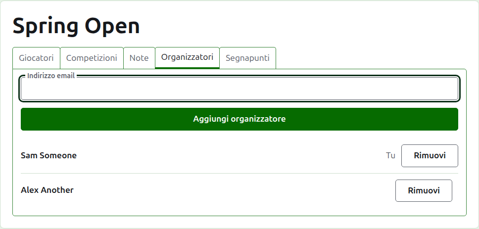
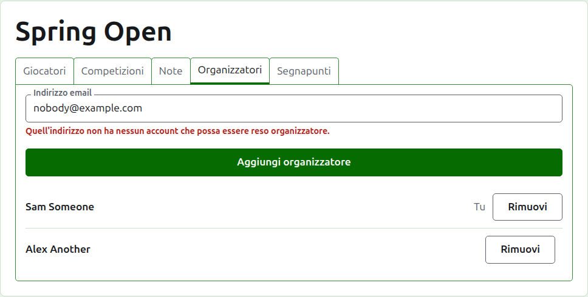
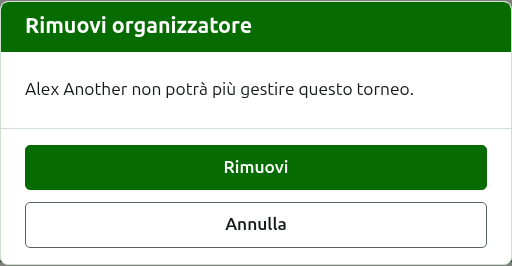
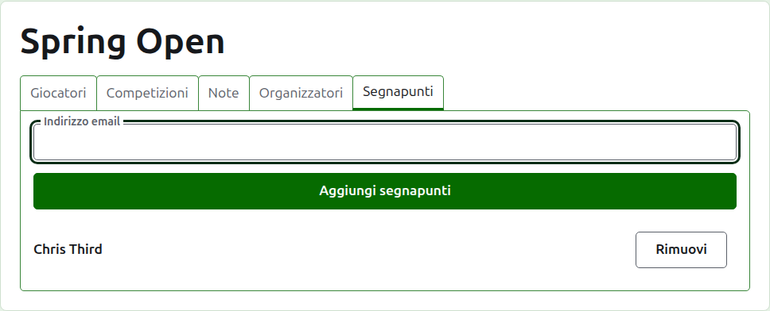
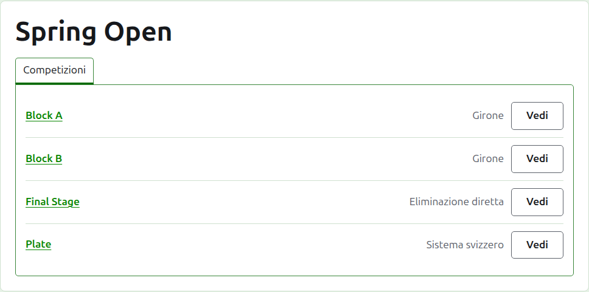

# Organizzatori e segnapunti

Un torneo ha degli organizzatori, che possono fare tutto ciò che si può fare a un torneo, e può avere dei segnapunti, che inseriscono i suoi punteggi e nient'altro. Chi ha creato il torneo è il suo primo organizzatore.

## Organizzatori {#managers}

La scheda **Organizzatori** elenca chi gestisce il torneo, nell'ordine in cui sono stati nominati, con il tuo nome segnato come tuo. È dove un torneo si condivide, o si passa ad altri.

Qualcuno diventa organizzatore tramite il suo indirizzo email. Scrivilo nel campo sopra l'elenco e premi **Aggiungi organizzatore**. L'indirizzo deve appartenere a un account registrato e confermato; un indirizzo che non ne ha viene rifiutato sotto il campo, e il sito non dice altro al riguardo. Un segnapunti reso organizzatore smette di essere segnapunti.

**Rimuovi** toglie un organizzatore. Di un organizzatore rimosso non si conserva nulla, quindi Rimuovi chiede prima; se lo si vuole di nuovo, lo si rende organizzatore ancora tramite il suo indirizzo. Un torneo ha sempre un organizzatore, quindi all'ultimo non viene offerto Rimuovi.

Puoi toglierti da solo. La domanda allora dice che cosa significa: perdi la tua via di ritorno al torneo, e nessuno sulla pagina può annullarlo per te. Un altro organizzatore può renderti di nuovo organizzatore.

## Segnapunti {#scorers}

La scheda **Segnapunti** è la scheda Organizzatori per i segnapunti, e funziona allo stesso modo: un indirizzo email e **Aggiungi segnapunti** sopra l'elenco, e **Rimuovi** su ciascuno.

Un segnapunti vede il torneo nel proprio elenco nell'amministrazione, con **Punteggi** al posto di Gestisci, e gli vengono offerte solo le sue competizioni: niente giocatori, note, organizzatori, segnapunti o classifiche. Sulla pagina di una competizione vede solo la scheda Punteggi, dove può inserire, correggere, archiviare e ripristinare i punteggi come un organizzatore. Chi gioca in una competizione lo decidono gli organizzatori.

Un organizzatore non viene reso segnapunti, perché un organizzatore può già fare tutto ciò che può fare un segnapunti. Un torneo non ha bisogno di nessun segnapunti, quindi ogni segnapunti può essere rimosso, anche l'ultimo.

Avanti: [Classifiche](rankings.md).
