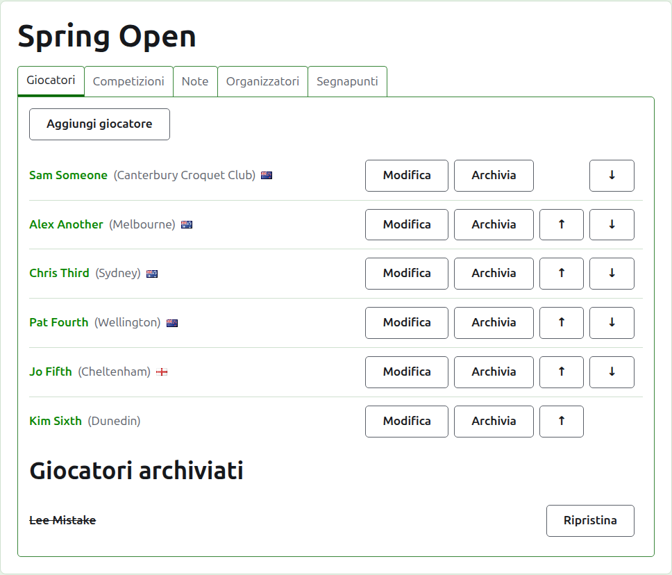
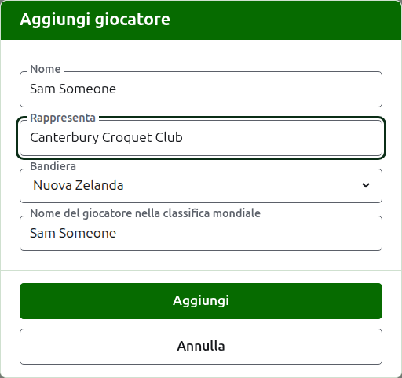
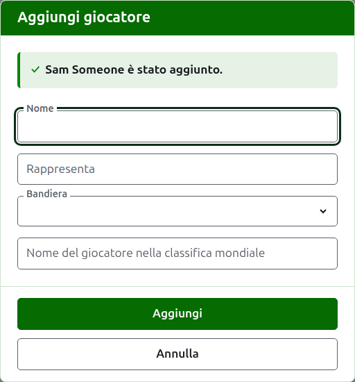
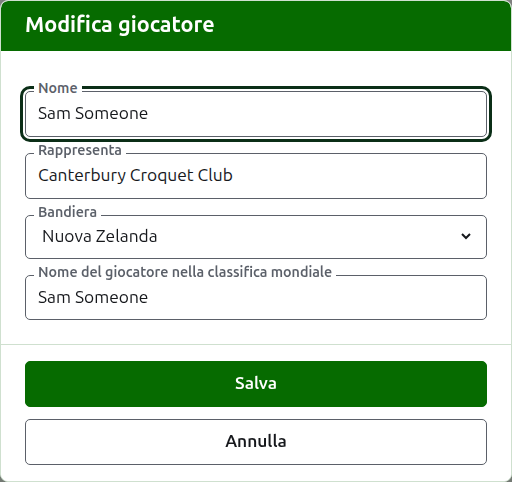
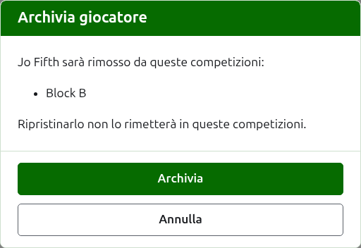

# Giocatori

La scheda **Giocatori** della pagina di un torneo è dove i suoi giocatori vengono inseriti, corretti, messi in ordine e messi da parte. È la scheda su cui si apre la pagina, perché inserire i giocatori è la prima cosa che si fa a un torneo.

I giocatori si inseriscono qui una volta sola, nel torneo. In quali competizioni gioca ciascuno si sceglie dopo, sulla pagina di ogni competizione, tra i giocatori inseriti qui. Vedi [Inserire i giocatori in una competizione](entering-players-in-a-competition.md).



## Aggiungere i giocatori {#add-a-player}

Premi **Aggiungi giocatore**, sopra l'elenco. Si apre una finestra di dialogo sopra la pagina.



**Nome** è obbligatorio. È il nome del giocatore come comparirà su ogni pagina, tra 3 e 254 caratteri. Due giocatori di uno stesso torneo non possono avere lo stesso nome, comunque siano scritte le maiuscole; dove due giocatori hanno davvero lo stesso nome, distinguili nel nome stesso, come "Andrew Hobbs (2)".

**Rappresenta** è ciò per cui il giocatore gioca, scritto come lo direbbe un lettore: un club, una regione o un paese, come "Canterbury Croquet Club". Compare tra parentesi dopo il nome. Si può lasciare vuoto.

**Bandiera** è la bandiera mostrata accanto al nome del giocatore. Si può lasciare su nessuna, com'è per la maggior parte dei giocatori. Ciò che un giocatore rappresenta e la bandiera che porta sono tenuti distinti, perché un giocatore può giocare per un club di un paese e portare la bandiera di un altro.

**Nome del giocatore nella classifica mondiale** è il nome con cui le classifiche mondiali conoscono il giocatore. Viene chiesto solo in un torneo di Association Croquet o di Golf Croquet, i due sport di cui le classifiche mondiali tengono un elenco di giocatori. I giocatori dell'American 6 Wicket sono noti alle classifiche con il proprio nome, quindi lì non viene chiesto, e il nome nella classifica mondiale di ogni giocatore è sempre il suo nome. Mentre aggiungi un giocatore segue il nome man mano che lo scrivi, perché la maggior parte dei giocatori è nota alle classifiche con il proprio nome, e smette di seguirlo appena ci scrivi dentro. Lasciato vuoto, viene conservato come il nome del giocatore.

Mentre scrivi un nome, vengono proposti i giocatori noti alle classifiche mondiali il cui nome comincia così, in modo che tu possa prendere un nome come lo scrivono le classifiche anziché scriverlo per intero. Accanto al nome nella classifica mondiale, una spunta dice che le classifiche conoscono il nome, e un punto interrogativo dice che non lo conoscono: il nome può essere scritto male, oppure il giocatore può essere nuovo nelle classifiche. È solo un consiglio. Un nome che le classifiche non conoscono viene conservato come uno che conoscono.

Premi **Aggiungi**. Il giocatore viene aggiunto, la finestra lo dice, e i suoi campi si svuotano per il giocatore successivo, con il cursore di nuovo nel nome. Aggiungi tutto l'elenco in questo modo, poi premi **Annulla** per chiudere la finestra. Annulla non conserva nulla che non fosse già stato aggiunto.



Un giocatore non si chiama mai "Bye". I bye di un'eliminazione diretta si aggiungono nell'eliminazione diretta stessa, dove si inseriscono i suoi giocatori, quindi un nome la cui prima parola è "bye" viene rifiutato, e la finestra spiega perché.

## Aggiungere più giocatori insieme {#adding-multiple-players}

Per aggiungere un'intera lista in una volta, premi **Aggiungi giocatori**, accanto a **Aggiungi giocatore**. Si apre una finestra di dialogo sopra la pagina con un solo riquadro, che accetta più righe di testo. Puoi copiare la lista da un foglio di calcolo e incollarla nel riquadro.

**La prima riga dà i nomi dei campi**, separati da virgole o da tabulazioni: **Name** e, in qualsiasi ordine, **Representing**, **Flag**, **Handicap** e **WorldRankingPlayerName**. Questi nomi si scrivono in inglese, qualunque sia la lingua del sito. **Name** deve esserci. **Ogni riga successiva è un giocatore**, con un valore per ogni campo, nello stesso ordine e separati allo stesso modo. Un giocatore che per un campo non ha nulla lo lascia vuoto, ma tiene la virgola o la tabulazione. Per esempio, con le virgole:

```
Name,Representing,Flag
Sam Someone,Canterbury Croquet Club,New Zealand
Alex Another,,England
```

- **Nome, Rappresenta e Nome del giocatore nella classifica mondiale** seguono le stesse regole di quando aggiungi un solo giocatore (vedi [Aggiungere i giocatori](players.md#add-a-player)). Un nome è lungo tra 3 e 254 caratteri, non è già nel torneo, comunque siano scritte le maiuscole, e non è "Bye".
- **Bandiera** è il nome del paese o del luogo, nella tua lingua, come lo offre l'elenco nella finestra Aggiungi giocatore, per esempio Nuova Zelanda.
- **Handicap** è un numero con segno, con al massimo due cifre e un decimale, come 4, +4 o -1.5.
- Un giocatore senza **WorldRankingPlayerName** è noto con il proprio nome, come quando viene aggiunto da solo.
- **Virgole o tabulazioni.** Le celle copiate da un foglio di calcolo sono separate da tabulazioni, e una lista scritta a mano di solito da virgole. Vanno bene entrambe. Se la prima riga contiene una tabulazione, tutta la lista viene letta con le tabulazioni, altrimenti con le virgole.
- Un valore che contiene il separatore si scrive tra virgolette doppie, come lo scrive un foglio di calcolo: "Smith, John" in una lista separata da virgole. Una virgoletta dentro un valore si scrive due volte.
- A ogni valore vengono tolti gli spazi alle estremità, e una riga senza nulla viene ignorata.
- Una lista contiene al massimo 500 giocatori. Aggiungi gli altri in un'altra lista.

Premi **Aggiungi**. Tutta la lista viene controllata prima che ne venga conservata una parte, quindi una lista con qualcosa di sbagliato non aggiunge nessuno. Ciò che non va è detto sotto il riquadro, sulla riga in cui si trova, contando la prima riga come riga 1. Ogni errore è elencato, non solo il primo, e ciò che hai scritto resta, così puoi correggerlo. Quando la lista è conservata, la finestra si chiude e la scheda Giocatori elenca i nuovi giocatori, nell'ordine in cui li hai scritti. A differenza di **Aggiungi giocatore**, che resta aperta per il giocatore successivo, qui non c'è un successivo: la lista era il successivo.

Il **?** nella barra del titolo della finestra porta qui.

## Correggere un giocatore {#correcting-a-player}

Premi il nome di un giocatore, o il suo **Modifica**, per aprire la stessa finestra su quel giocatore, intitolata Modifica giocatore. Cambia ciò che non va e premi **Salva**, che conserva la modifica e chiude la finestra. Un giocatore il cui nome viene corretto mantiene il nome nella classifica mondiale che aveva, perché le classifiche lo conoscono ancora con quello. Nell'American 6 Wicket il nome di un giocatore nella classifica mondiale è sempre il suo nome, quindi correggere il nome corregge anche quello.



Un giocatore corretto qui è corretto ovunque: in ogni competizione in cui si trova, e su ogni pagina pubblica.

## Mettere in ordine i giocatori

I giocatori sono elencati nell'ordine del torneo, che è l'ordine in cui vengono proposti quando si inseriscono nelle competizioni, e l'ordine in cui si sorteggia un'eliminazione diretta. **Su** e **Giù**, le frecce alla fine di ogni riga, spostano un giocatore di un posto. Al primo giocatore non viene offerto Su e all'ultimo non viene offerto Giù.

## Archiviare un giocatore {#archiving-a-player}

**Archivia** mette da parte un giocatore: inserito per errore, o ritirato dall'intero torneo. Un giocatore archiviato è elencato sotto **Giocatori archiviati**, barrato, dopo i giocatori in uso, e offre solo **Ripristina**. Un giocatore archiviato non è in nessuna competizione e non compare su nessuna pagina pubblica.

Un giocatore che ha giocato una qualsiasi partita non può essere archiviato, perché le partite risulterebbero giocate contro qualcuno che non c'è più, quindi a un giocatore così non viene offerto Archivia. Un giocatore le cui sole partite sono archiviate può esserlo.

Archiviare un giocatore che non è in nessuna competizione non chiede prima, perché ripristinarlo rimette tutto a posto. Archiviare un giocatore che è in una qualsiasi competizione chiede prima, perché archiviarlo lo toglie da ogni competizione in cui si trova, e ripristinarlo non lo rimette dentro.



Avanti: [Competizioni](competitions.md).
