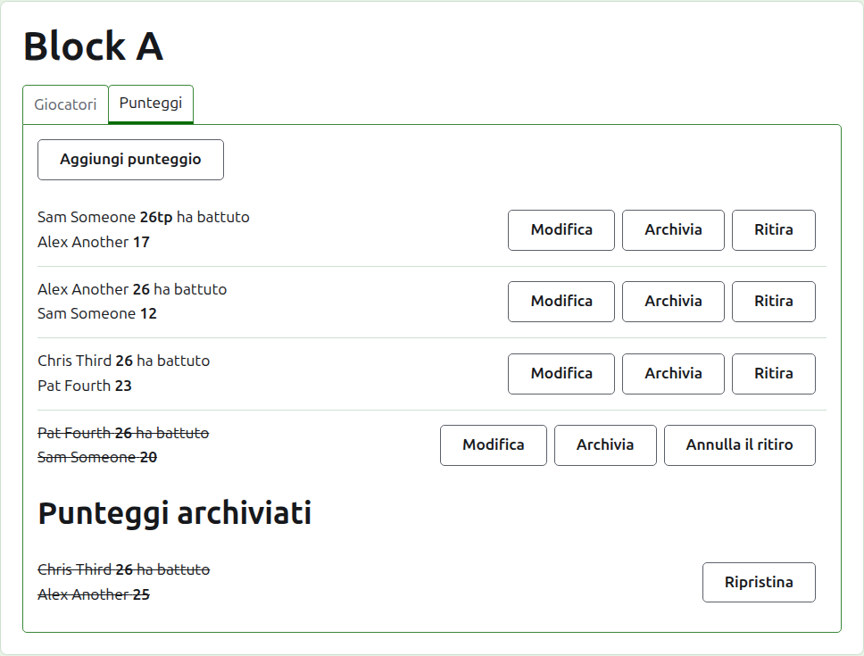
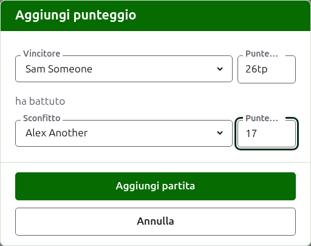
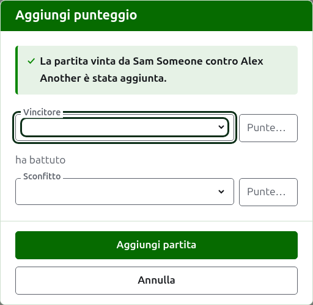
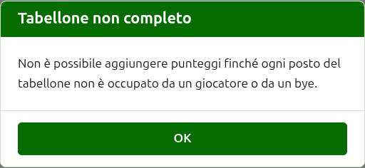
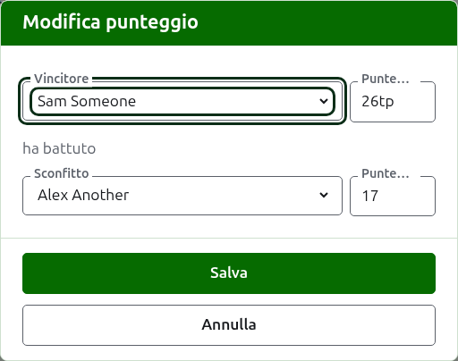

# Punteggi

La scheda **Punteggi** della pagina di una competizione è dove le sue partite vengono inserite, corrette e messe da parte. Un segnapunti vede solo questa scheda, e può farvi tutto ciò che può fare un organizzatore.

## Inserire un punteggio

Premi **Aggiungi punteggio**, sopra l'elenco. La finestra si legge come un risultato si dice a voce: il vincitore e il suo punteggio, poi "ha battuto", poi lo sconfitto e il suo punteggio.

Il vincitore e lo sconfitto si scelgono ciascuno tra i giocatori della competizione che stanno giocando, nell'ordine della competizione. All'inizio non è scelto nessuno, così una partita non viene mai segnata a un giocatore che non hai scelto. In un'eliminazione diretta, scegliere il vincitore sceglie come sconfitto chi è sorteggiato contro di lui, dove puoi vederlo e sceglierne un altro.

Un punteggio si scrive come lo ha annotato il segnapunti: il suo numero di punti, e tutto ciò che segue, che viene conservato e mostrato com'è stato scritto, come "26tp" per 26 archetti e un triple peel. Il numero sono le cifre con cui il punteggio comincia; un punteggio che non comincia con una cifra viene rifiutato.

Una partita vinta a punti pari, come quando viene fermata per il tempo e decisa in qualche altro modo, dice chi l'ha vinta con un segno dopo il punteggio del vincitore: "6w" ha battuto "6". Su Croquet Scores i segni sono "w", "won" e "winner"; Gateball Scores accetta anche "cb" e "so". Il punteggio di un vincitore deve essere maggiore di quello dello sconfitto, oppure segnato, a meno che il torneo non ammetta i pareggi, nel qual caso punti pari senza segno vengono conservati come pareggio.

Premi **Aggiungi partita**. La partita viene aggiunta, la finestra dice quale, e i campi si svuotano per la successiva, perché i punteggi arrivano a gruppi letti da un tabellone alla fine di un turno. Premi **Annulla** quando ci sono tutti.

Ciò che viene rifiutato è detto sotto il campo a cui si riferisce: un vincitore o uno sconfitto non scelto, un punteggio non scritto o che non comincia con una cifra, lo stesso giocatore in entrambi i ruoli, il punteggio di uno sconfitto segnato come vinto, o il punteggio di un vincitore inferiore a quello dello sconfitto. In un'eliminazione diretta, due giocatori che non sono sorteggiati per incontrarsi vengono rifiutati sopra i campi.

## Il tabellone di un'eliminazione diretta va prima completato

Un'eliminazione diretta si gioca solo quando ogni posto del suo tabellone è occupato da un giocatore o da un bye. Fino ad allora, Aggiungi punteggio spiega perché non si possono aggiungere punteggi anziché aprire la finestra.

## L'elenco dei punteggi

I punteggi in uso sono elencati nell'ordine in cui sono stati inseriti, dal più vecchio, così l'elenco si legge come la competizione è stata giocata. Ciascuno dice il vincitore e il suo punteggio, poi lo sconfitto e il suo, e offre **Modifica** e **Archivia**.

## Correggere un punteggio

**Modifica** apre la stessa finestra su quel punteggio, intitolata Modifica punteggio, con i suoi giocatori scelti e i suoi punteggi come sono stati scritti. Premi **Salva** per conservare la correzione e chiudere la finestra.

Una correzione mantiene il risultato: una partita vinta resta vinta, e una partita pareggiata resta pareggiata. Una partita il cui risultato era sbagliato si archivia e si inserisce di nuovo.

Dove un punteggio potrebbe essere archiviato, se ne possono cambiare i giocatori oltre ai punteggi. In un'eliminazione diretta, un punteggio il cui vincitore ha già giocato nel turno successivo mantiene i suoi giocatori, perché cambiare chi l'ha vinto lascerebbe la partita successiva giocata da qualcuno che non ci era arrivato; se ne possono correggere solo i punteggi.

## Archiviare un punteggio

**Archivia** mette da parte un punteggio così che non conti nulla. È elencato sotto **Punteggi archiviati**, barrato, e offre solo **Ripristina**. Nessuno dei due chiede prima, perché ciascuno annulla l'altro.

In un'eliminazione diretta il vincitore di un incontro passa al turno successivo, quindi al punteggio di un incontro il cui vincitore ha giocato nel turno successivo non viene offerto Archivia. Si archivia prima la partita del turno successivo, e poi si possono archiviare quelle prima. Dove un turno è al meglio di 3 o di 5, ogni partita dell'incontro è trattenuta allo stesso modo. Un girone e un sistema svizzero non hanno turni che dipendono l'uno dall'altro, quindi ogni loro punteggio può essere archiviato.

## Ritirare un punteggio

Un giocatore che lascia una competizione di solito viene ritirato da essa, nella scheda Giocatori, e questo è tutto ciò che serve: non gioca più, le partite che ha giocato restano, ma le sue partite non contano più per vittorie/sconfitte e archetti. Ritirare un punteggio è per il caso più raro in cui una partita giocata non deve contare. Nel President's Eights australiano, per esempio, quando un giocatore si ritira i risultati del primo turno restano, e solo le sue partite del secondo turno vengono tolte dal conteggio: ritira quelle partite.

In un girone o in un sistema svizzero, un punteggio che è stato giocato ma non deve contare si ritira anziché archiviarlo. **Ritira** lo tiene tra i punteggi in uso, al suo posto, ma barrato e senza contare nulla sulle pagine pubbliche. **Annulla il ritiro** lo fa contare di nuovo. Nessuno dei due chiede prima. Ai punteggi di un'eliminazione diretta non viene offerto Ritira, perché lì un punteggio decide più della classifica.

Avanti: [Note](notes.md).
