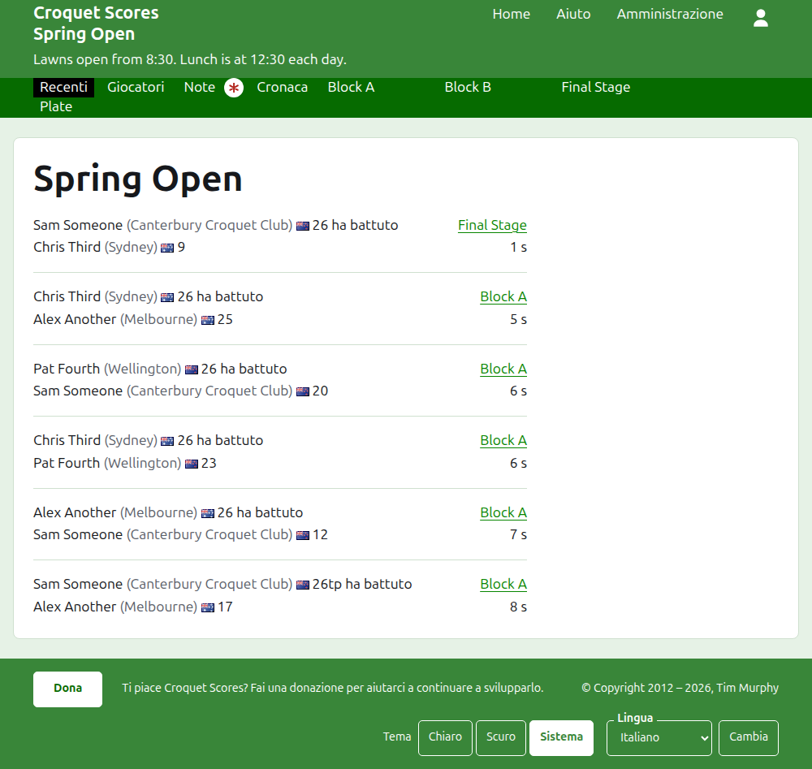
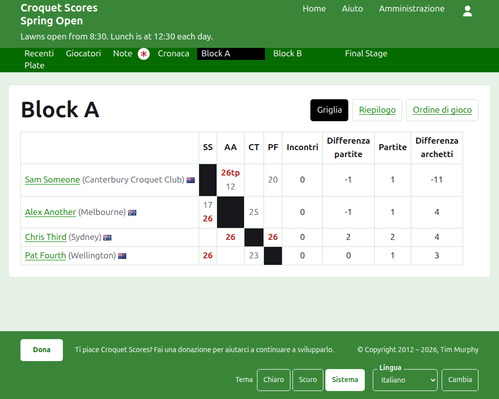
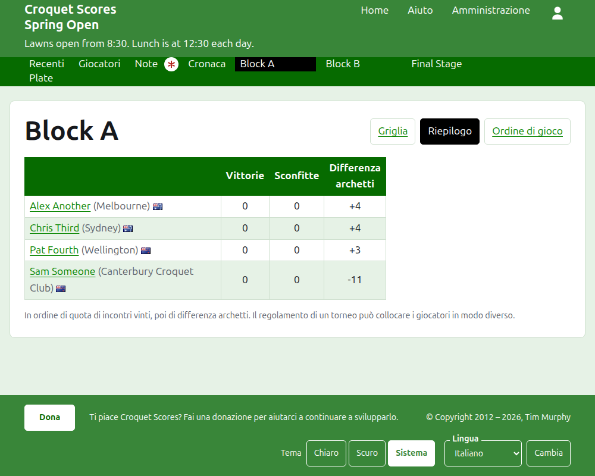
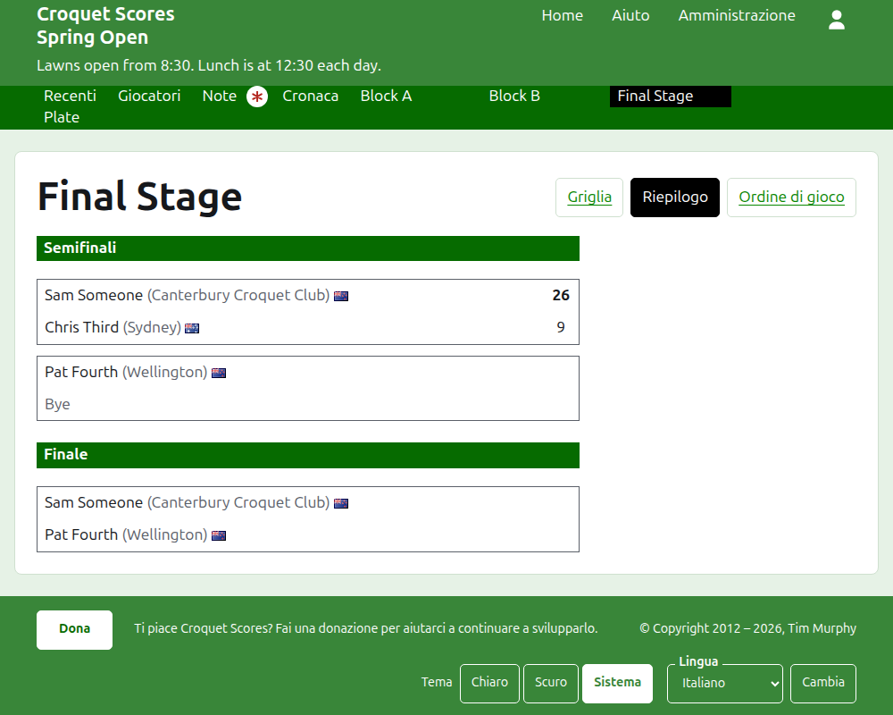
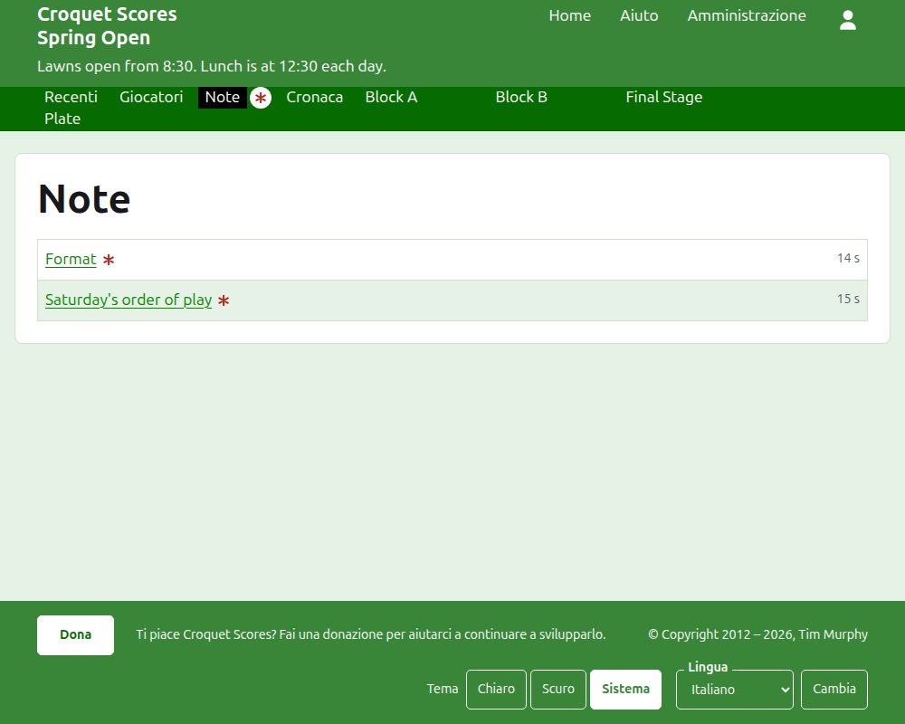

# Che cosa vede il pubblico

Non si pubblica nulla: le pagine pubbliche sono ricavate da ciò che l'amministrazione contiene, quindi un punteggio inserito è subito su di esse. Non richiedono né un account né script, e sono impaginate per un telefono.

## La pagina del torneo

La pagina del torneo si trova al suo anno, al suo sport e al suo nome, come `/2026/ac/spring-open`. È intestata con il nome del torneo, con il suo sottotitolo sotto. Elenca ogni partita in uso, dalla più recente, così un lettore che torna vede che cosa è successo nel frattempo. Ogni partita dice il vincitore, ciò che rappresenta, la sua bandiera e il suo punteggio, poi lo sconfitto e i suoi, con la competizione in cui è stata giocata e quanto tempo fa è stata aggiunta.

La barra verde scuro offre le sezioni del torneo: **Recenti**, che è questa pagina, **Giocatori**, **Note** e **Cronaca**, poi ogni competizione in uso, nell'ordine in cui le ha la scheda Competizioni. Note è segnata con un asterisco rosso finché c'è una nota che il lettore non ha letto.

## Un girone

La pagina di un girone mostra i suoi risultati come una griglia: una riga e una colonna per ogni giocatore nell'ordine del girone, con le partite tra due giocatori dove la riga incontra la colonna, ciascuna segnata come vinta, persa o pareggiata per il giocatore della riga. Dopo le colonne dei giocatori vengono i totali di ciascun giocatore. Dove ogni incontro è una partita sola, sono le vittorie e la differenza archetti; dove un incontro è al meglio di più partite, sono gli incontri, la differenza partite, le partite e la differenza archetti.

Un girone si mostra in tre modi, offerti sulla riga del suo nome: **Griglia**, **Riepilogo** e **Programma**. Il riepilogo è quello per un telefono: i giocatori classificati, con le loro vittorie, sconfitte e differenza archetti. Il programma elenca ogni partita dalla più vecchia. Un lettore che sceglie una vista la mantiene per ogni competizione finché non ne sceglie un'altra.

La riga di un giocatore ritirato lo dice. Un punteggio ritirato è mostrato barrato e non conta nulla. Un punteggio archiviato non è mostrato.

## Un'eliminazione diretta

La pagina di un'eliminazione diretta disegna il suo tabellone turno per turno, una colonna per ogni turno dal primo alla finale, con le due parti di ogni incontro una sopra l'altra e una cella per ogni partita di cui l'incontro è al meglio. L'incontro di un turno successivo sta accanto ai due incontri tra i cui vincitori si gioca. Su un telefono il tabellone scorre di lato, con delle frecce verso la finale e indietro.

## Un sistema svizzero

La pagina di un sistema svizzero classifica i suoi giocatori in una tabella: le loro partite, le loro vittorie, la loro percentuale di vittorie e i loro risultati, ciascuno detto come l'avversario e lo scarto, come "+4" per una partita vinta di quattro.

## Giocatori

La pagina Giocatori elenca ogni giocatore del torneo che non è archiviato, in ordine alfabetico, con ciò che rappresenta e la sua bandiera.

## Note

La pagina Note elenca le note del torneo, dalla più recente, ciascuna delle quali porta a una pagina sua e dice quanto tempo fa è stata scritta. Una nota che il lettore non ha letto è segnata con un asterisco rosso finché non la apre.

## Indirizzi che si spostano

Un torneo mantiene il suo indirizzo quando il nome viene corretto. Quando si sposta, perché il suo anno o il suo sport è cambiato, il vecchio indirizzo porta a quello nuovo, così un link conservato da prima funziona ancora. Le pagine di un torneo archiviato non si trovano finché non viene ripristinato.
