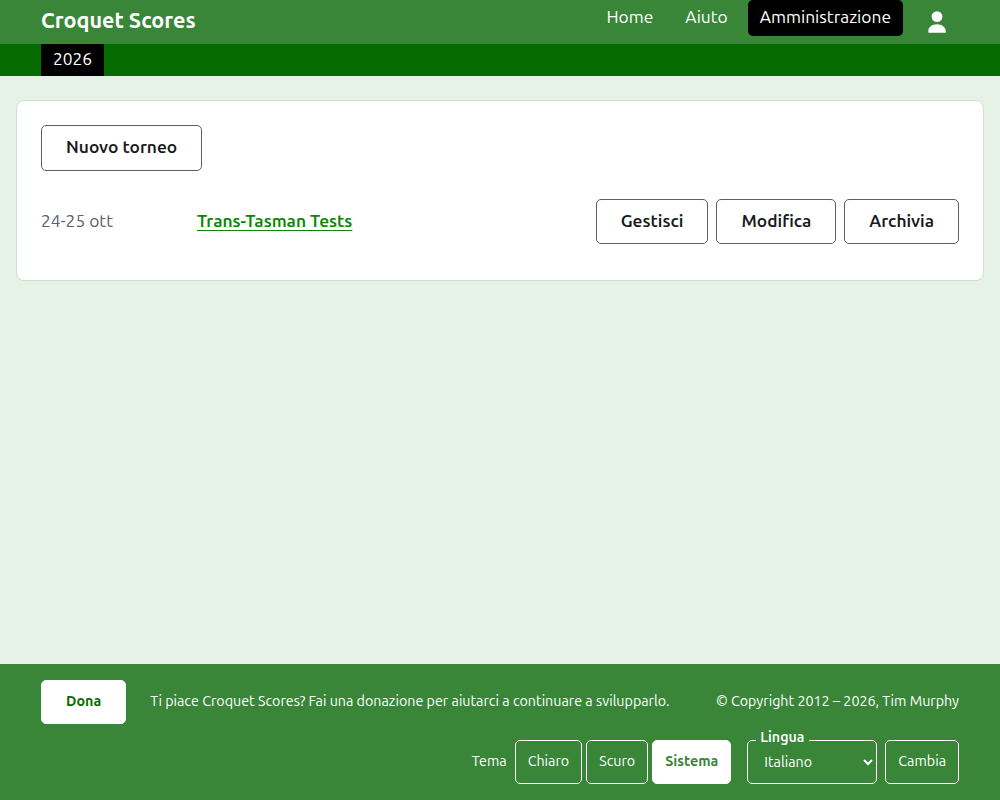
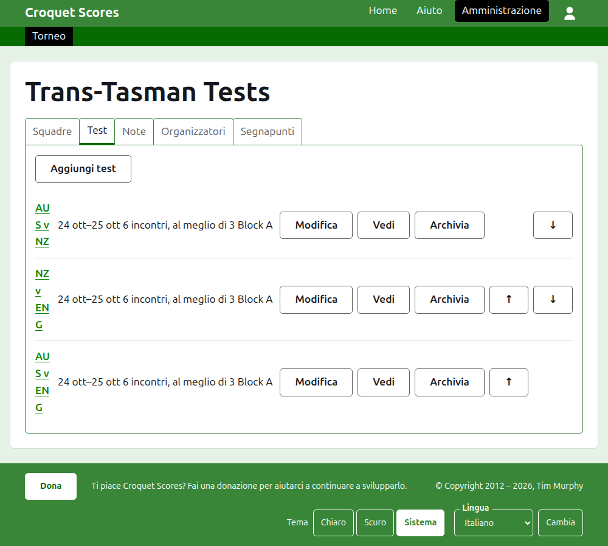

# Gestire un torneo a squadre

Un torneo a squadre è un torneo in cui si affrontano delle compagini, anziché giocatori iscritti uno a uno: una serie di test tra due paesi, un interstate shield, un campionato mondiale a squadre. Le sue squadre vengono create con i loro giocatori, i test tra le squadre vengono aggiunti, e le partite di ogni test vengono pubblicate man mano che si giocano. Questa guida accompagna un organizzatore dall'accesso fino a un torneo i cui risultati sono a disposizione del pubblico.

Sta in piedi da sola. Nulla di ciò che contiene dipende dalla guida al torneo standard, che è scritta a parte.

## Prima di cominciare

Ti serve un account. Clicca [qui](/account/register) per registrarne uno.

Tutto ciò che fa un organizzatore lo fa nella sezione di amministrazione del sito. Le pagine pubbliche, dove giocatori e spettatori seguono il torneo, sono ricavate da ciò che l'amministrazione contiene, quindi non c'è nulla da pubblicare: un punteggio inserito è subito sulle pagine pubbliche.

## Le parole

Una **squadra** è una compagine, come l'Australia, con un nome, un nome breve come "AUS" e una bandiera. Una squadra ha dei **giocatori** suoi, che giocano per lei e per nessun'altra. Un **test** è una sfida tra due squadre, chiamata con i loro nomi brevi, come "AUS v ENG", composta da un certo numero di **incontri** tra un giocatore di ciascuna squadra, ogni incontro al meglio di un certo numero di **partite**. I test possono essere raggruppati in **gruppi**, come "Block A", quando molte squadre giocano tra loro.

## Le pagine in ordine

1. [Creare un torneo](creating-a-tournament.md): il suo nome, i suoi giorni, il suo sport, il suo formato e dove si gioca.
2. [Squadre](teams.md): aggiungere le squadre, con i loro nomi brevi e le loro bandiere.
3. [I giocatori di una squadra](team-players.md): inserire i giocatori di ogni squadra sulla pagina della squadra.
4. [Test](tests.md): aggiungere i test tra le squadre, i loro giorni, quanti incontri ha ciascuno e i loro gruppi.
5. [Punteggi](scores.md): inserire le partite di un test, correggerle e mettere da parte quelle inserite per errore.
6. [Note](notes.md): dire ai giocatori ciò che devono sapere mentre il torneo va avanti.
7. [Organizzatori e segnapunti](managers-and-scorers.md): condividere la gestione del torneo, e lasciare che qualcuno inserisca i punteggi senza poter cambiare nient'altro.
8. [Modificare, archiviare e ripristinare un torneo](changing-and-archiving.md): correggere i dati del torneo, e mettere da parte un torneo.
9. [Che cosa vede il pubblico](what-the-public-sees.md): le pagine che i tuoi giocatori seguono, e come ciò che inserisci vi compare.

## Com'è organizzata l'amministrazione

La porta d'ingresso dell'amministrazione elenca i tornei in cui hai un ruolo, un anno alla volta.

Premendo il nome di un torneo, o **Gestisci**, si apre la sua pagina. Tutto ciò che c'è da gestire sta in cinque schede sotto il suo nome: **Squadre**, **Test**, **Note**, **Organizzatori** e **Segnapunti**. La pagina si apre su Squadre, perché le squadre sono la prima cosa che si crea.

La barra verde scuro sotto l'intestazione serve a spostarsi tra le pagine. Sulla pagina del torneo e sulla pagina di un test porta al torneo, come **Torneo**, e a ciascun test con il suo nome. Sulla pagina di una squadra porta invece al torneo e a ciascuna squadra con il suo nome breve, perché un organizzatore sulla pagina di una squadra sta inserendo i giocatori squadra per squadra. La pagina in cui ti trovi è segnata in nero.

## Cose che valgono ovunque

**Nulla viene eliminato del tutto, tranne una nota.** Squadre, giocatori, test, punteggi e il torneo stesso vengono archiviati anziché eliminati: messi da parte, barrati ed elencati sotto un'intestazione tutta loro, con **Ripristina** per riportarli indietro. Archiviare, ripristinare e spostare su e giù non chiedono mai conferma, perché ciascuna di queste azioni si annulla premendo quella opposta. Le cose che non si possono annullare, come eliminare una nota o rimuovere un organizzatore, chiedono prima.

**Una finestra di dialogo sopra la pagina non conserva nulla finché non premi il suo pulsante.** Annulla, o il tasto Esc, la chiude e lascia tutto com'era. Le finestre che aggiungono qualcosa, come Aggiungi squadra e Aggiungi punteggio, restano aperte dopo ogni aggiunta, così un elenco si può scrivere tutto di seguito.

**Ciò che viene rifiutato è detto accanto al campo a cui si riferisce.** Nulla di ciò che è rifiutato viene conservato, e ciò che hai scritto resta scritto, così si può correggere anziché scriverlo di nuovo.

**L'amministrazione funziona su un telefono.** Ogni pulsante è abbastanza grande da premere con un pollice, e nulla è più largo dello schermo.

Avanti: [Creare un torneo](creating-a-tournament.md).
