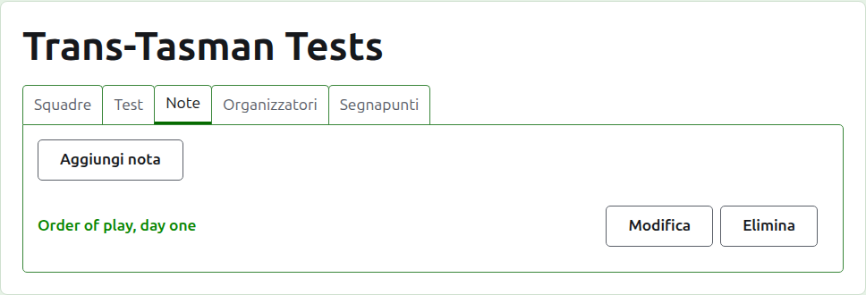
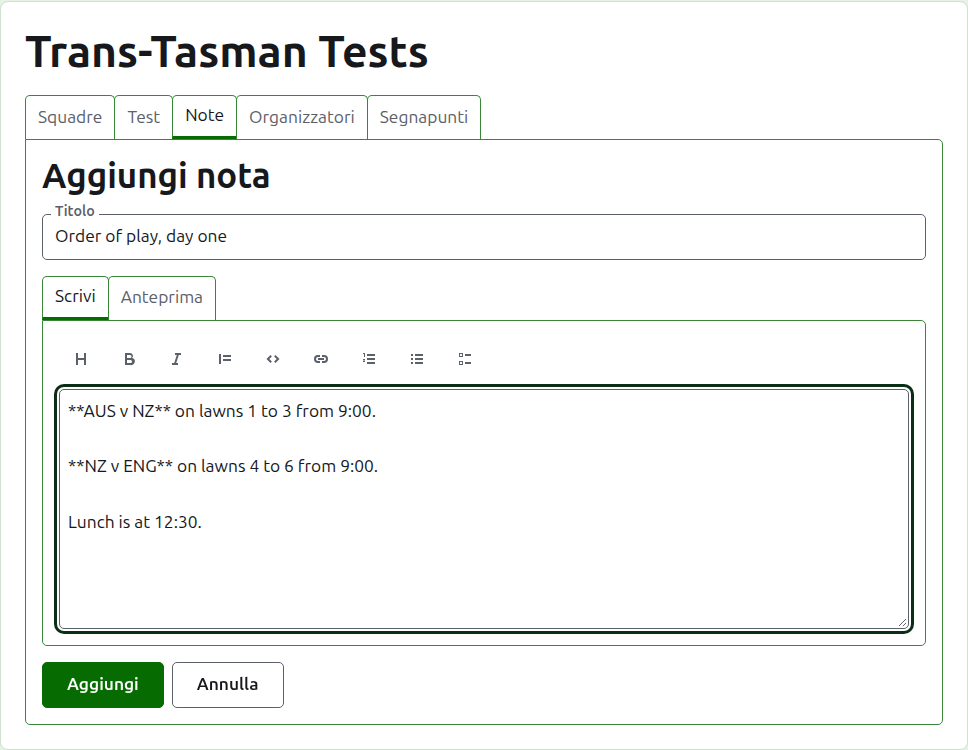
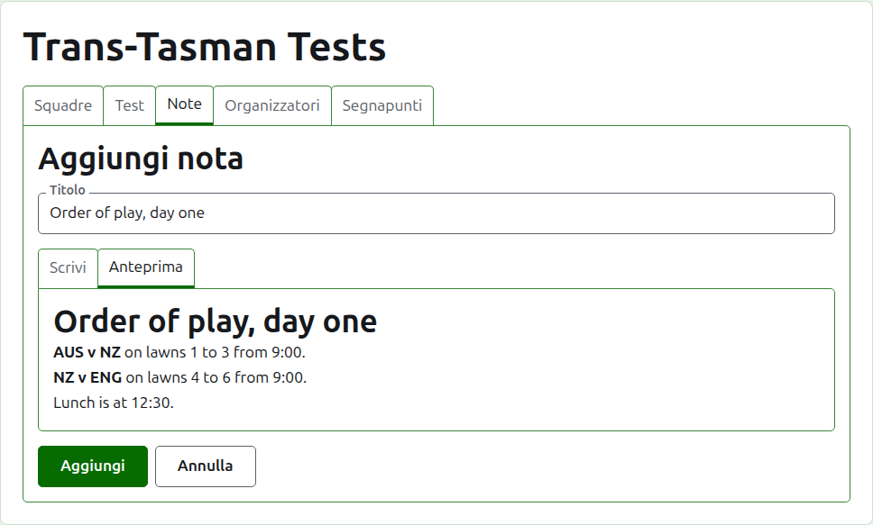
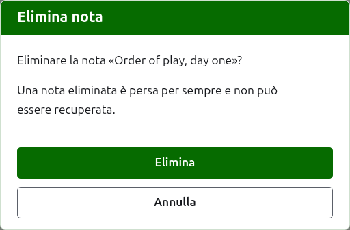

# Note

La scheda **Note** della pagina di un torneo è dove i suoi organizzatori scrivono ciò che i giocatori devono sapere mentre il torneo va avanti: l'ordine di gioco, un cambiamento di campi, l'ora del pranzo. I lettori le trovano sulla pagina pubblica Note del torneo, e una nota che non hanno letto è segnata lì con un asterisco rosso, che segna anche la sezione Note su ogni pagina del torneo finché non la aprono.

## Scrivere una nota

Premi **Aggiungi nota**, sopra l'elenco. Un pannello prende il posto dell'elenco, perché una nota si scrive per esteso e ha bisogno di spazio.

**Titolo** è obbligatorio, ed è ciò con cui la nota è elencata. È testo semplice.

**Descrizione** si scrive in Markdown e si può lasciare vuota quando il titolo dice tutto ciò che c'è da dire. La barra degli strumenti sopra la casella scrive il Markdown per te: Titolo, Grassetto, Corsivo, Citazione, Codice, Link, Elenco numerato, Elenco puntato ed Elenco di attività. Ciascuno agisce su ciò che è selezionato, o all'inizio di ogni riga selezionata, oppure mette il cursore dove vanno le parole.

**Anteprima** mostra la nota come la vedrà un lettore sulla sua pagina.

Premi **Aggiungi**. La nota viene conservata, l'elenco torna con lei in cima, ed è subito sulla pagina pubblica Note.

## Modificare una nota

Premi il titolo di una nota, o il suo **Modifica**, per aprire il pannello su quella nota. Premi **Salva** per conservare la modifica. Una nota modificata dopo che un lettore l'ha letta viene segnata di nuovo per lui.

## Eliminare una nota

Una nota che non vale più si elimina. Una nota eliminata è persa per sempre, quindi **Elimina** chiede prima.

Avanti: [Organizzatori e segnapunti](managers-and-scorers.md).
