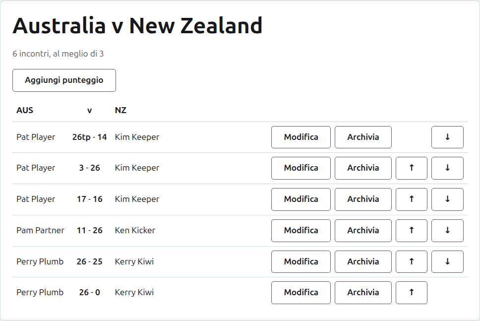
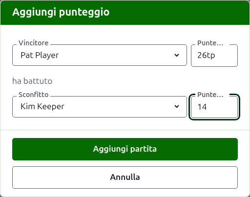

# Punteggi

La pagina di un test si apre dal suo nome nella scheda Test, o dalla barra verde scuro. È intestata con i nomi completi delle sue squadre, come "Australia v New Zealand", con sotto quanti incontri deve avere e di quante partite è al meglio ciascuno. I suoi punteggi sono la pagina, senza schede. Un organizzatore e un segnapunti vedono la stessa pagina, perché un segnapunti può fare a un punteggio tutto ciò che può fare un organizzatore.

## Come sono disposti i punteggi

I punteggi sono disposti per squadra anziché per chi ha vinto, in una tabella intestata con il nome breve della prima squadra, "v", e quello della seconda. Ogni punteggio è una riga: il giocatore della prima squadra, poi entrambi i punteggi con quello della prima squadra per primo, come "26tp - 14", poi il giocatore della seconda squadra, chiunque dei due abbia vinto. I punteggi archiviati sono disposti allo stesso modo sotto.

## Inserire un punteggio {#entering-a-score}

Premi **Aggiungi punteggio**, sopra l'elenco. La finestra si legge come un risultato si dice a voce: il vincitore e il suo punteggio, poi "ha battuto", poi lo sconfitto e il suo punteggio.

Il vincitore si sceglie tra i giocatori in uso di entrambe le squadre, sotto il nome di ciascuna squadra, prima i giocatori della prima squadra e quelli di ogni squadra nell'ordine della squadra. All'inizio non è scelto nessuno. Una volta scelto il vincitore, lo sconfitto viene proposto solo dall'altra squadra, perché una partita tra due giocatori della stessa squadra non è una partita tra le squadre. Un giocatore archiviato non viene proposto.

Un punteggio si scrive come lo ha annotato il segnapunti: il suo numero di punti, e tutto ciò che segue, che viene conservato e mostrato com'è stato scritto, come "26tp" per 26 archetti e un triple peel. Il numero sono le cifre con cui il punteggio comincia; un punteggio che non comincia con una cifra viene rifiutato.

Una partita vinta a punti pari, come quando viene fermata per il tempo e decisa in qualche altro modo, dice chi l'ha vinta con un segno dopo il punteggio del vincitore: "6w" ha battuto "6". I segni sono "w", "won" e "winner". Il punteggio di un vincitore deve essere maggiore di quello dello sconfitto, oppure segnato, a meno che il torneo non ammetta i pareggi, nel qual caso punti pari senza segno vengono conservati come pareggio.

Premi **Aggiungi partita**. La partita viene aggiunta, la finestra dice quale, e i campi si svuotano per la successiva, perché i punteggi arrivano a gruppi letti da un tabellone alla fine di una sessione. Premi **Annulla** quando ci sono tutti.

## Incontri

Due giocatori che si affrontano giocano un incontro al meglio di quanto previsto dal test. Le partite tra loro sono le partite di quell'incontro, e una partita tra due giocatori il cui incontro è già deciso viene rifiutata: uno dei due ha vinto più partite di quante l'altro possa ancora vincere, oppure ne sono state giocate tutte.

Un incontro è cominciato quando i suoi due giocatori hanno una partita in uso. Un test non fa cominciare più incontri di quanti deve avere: una volta che ne sono cominciati tanti, una partita tra due giocatori che non si sono affrontati viene rifiutata, mentre un'altra partita di un incontro già cominciato viene accettata. Quando il test deve avere più incontri, modificalo nella scheda Test perché li preveda.

## Correggere un punteggio {#correcting-a-score}

**Modifica** apre la stessa finestra su quel punteggio, intitolata Modifica punteggio, con i suoi giocatori scelti e i suoi punteggi come sono stati scritti. Se ne possono cambiare i giocatori oltre ai punteggi, scelti come quando si aggiunge. Premi **Salva** per conservare la correzione e chiudere la finestra. Una correzione mantiene il risultato: una partita vinta resta vinta, e una partita pareggiata resta pareggiata. Una partita il cui risultato era sbagliato si archivia e si inserisce di nuovo.

## Mettere in ordine i punteggi

I punteggi arrivano nell'ordine in cui vengono inseriti, quindi ogni punteggio in uso offre **Su** e **Giù**, che lo scambiano con il punteggio accanto, così l'elenco si può mettere nell'ordine in cui le partite sono state giocate.

## Archiviare un punteggio

**Archivia** mette da parte un punteggio così che non conti nulla. È elencato sotto **Punteggi archiviati**, barrato, e offre solo **Ripristina**. Nessuno dei due chiede prima, perché ciascuno annulla l'altro. Ogni punteggio di un test può essere archiviato, perché un test non ha turni che dipendono l'uno dall'altro.

Un punteggio il cui giocatore è stato archiviato nel frattempo non viene ripristinato finché non lo è il giocatore, e la pagina lo dice.

Avanti: [Note](notes.md).
