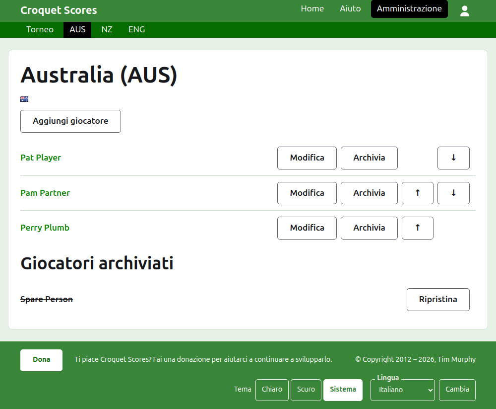
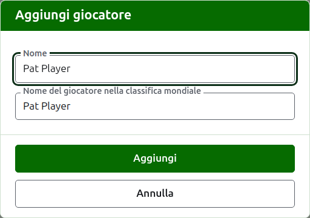

# I giocatori di una squadra

La pagina di una squadra si apre dal suo nome, o dal suo **Vedi**, nella scheda Squadre. È intestata con il nome della squadra con il suo nome breve tra parentesi, e la sua bandiera, così un organizzatore arrivato alla squadra sbagliata se ne accorge subito. Ha una sola cosa da mostrare, i giocatori della squadra, quindi l'elenco è la pagina.

La barra verde scuro sulla pagina di una squadra porta al torneo e a ciascuna squadra in uso con il suo nome breve, così i giocatori si inseriscono squadra per squadra senza tornare alla scheda Squadre.

Un giocatore di una squadra appartiene a quella squadra sola, rappresenta la squadra e porta la bandiera della squadra anziché una sua. La stessa persona che gioca per due squadre, o in due tornei, è un giocatore in ciascuna.

## Aggiungere un giocatore

Premi **Aggiungi giocatore**, sopra l'elenco. Si apre una finestra di dialogo sopra la pagina.

**Nome** è obbligatorio, tra 3 e 254 caratteri. Due giocatori di una stessa squadra non possono avere lo stesso nome, comunque siano scritte le maiuscole; un giocatore di un'altra squadra può averlo uguale.

**Nome del giocatore nella classifica mondiale** è il nome con cui le classifiche mondiali conoscono il giocatore. Viene chiesto solo in un torneo di Association Croquet o di Golf Croquet, i due sport di cui le classifiche mondiali tengono un elenco di giocatori. I giocatori del Croquet americano a 6 archetti sono noti alle classifiche con il proprio nome, quindi lì non viene chiesto, e il nome nella classifica mondiale di ogni giocatore è sempre il suo nome. Mentre aggiungi un giocatore segue il nome man mano che lo scrivi, e smette di seguirlo appena ci scrivi dentro. Lasciato vuoto, viene conservato come il nome del giocatore. Mentre scrivi, vengono proposti i giocatori noti alle classifiche mondiali il cui nome comincia così, e accanto al nome nella classifica mondiale una spunta dice che le classifiche conoscono il nome e un punto interrogativo dice che non lo conoscono. È solo un consiglio: un nome che le classifiche non conoscono viene conservato come uno che conoscono.

Un giocatore non si chiama mai "Bye": un nome la cui prima parola è "bye" viene rifiutato.

Premi **Aggiungi**. Il giocatore viene aggiunto, la finestra lo dice, e i suoi campi si svuotano per il successivo, con il cursore di nuovo nel nome. Aggiungi tutta la squadra in questo modo, poi premi **Annulla** per chiudere la finestra.

## Correggere un giocatore

Premi il nome di un giocatore, o il suo **Modifica**, per aprire la stessa finestra su quel giocatore, intitolata Modifica giocatore. Premi **Salva** per conservare la modifica. Un giocatore il cui nome viene corretto mantiene il nome nella classifica mondiale che aveva, tranne nel Croquet americano a 6 archetti, dove il nome di un giocatore nella classifica mondiale è sempre il suo nome.

## Ordine

I giocatori sono elencati nell'ordine della squadra, che è l'ordine in cui vengono proposti quando si inserisce il punteggio di un test. **Su** e **Giù** spostano un giocatore di un posto all'interno della squadra.

## Archiviare un giocatore

**Archivia** mette da parte un giocatore: inserito per errore, o non più nella squadra. Un giocatore archiviato è elencato sotto **Giocatori archiviati**, barrato, dopo i giocatori in uso, e offre solo **Ripristina**. Archiviare non chiede mai prima, perché un giocatore di una squadra non è inserito in nient'altro e ripristinarlo rimette tutto a posto.

Un giocatore che ha giocato una qualsiasi partita in uso in un test non può essere archiviato, perché le partite risulterebbero giocate contro qualcuno che non c'è più, quindi a un giocatore così non viene offerto Archivia. Un giocatore le cui sole partite sono archiviate può esserlo.

Avanti: [Test](tests.md).
