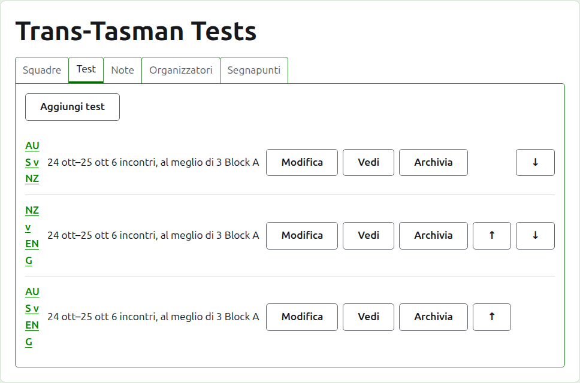
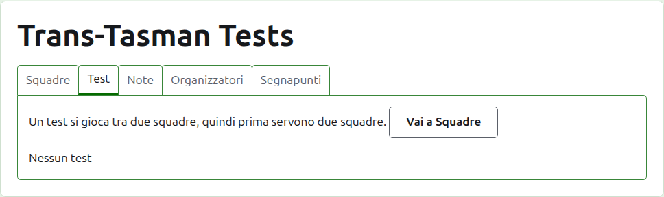
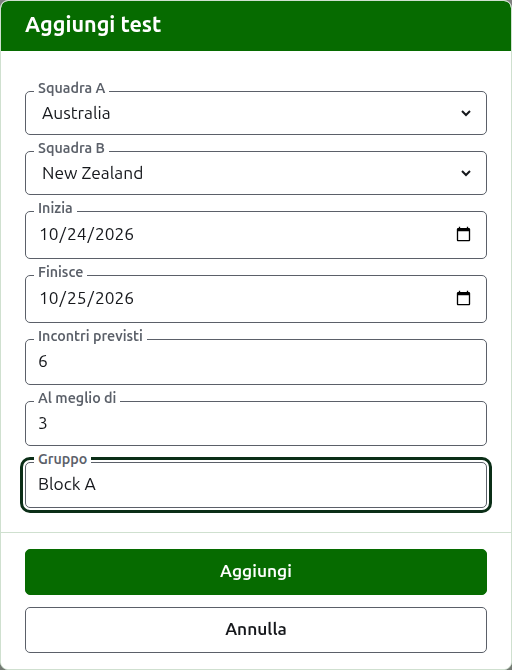
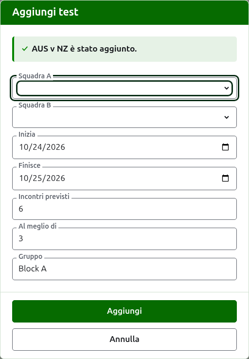
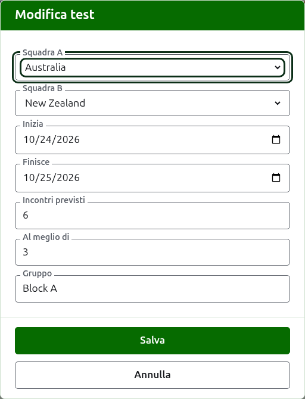

# Test

La scheda **Test** della pagina di un torneo è dove i test tra le sue squadre vengono aggiunti, modificati, messi in ordine e messi da parte. Un test è una delle competizioni del torneo: una sfida tra due squadre, chiamata con i loro nomi brevi, come "AUS v NZ", giocata come un certo numero di incontri tra un giocatore di ciascuna squadra. Ogni test ha una pagina sua, dove si inseriscono i suoi punteggi.

Ogni test dice il suo nome, i giorni in cui si gioca, quanti incontri deve avere e di quante partite è al meglio ciascuno, come "6 incontri, al meglio di 3", e il suo gruppo quando è in uno.

## Prima due squadre

Un test è tra due squadre in uso, quindi finché il torneo ne ha meno di due la scheda lo dice dove starebbe Aggiungi test, e porta alla scheda Squadre.

## Aggiungere un test

Premi **Aggiungi test**, sopra l'elenco. Si apre una finestra di dialogo sopra la pagina, che si legge nell'ordine in cui un test si dice a voce.

**Squadra A** e **Squadra B** si scelgono ciascuna tra le squadre in uso del torneo, per nome, nell'ordine del torneo. All'inizio non è scelta nessuna delle due, così un test non viene mai aggiunto tra squadre che non hai scelto. Squadra B propone ogni squadra tranne quella scelta come Squadra A, perché una squadra non gioca un test contro se stessa. Squadra A è la prima squadra: i suoi giocatori stanno a sinistra sulla pagina del test e sulla pagina pubblica. Un test non ha un nome suo da scrivere; si chiama con i nomi brevi delle sue squadre.

**Inizia** e **Finisce** sono i giorni in cui si gioca il test, che cominciano dal primo giorno del torneo. Un test si gioca all'interno del suo torneo, quindi giorni prima che il torneo cominci o dopo che finisce vengono rifiutati.

**Incontri previsti** è quanti incontri il test deve avere, fissato dall'evento prima che cominci, così chi legge i suoi punteggi può vedere a che punto è. È un numero intero da 1 in su. È anche un limite: una volta che sono cominciati tanti incontri quanti il test deve avere, una partita che ne comincerebbe un altro viene rifiutata, mentre gli incontri già cominciati si giocano fino in fondo. Un test che deve averne di più si modifica perché li preveda.

**Al meglio di** è di quante partite è al meglio ciascun incontro. Può essere pari, perché un incontro può finire in parità.

**Gruppo** è il gruppo in cui il test si trova, quando l'evento si gioca a gruppi, come "Block A". È facoltativo: lasciato vuoto, il test non è in nessuno. I test di un gruppo hanno una pagina loro sul sito pubblico, che mostra la classifica delle squadre del gruppo.

Premi **Aggiungi**. Il test viene aggiunto, la finestra dice quale con il suo nome, e le squadre si svuotano per il successivo, mentre i giorni, gli incontri previsti, l'al meglio di e il gruppo restano com'erano: i test si aggiungono un turno alla volta, tra squadre che si affrontano lo stesso giorno, quindi per il test successivo del turno bastano le sue due squadre. Premi **Annulla** quando ci sono tutti.

## Modificare un test

**Modifica** apre la stessa finestra sul test, intitolata Modifica test, già compilata com'è il test. Premi **Salva** per conservare la modifica.

Un test con partite in uso mantiene le sue squadre: la finestra le mostra ma non si possono cambiare. Il resto si può cambiare, entro ciò che è stato giocato: incontri previsti in numero inferiore agli incontri già cominciati vengono rifiutati, e così pure un al meglio di inferiore al massimo di partite che due giocatori abbiano giocato.

## Ordine

I test sono elencati nell'ordine del torneo, che è l'ordine in cui compaiono sulle pagine pubbliche e nella barra verde scuro. **Su** e **Giù** spostano un test di un posto.

## Andare a un test

Il nome di un test, o **Vedi**, apre la sua pagina, dove si inseriscono i suoi punteggi. Anche la barra verde scuro porta lì, dalla pagina del torneo o da quella di qualsiasi altro test.

## Archiviare un test

**Archivia** mette da parte un test, e **Ripristina** lo annulla, quindi nessuno dei due chiede prima. Un test archiviato è elencato sotto **Test archiviati**, barrato, offre solo Ripristina e non è sulle pagine pubbliche.

Un test con partite in uso è stato giocato, e non può essere archiviato finché non lo sono le sue partite. Un test le cui partite sono tutte archiviate può esserlo, perché una partita archiviata non conta nulla. Un test la cui squadra è stata archiviata nel frattempo non viene ripristinato finché non lo è la squadra, e la scheda lo dice.

Avanti: [Punteggi](scores.md).
