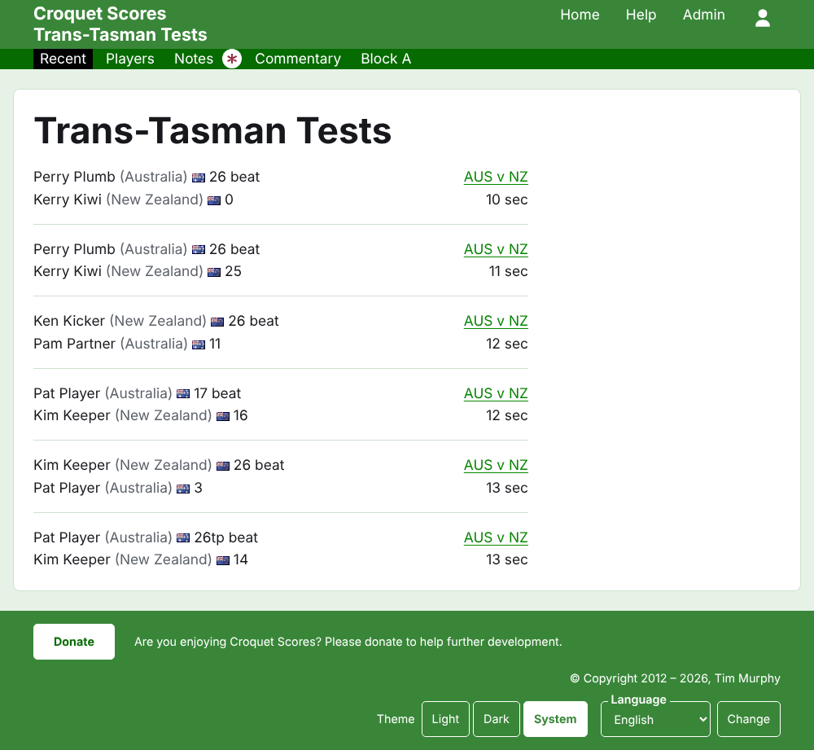
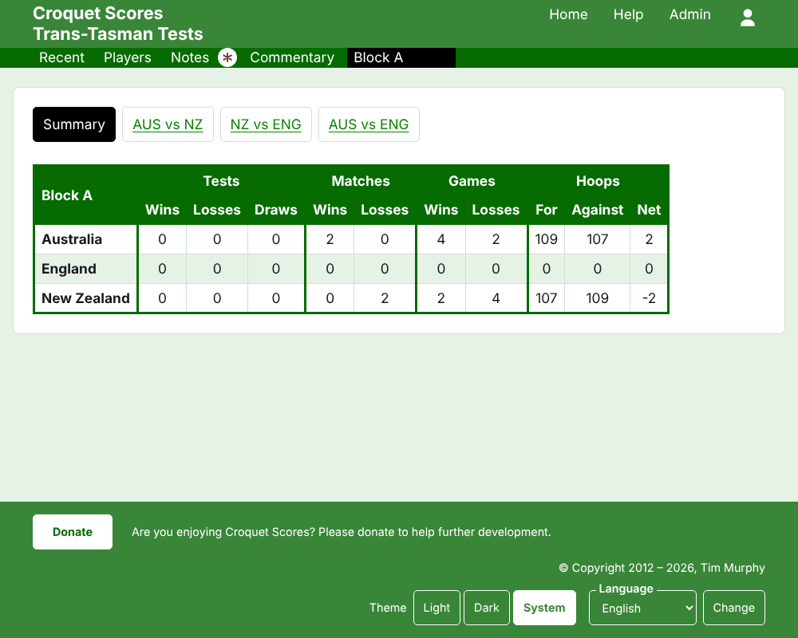
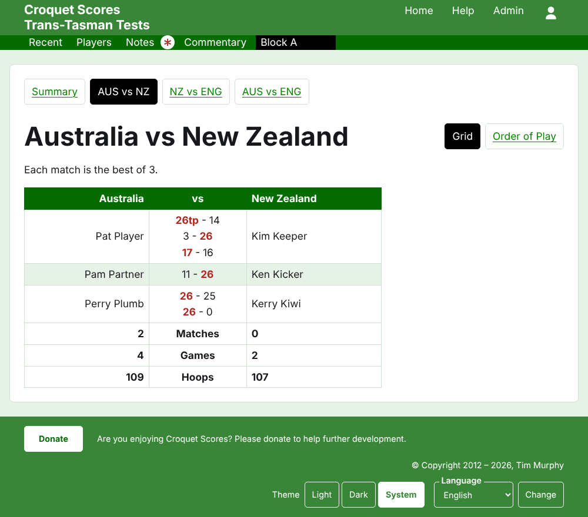
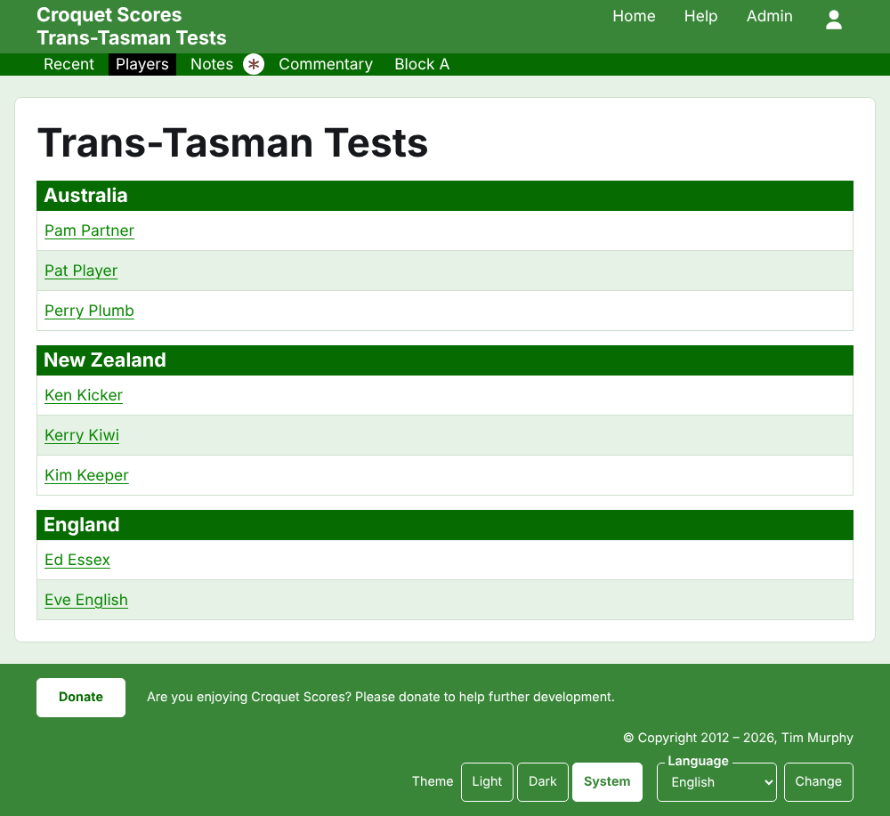

# Che cosa vede il pubblico

Non si pubblica nulla: le pagine pubbliche sono ricavate da ciò che l'amministrazione contiene, quindi un punteggio inserito è subito su di esse. Non richiedono né un account né script, e sono impaginate per un telefono.

## La pagina del torneo

La pagina del torneo si trova al suo anno, al suo sport e al suo nome, come `/2026/ac/trans-tasman-tests`. È intestata con il nome del torneo, con il suo sottotitolo sotto. Elenca ogni partita in uso, dalla più recente, così un lettore che torna vede che cosa è successo nel frattempo. Ogni partita dice il vincitore, la sua squadra e il suo punteggio, poi lo sconfitto e i suoi, con il test in cui è stata giocata e quanto tempo fa è stata aggiunta.

La barra verde scuro offre le sezioni del torneo: **Recenti**, che è questa pagina, **Riepilogo**, **Giocatori**, **Note** e **Cronaca**, poi i test. Un test è detto con i nomi brevi delle sue squadre e "contro" in mezzo, come "AUS contro NZ". I test di un gruppo non sono offerti uno a uno: il gruppo è una sola sezione, chiamata come il gruppo, al posto in cui starebbe il suo primo test. Note è segnata con un asterisco rosso finché c'è una nota che il lettore non ha letto.

## Il riepilogo

Un torneo i cui test non sono in nessun gruppo ha un **Riepilogo**: una sola tabella di tutte le squadre, classificate, con i test vinti, persi e pareggiati, le partite vinte e perse, e gli archetti fatti, subiti e la differenza. Dove gli incontri di un qualsiasi test sono al meglio di più partite, gli incontri vinti e persi vengono dopo i test. Il riepilogo è dove un lettore cerca ogni squadra nel suo insieme.

Un torneo con un test in un gruppo non ha un Riepilogo. La pagina di ogni gruppo mostra invece la classifica delle squadre di quel gruppo, perché una sola tabella di squadre di gruppi diversi che non si sono mai affrontate non classificherebbe nulla.

## Un gruppo

La pagina di un gruppo mostra la classifica delle squadre del gruppo, contando solo i test del gruppo, nella tabella che usa il riepilogo. Sopra la tabella, in una riga tutta loro, offre **Riepilogo**, che è questa pagina, e ciascuno dei test del gruppo, che porta alla pagina del test.

## Un test

La pagina di un test è intestata con i nomi completi delle sue squadre, come "Australia contro New Zealand", e dice di quante partite è al meglio ciascun incontro. La sua tabella è intestata con le due squadre, la prima a sinistra. Ogni incontro giocato è una riga, nell'ordine in cui è cominciato, con il giocatore della prima squadra a sinistra, quello della seconda a destra, e le partite dell'incontro in mezzo, ciascuna con il punteggio della prima parte e poi quello della seconda, con quello del vincitore segnato. Sotto gli incontri stanno le partite e gli archetti di ciascuna squadra e, dove ogni incontro è al meglio di più partite, i suoi incontri vinti, dal suo lato.

Un test si mostra in due modi, offerti sulla riga del suo nome: **Griglia**, che è questa tabella, e **Ordine di gioco**, che elenca ogni partita del test dalla più vecchia. Un test in un gruppo offre il Riepilogo e i test del suo gruppo in una riga sopra la sua intestazione, con questo test segnato.

## Giocatori

La pagina Giocatori elenca i giocatori squadra per squadra: ogni squadra sotto un'intestazione con il suo nome, nell'ordine del torneo delle sue squadre, e i suoi giocatori sotto in ordine alfabetico.

## Note

La pagina Note elenca le note del torneo, dalla più recente, ciascuna delle quali porta a una pagina sua e dice quanto tempo fa è stata scritta. Una nota che il lettore non ha letto è segnata con un asterisco rosso finché non la apre.

## Indirizzi che si spostano

Un torneo mantiene il suo indirizzo quando il nome viene corretto. Quando si sposta, perché il suo anno o il suo sport è cambiato, il vecchio indirizzo porta a quello nuovo, così un link conservato da prima funziona ancora. Le pagine di un torneo archiviato non si trovano finché non viene ripristinato.
