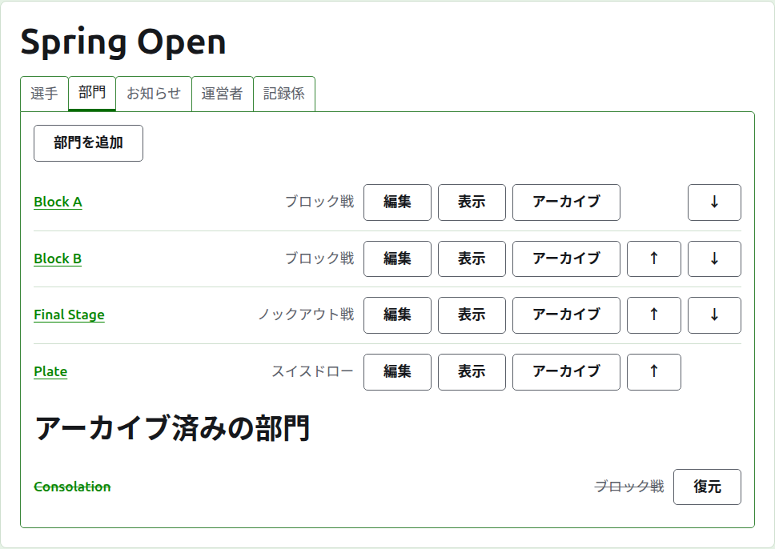
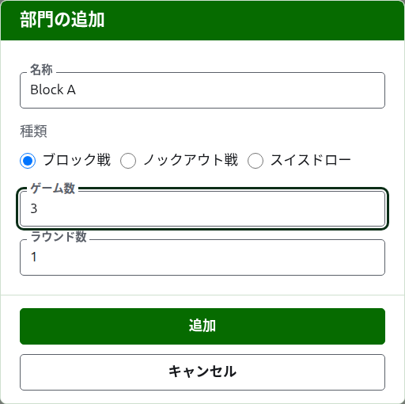
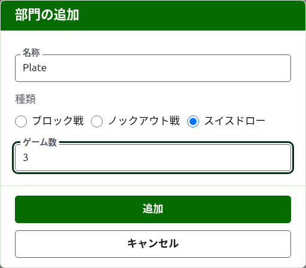
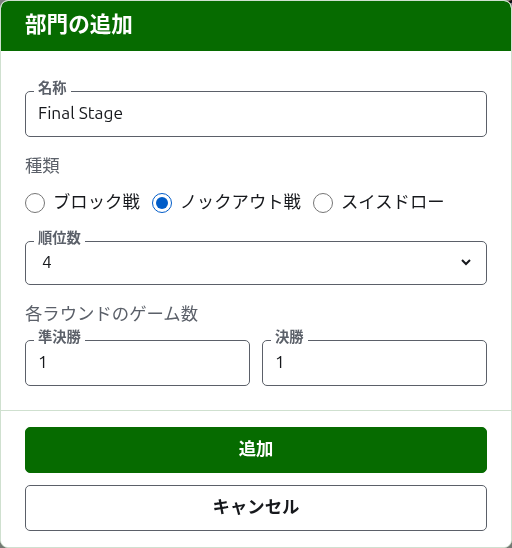

# 部門

大会のページの**部門**タブでは、大会の部門を追加し、並べ替え、除外します。部門とは、ブロック戦、ノックアウト戦、スイスドローのいずれかです。それぞれに専用のページがあり、そこで選手を登録し、スコアを入力します。

## 部門の追加

一覧の上にある**部門を追加**を押します。ページの上にダイアログが開き、部門の名称、種類、そしてその種類に応じた構成を尋ねます。

**名称**は、選手が大会のページで自分の試合を探すときに目にするものです。1文字以上254文字以内で、1文字だけでも構いません。ブロックは1文字で呼ばれることが多いからです。1つの大会で2つの部門が同じ名称を持つことはできません。

**種類**は、ブロック戦、ノックアウト戦、スイスドローのいずれかです。ダイアログはブロック戦で始まります。ほとんどの部門がそうだからです。

### ブロック戦

ブロック戦では、各対戦の**先取ゲーム数**と、何**ラウンド**で行うかを尋ねます。

**先取ゲーム数**は最初は1です。3ゲーム制なら、2ゲームを勝った方が勝ちです。偶数でも構いません。ブロック戦では選手は勝ったゲーム数で順位付けされるので、2ゲームを1つずつ分け合った対戦も、ほかと同じ1つの結果だからです。

**ラウンド数**は、ブロック内の各選手の組が何回対戦するかで、各ラウンドに1試合ずつ行います。最初は1で、ブロック戦にはほとんどの場合1が合っています。どの選手も、ほかの全員とそれぞれ1回ずつ対戦します。再び対戦するブロックの場合にだけ増やしてください。たとえばダブルラウンドロビンでは、2にすると各組が2試合を行います。

### スイスドロー

スイスドローでは、ブロック戦と同じく、各対戦の**先取ゲーム数**だけを尋ねます。最初は1です。3ゲーム制なら、2ゲームを勝った方が勝ちです。偶数でも構いません。スイスドローでは選手は勝ったゲーム数で順位付けされるので、2ゲームを1つずつ分け合った対戦も、ほかと同じ1つの結果だからです。

### ノックアウト戦

ノックアウト戦では、組み合わせの**枠数**と、各ラウンドのゲーム数を尋ねます。枠数の候補は2、4、8、16、32、64、128です。これ以外の数では、ラウンドごとに半分にして決勝にたどり着けないからです。ダイアログは8で始まります。選手を登録して残った枠は不戦勝で埋めます。不戦勝は選手と同じ場所で追加します。

組み合わせのラウンド数は、枠数を1になるまで半分にしていく回数です。8枠の組み合わせなら3ラウンドです。ダイアログでは各ラウンドのゲーム数を**各ラウンドの先取ゲーム数**の下にまとめて、行われる順に尋ねます。最後の3つは組み合わせのラウンドの呼び方どおり**準々決勝**、**準決勝**、**決勝**と呼ばれ、それより前のラウンドは第1ラウンドから番号で呼ばれます。枠数を増やすと組み合わせの先頭にラウンドが加わり、減らすと先頭から取り除かれるので、決勝に入力した値はそのまま決勝のものです。各ラウンドのゲーム数は奇数です。ノックアウト戦の対戦には勝者が必要だからです。

### 行い方と集計

どの種類でも、構成の下で同じ3つを尋ねます。

**ハンディキャップあり。** ハンディキャップ付きで行う部門の場合にチェックします。

**引き分けを認める。** どちらの選手も勝者にならずにゲームが終わりうる場合にチェックします。ほとんどの部門では認めません。チェックした場合、同点で印のないスコアは引き分けとして保存されます。チェックしない場合、同点のゲームは、勝者のスコアの後ろに「6w」のような印を付けて、誰が勝ったかを示す必要があります。ノックアウト戦の試合には必ず勝者がいるので、引き分けのゲームでは決着しません。

**世界ランキングの対象。** 対象になりうる場合、つまりアソシエーションクロッケーかゴルフクロッケーの部門で、ハンディキャップありでも引き分けを認めるものでもない場合にだけ尋ねます。最初はチェックされているので、対象にしない部門ではチェックを外してください。

### 複数をまとめて追加する

**追加**を押します。部門が追加され、ダイアログがそう告げ、名称は次のために空になります。種類とその構成はそのまま残ります。まとめて追加する部門はたいてい似ているので、「Block A」の次の「Block B」は名称が変わるだけです。すべて追加したら**キャンセル**を押してダイアログを閉じます。

## 部門の変更

**編集**を押すと、同じダイアログが「部門の編集」というタイトルでその部門について開き、名称、構成、行い方と集計が現在のまま表示されます。種類は尋ねません。ブロック戦を変更してノックアウト戦にすることはないからです。種類を誤った部門はアーカイブして、改めて追加します。**保存**を押すと、変更が保存されてダイアログが閉じます。

試合のあるノックアウト戦では、選手が組み合わせの中に配置されており、枠数を変更すると選手が動いてしまうので、試合が1つでも入力されると枠数の変更は受け付けられません。各ラウンドのゲーム数は変更できます。

## 順序

部門は大会の順序で一覧表示されます。これは公開ページと濃い緑色のバーに並ぶ順序でもあります。**上へ**と**下へ**で、部門を1つ移動します。

## 部門へ移動する

部門の名称か**表示**を押すと、その部門のページが開きます。そこで選手を登録し、スコアを入力します。ヘッダーの下の濃い緑色のバーからも、大会のどのページからでもそこへ移動できます。

## 部門のアーカイブ

**アーカイブ**は部門を脇に置きます。試合があってもなくても構いません。試合は部門とともに保たれ、復元すると戻ります。アーカイブ済みの部門は、取り消し線付きで**アーカイブ済みの部門**の下に一覧表示され、**復元**だけが表示され、公開ページには載りません。アーカイブは確認を求めません。復元で元に戻せるからです。

次：[部門への選手の登録](entering-players-in-a-competition.md)。
