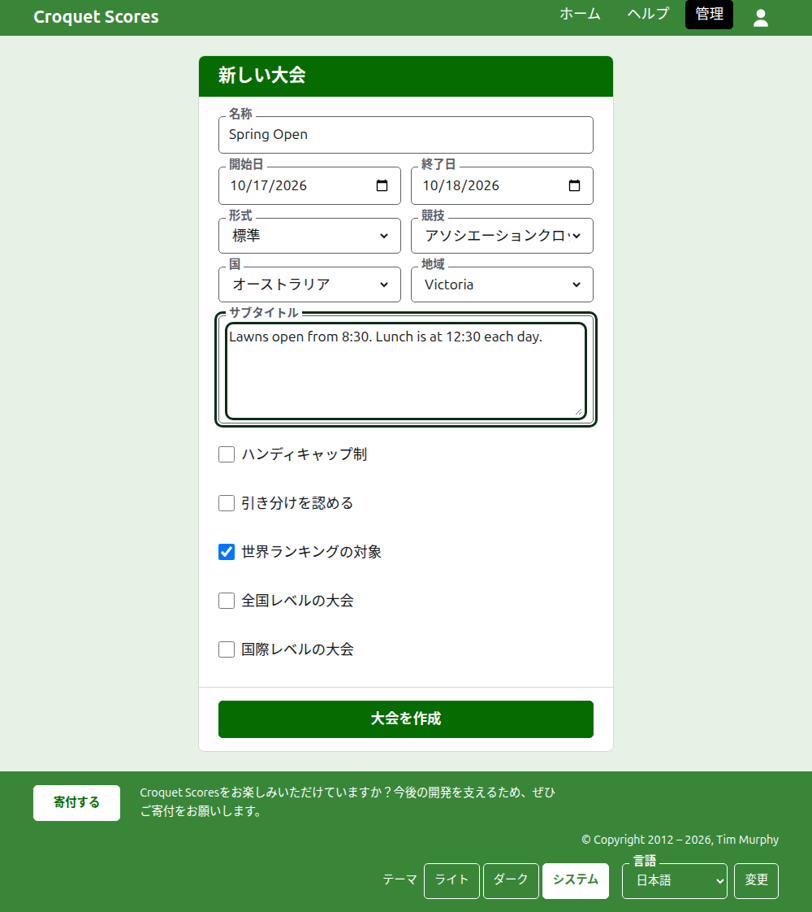

# 大会の作成

管理画面の大会一覧の上にある**新しい大会**を押します。一覧の下ではなく上にあるのは、一覧が長くなってもスマートフォンの画面から押し出されないようにするためです。

フォームでは、大会を始めるのに必要なことをすべて尋ねます。ふつうの大会なら、名称と2つの日付と国を入れるだけです。それ以外はあらかじめ決められており、あとから変更できます。

## フォームで尋ねること

**名称。** 読者が大会を探すときに目にするもので、「Spring Open」のようなものです。3文字以上254文字以内です。すべて小文字、またはすべて大文字の名称は受け付けられません。表示されるすべてのページで誤りのように見えるからです。同じ大会は毎年開催されるので、2つの大会が同じ名称でも構いません。

**開始日**と**終了日。** 大会が行われる日です。終了日を開始日より前にはできず、開始日も終了日も来年の末より後にはできません。大会は開始日の年に属し、その年がアドレスにも入るので、年をまたぐ大会は開始した年に一覧表示されます。

**形式。** 選手どうしで行う大会には**標準**を選びます。ほかの形式はチームで行う大会のためのもので、別のガイドがあります。

**競技。** ウェブサイトが提供する競技を、その順に並べたものです。Croquet Scoresでは、アソシエーションクロッケー、ゴルフクロッケー、アメリカン6ウィケット、リコシェです。Gateball Scoresでは競技も形式も尋ねません。そこにある大会はすべてゲートボールの標準大会だからです。

**国**と**地域。** 大会が行われる場所です。地域を尋ねるのは、選んだ国がオーストラリアの州のように地域に分かれている場合だけです。国全体が1つの地域である国では尋ねません。地域が提示されても、選ばなくて構いません。

**サブタイトル。** 専用の項目がないけれど読者に知ってほしいこと、たとえば駐車場の場所、昼食の時間、連絡先などを書きます。すべての公開ページで、大会の名称の下に表示されます。Markdownで書くので、単語をアスタリスクで囲めば太字になり、各行の先頭にダッシュを置けばリストになります。2000文字まで書けます。空のままでも構いません。

**ハンディキャップ制。** ハンディキャップ大会の場合にチェックします。

**引き分けを認める。** どちらの選手も勝者にならずにゲームが終わりうる場合にチェックします。ほとんどの大会では認めません。チェックした場合、同点で印のないスコアは引き分けとして保存されます。チェックしない場合、同点のゲームは、勝者のスコアの後ろに「6w」のような印を付けて、誰が勝ったかを示す必要があります。

**世界ランキングの対象。** 対象になりうる場合、つまりアソシエーションクロッケーかゴルフクロッケーの大会で、ハンディキャップ制でも引き分けを認めるものでもない場合にだけ尋ねます。最初はチェックされているので、対象にしない大会ではチェックを外してください。

**全国レベルの大会**と**国際レベルの大会。** 大会はどちらか一方か、どちらでもないかのいずれかで、両方になることはありません。一方をチェックすると、もう一方のチェックが外れます。

## 作成する

**大会を作成**を押します。大会を運営する管理画面のページに移動し、あなたがその最初の運営者になります。大会は管理画面で、開始日の年の下に一覧表示されます。

大会の公開アドレスは、年、競技、名称から`/2026/ac/spring-open`のように作られます。あとで名称を訂正してもこのアドレスは変わらないので、すでに送ったリンクはそのまま使えます。アドレスが変わるのは、開始日の年か競技が変わったときだけです。

## 受け付けられなかった場合

受け付けられなかった内容は該当する項目の下に表示され、入力した文字はそのまま残ります。すべての項目が受け付けられるまで、何も保存されません。よく受け付けられないのは、すべて小文字で入力した名称、開始日より前の終了日、国が選ばれていない場合です。

次：[選手](players.md)。
