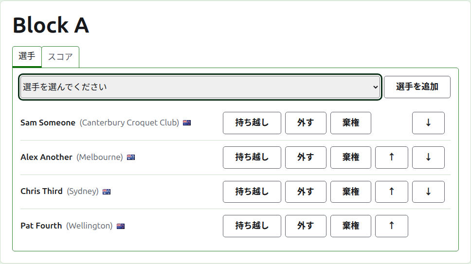
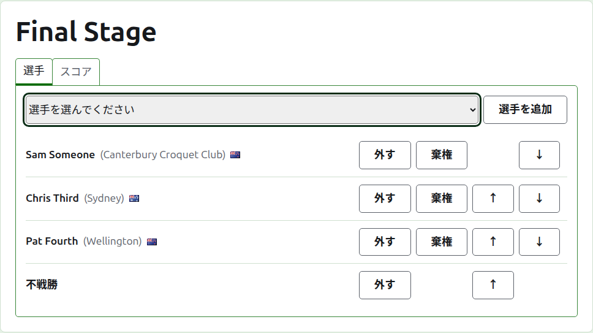
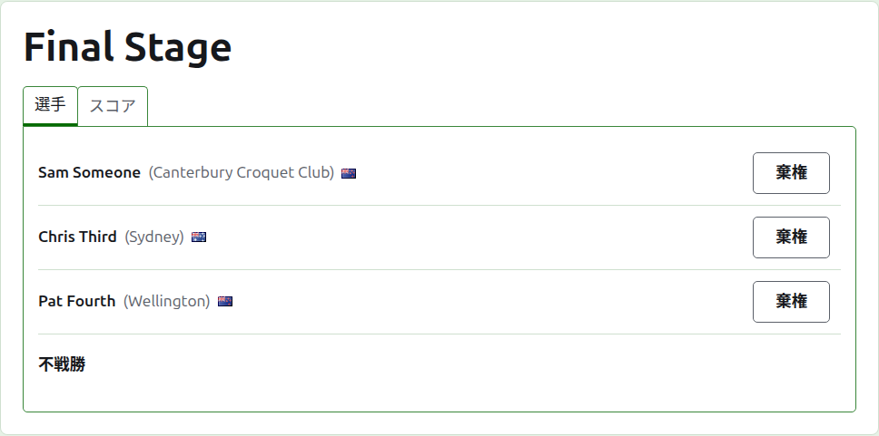
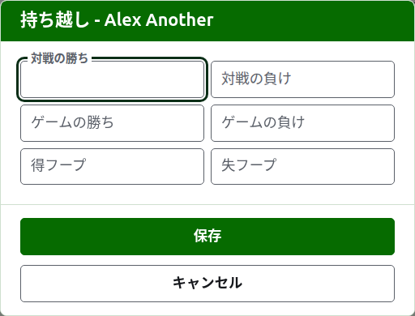
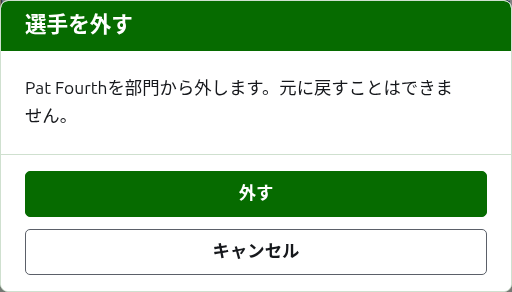
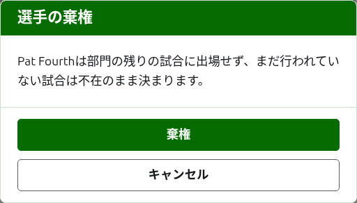
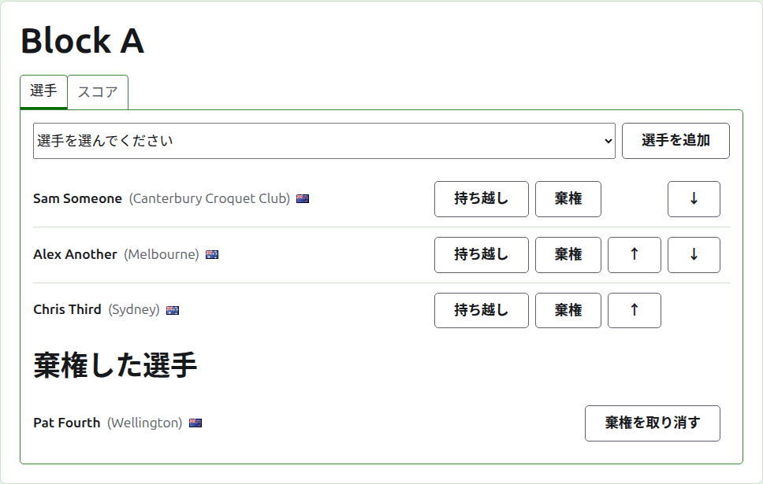

# 部門への選手の登録

部門のページは、部門タブの名称か、濃い緑色のバーから開きます。見出しは部門の名称で、その下に**選手**と**スコア**の2つのタブがあります。何かが行われる前に選手を登録するので、ページは選手タブで開きます。

部門の選手は大会の選手の中から選ぶので、入力するのではなく、選んで登録します。部門内での位置と、部門に持ち越す成績以外のことはすべて、大会の選手タブで変更します。

## 選手の追加

一覧の上のドロップダウンには、まだこの部門に入っていない大会の選手がすべて、大会の順序で並びます。1人を選んで**選手を追加**を押します。選手は登録済みの選手の中に大会の順序で入り、ドロップダウンからは消え、カーソルはドロップダウンに戻るので、次の選手をキーボードから選べます。大会の選手が全員部門に入っている場合、ドロップダウンは表示されず、タブがそう告げます。

大会のアーカイブ済みの選手は候補に出ません。

## ノックアウト戦の不戦勝

ノックアウト戦は、組み合わせのすべての枠が埋まってから行われ、選手で埋まらなかった枠は不戦勝で埋めます。そのためノックアウト戦では、ドロップダウンの先頭に、選手より前に**不戦勝**が並び、不戦勝を何度追加しても引き続き並びます。組み合わせには複数の不戦勝が必要なことがあるからです。

不戦勝は選手と同じように組み合わせに配置されます。上下に移動したり外したりできますが、棄権はできません。何も行わないからです。すべての枠が埋まったノックアウト戦に選手を登録しようとすると受け付けられず、タブがドロップダウンの下でそう告げます。

ノックアウト戦の選手の順序が、そのまま組み合わせです。最初の2枠が最初の対戦で当たり、次の2枠が次の対戦で当たる、という具合です。スコアを入力する前に、選手を組み合わせどおりの順序に並べてください。ノックアウト戦に使用中の試合が1つでもあると、選手は固定され、追加も、外すことも、移動もできなくなります。棄権はできます。

## 順序

選手は部門の順序で一覧表示されます。これはノックアウト戦の組み合わせの順序であり、ブロック戦の公開ページに並ぶ順序でもあります。**上へ**と**下へ**で、選手を1つ移動します。

## 持ち越し

**持ち越し**は、ここで記録していない対戦から選手が部門に持ち込む成績です。前の段階の結果や、この部門をここで記録し始める前に行われた試合の結果などです。持ち越しは、集計する順位表のあるブロック戦とスイスドローで使えます。ノックアウト戦にはありません。

ダイアログでは6つの数を尋ねます。対戦の勝ちと負け、ゲームの勝ちと負け、得フープと失フープです。どれも任意です。空のままの数は何も持ち越しません。これは0を持ち越すのとは違い、あとで変更する人が、空のままだったと分かるようにするためです。**保存**を押すと6つすべてが保存されます。

## 選手を外す

**外す**は、誤って登録した選手を取り除きます。その選手は大会の選手のままで、ドロップダウンに再び候補として出ますが、部門での位置については何も残らないので、外すは先に確認を求めます。

部門に使用中の試合が1つでもある選手は外せません。その試合の相手がいなくなってしまうからです。そのため外すは表示されません。試合がすべてアーカイブ済みの選手は外せます。アーカイブ済みのスコアも一緒に取り除かれます。

## 選手の棄権

**棄権**は、部門の残りの試合に出場しない選手に使います。選手は行った試合とともに部門に残り、まだ出場している選手の後に**棄権した選手**の下に一覧表示されます。ノックアウト戦では、まだ決まっていない対戦の相手が勝ち上がります。

棄権は部門の結果を変えるので、先に確認を求めます。その選手がまだ行っていない試合は、不在のまま決まります。

棄権した選手には**棄権を取り消す**だけが表示されます。これを押すと、確認なしに、残った選手の後ろで出場中の選手に戻ります。

次：[スコア](scores.md)。
