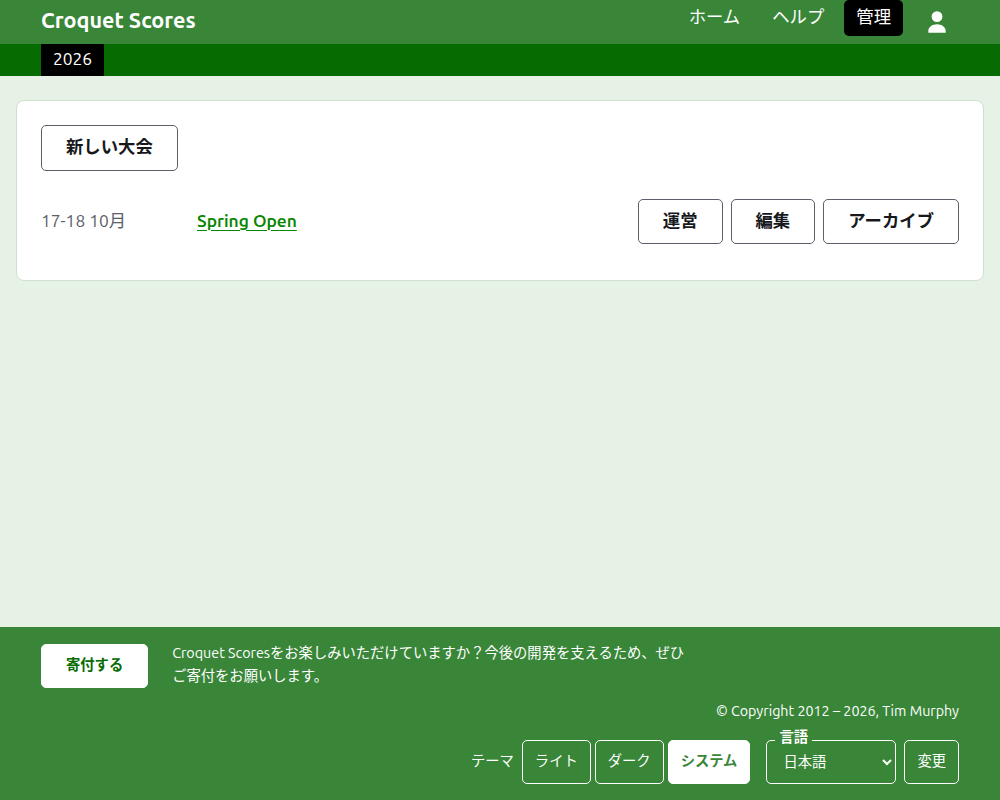
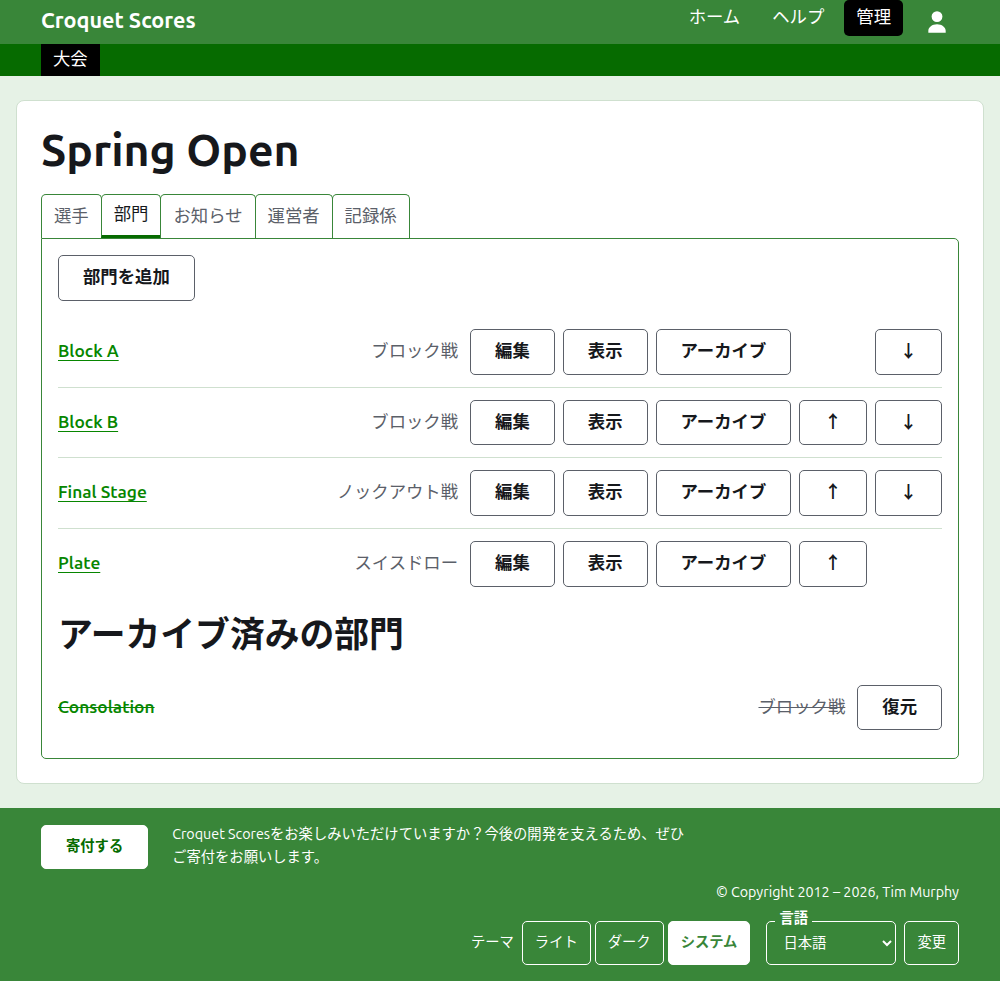

# 標準大会の運営

標準大会とは、選手を一人ずつ登録して行う大会です。クラブの週末大会、オープン大会、選手権などがこれにあたります。選手はブロック戦、ノックアウト戦、スイスドローに登録され、スコアは試合が行われるたびに掲載されます。このガイドでは、運営者がサインインしてから、結果が一般に公開された大会になるまでの手順を説明します。

このガイドはそれだけで完結しています。チームで行う大会のガイドは別に書かれており、このガイドの内容はそれに依存しません。

## はじめる前に

アカウントが必要です。アカウントの登録は[こちら](/account/register)から行えます。

運営者の作業はすべて、ウェブサイトの管理セクションで行います。選手や観客が大会を追う公開ページは、管理画面にある内容から作られるので、公開のための操作は何も要りません。入力したスコアは、すぐに公開ページに載ります。

## ページの順序

1. [大会の作成](creating-a-tournament.md)：名称、日程、競技、開催地、何の対象となるか。
2. [選手](players.md)：大会の選手の登録、訂正、誤って登録した選手の除外。
3. [部門](competitions.md)：ブロック戦、ノックアウト戦、スイスドローの追加と並べ替え。
4. [部門への選手の登録](entering-players-in-a-competition.md)：各部門に出場する選手、ノックアウト戦の不戦勝、持ち越し、選手を外すことと棄権。
5. [スコア](scores.md)：結果の入力、訂正、誤って入力した結果の除外。
6. [お知らせ](notes.md)：大会の進行中に、選手が知るべきことを伝える。
7. [運営者と記録係](managers-and-scorers.md)：大会の運営を分担すること、ほかには何も変更できない人にスコアの入力だけを任せること。
8. [ランキング](rankings.md)：世界ランキングに送るファイルと、あなたが記入することとして残るもの。
9. [大会の変更、アーカイブ、復元](changing-and-archiving.md)：大会の詳細の訂正と、大会の除外。
10. [一般公開される内容](what-the-public-sees.md)：選手が見るページと、入力した内容がそこにどう表示されるか。

## 管理画面の構成

管理画面の入口には、あなたが関わっている大会が1年分ずつ一覧表示されます。

大会の名称か**運営**を押すと、その大会のページが開きます。運営に必要なものはすべて、名称の下にある6つのタブにあります。**選手**、**部門**、**お知らせ**、**運営者**、**記録係**、**ランキング**です。最初に登録するのは選手なので、ページは選手タブで開きます。

ヘッダーの下の濃い緑色のバーは、ページ間の移動に使います。**大会**として大会のページへ、また各部門へその名称で移動できるので、部門タブを経由せずに、大会から部門へ、部門から部門へ移れます。いま開いているページは黒で示されます。

## どこでも共通のこと

**お知らせ以外は、何も完全には削除されません。** 選手、部門、スコア、そして大会そのものは、削除ではなくアーカイブされます。つまり、脇に置かれ、取り消し線が引かれ、専用の見出しの下に一覧表示され、**復元**で戻せます。アーカイブ、復元、上下への移動は確認を求めません。どれも反対の操作で元に戻せるからです。部門から選手を外す、お知らせを削除するなど、元に戻せない操作は、先に確認を求めます。

**ページの上に開くダイアログは、ボタンを押すまで何も保存しません。** キャンセルかEscapeキーで閉じると、すべてが元のままです。選手の追加やスコアの追加など、何かを追加するダイアログは、1つ追加しても開いたままなので、一覧を続けて入力できます。

**受け付けられなかった内容は、該当する項目のそばに表示されます。** 受け付けられなかった内容は保存されず、入力した文字はそのまま残るので、入力し直すのではなく修正できます。

**管理画面はスマートフォンでも使えます。** すべてのボタンは親指で押せる大きさで、画面の幅を超えるものはありません。

次：[大会の作成](creating-a-tournament.md)。
