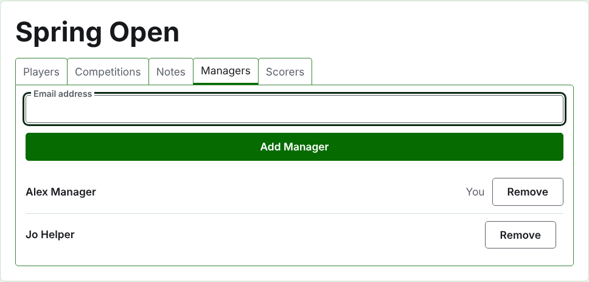
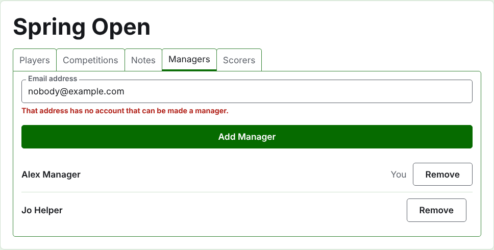
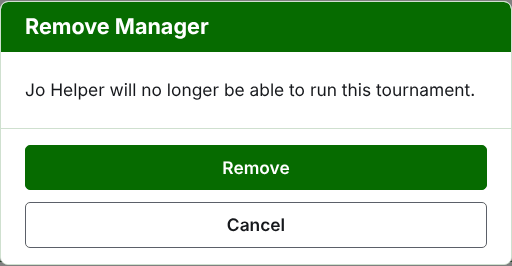
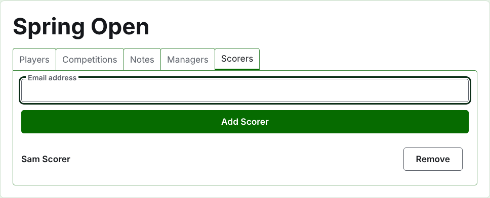
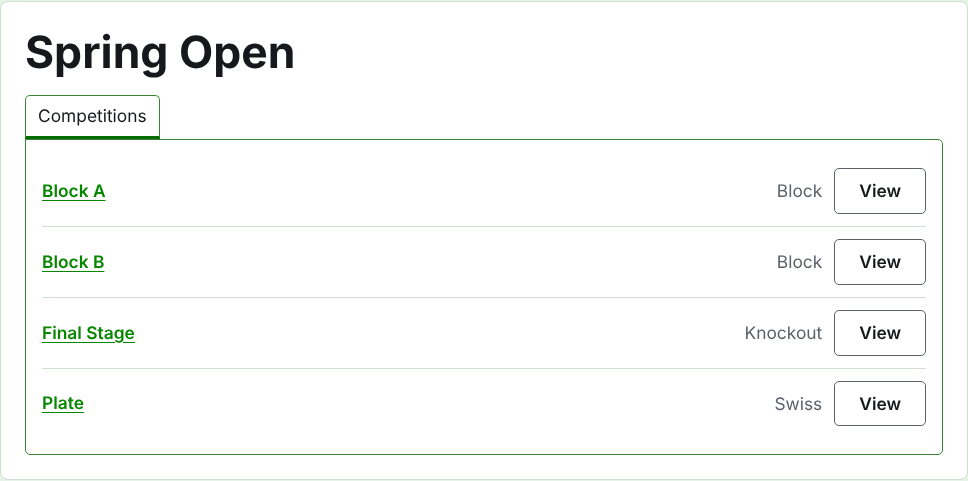

# 運営者と記録係

大会には運営者がいて、大会に対してできることをすべて行えます。記録係を置くこともでき、記録係はスコアの入力だけを行います。大会を作成した人が最初の運営者です。

## 運営者

**運営者**タブには、大会を運営する人が、運営者になった順に一覧表示され、あなた自身の名前にはその印が付きます。大会を共有したり、引き継いだりするのはここです。

運営者はメールアドレスで加えます。一覧の上の項目にアドレスを入力して**運営者を追加**を押します。アドレスは、登録と確認が済んだアカウントのものでなければなりません。該当するアカウントのないアドレスは項目の下で受け付けられないと表示され、サイトはそれ以上のことを言いません。記録係を運営者にすると、記録係ではなくなります。

**外す**は運営者を外します。外した運営者については何も残らないので、外すは先に確認を求めます。再び必要になれば、アドレスで改めて運営者にします。大会には常に運営者がいるので、最後の1人には外すが表示されません。

自分自身を外すこともできます。その場合、確認にはそれが何を意味するかが示されます。あなたは大会に戻る手段を失い、このページでは誰にも元に戻せません。ほかの運営者が、あなたを再び運営者にできます。

## 記録係

**記録係**タブは、記録係のための運営者タブで、同じように働きます。一覧の上にメールアドレスと**記録係を追加**があり、各人に**外す**があります。

記録係には、管理画面の自分の一覧に大会が表示され、運営の代わりに**スコア**が表示されます。開けるのは部門だけで、選手、お知らせ、運営者、記録係は表示されません。部門のページではスコアタブだけが表示され、そこでは運営者と同じように、スコアを入力し、訂正し、アーカイブし、復元できます。どの選手が部門に出場するかを決めるのは運営者です。

運営者を記録係にすることはありません。運営者は記録係にできることをすべてできるからです。大会に記録係は必須ではないので、最後の1人を含め、すべての記録係を外せます。

次：[大会の変更、アーカイブ、復元](changing-and-archiving.md)。
