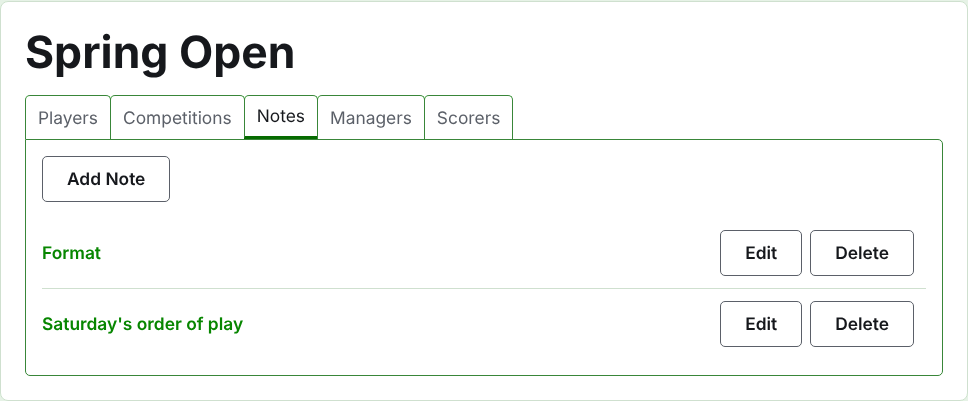
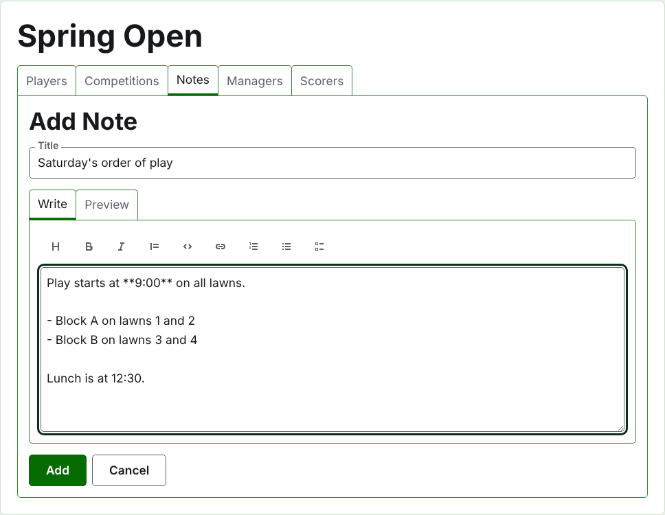
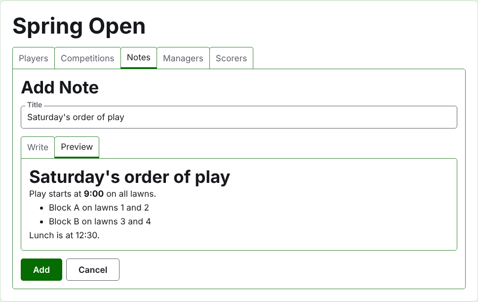
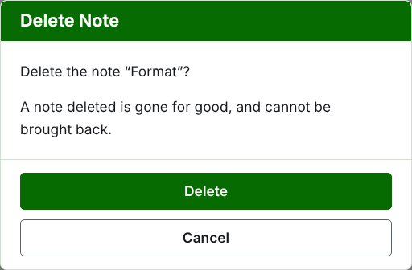

# お知らせ

大会のページの**お知らせ**タブでは、運営者が、大会の進行中に選手が知るべきことを書きます。形式、試合順の変更、昼食の時間などです。読者は大会の公開お知らせページでこれを見ます。まだ読んでいないお知らせには赤いアスタリスクが付き、大会のすべてのページのお知らせセクションにも、開くまで同じ印が付きます。

## お知らせを書く

一覧の上にある**お知らせを追加**を押します。一覧の代わりにパネルが表示されます。お知らせは長く書くもので、場所が必要だからです。

**タイトル**は必須で、お知らせが一覧に表示されるときの名前です。プレーンテキストです。

**本文**はMarkdownで書きます。タイトルで言い尽くせる場合は空のままでも構いません。入力欄の上のツールバーがMarkdownを書いてくれます。見出し、太字、斜体、引用、コード、リンク、番号付きリスト、箇条書き、タスクリストです。それぞれ、選択した範囲に、または選択した各行の先頭に働くか、文字を入れる位置にカーソルを置きます。

**プレビュー**は、読者がページで見るとおりにお知らせを表示します。

**追加**を押します。お知らせが保存され、一覧がそのお知らせを先頭にして戻り、すぐに公開お知らせページに載ります。

## お知らせの編集

お知らせのタイトルか、その**編集**を押すと、そのお知らせについてパネルが開きます。**保存**を押すと変更が保存されます。読者が読んだ後に編集されたお知らせには、再び印が付きます。

## お知らせの削除

もう当てはまらないお知らせは削除します。削除したお知らせは完全になくなるので、**削除**は先に確認を求めます。

次：[運営者と記録係](managers-and-scorers.md)。
