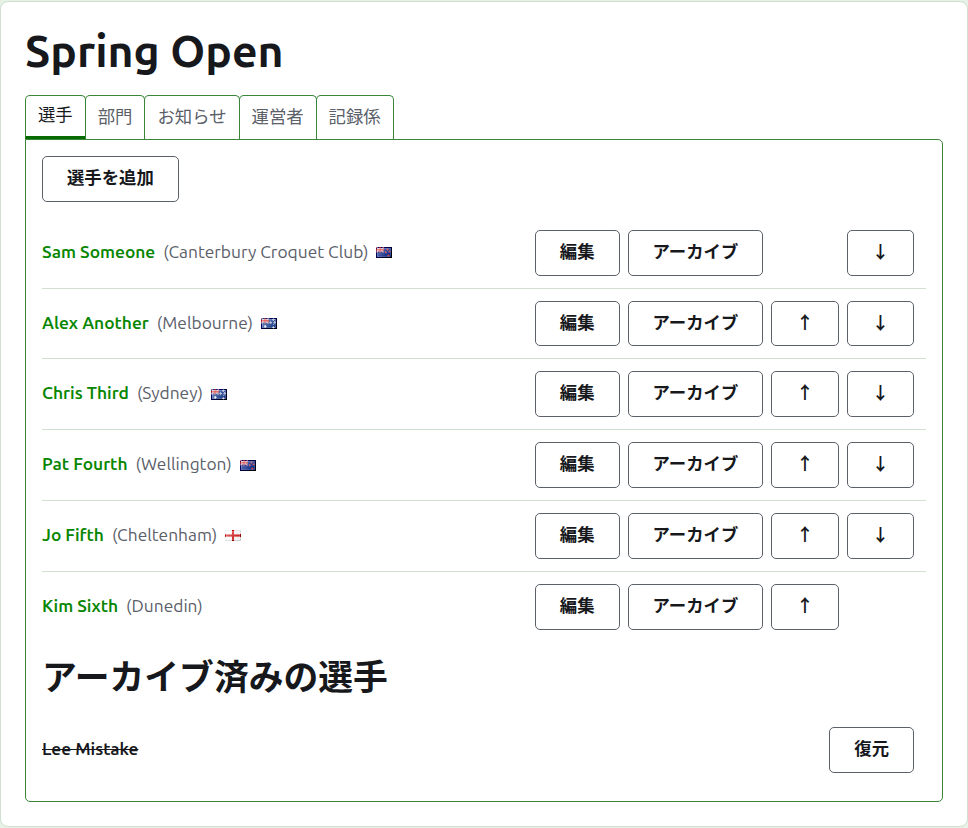
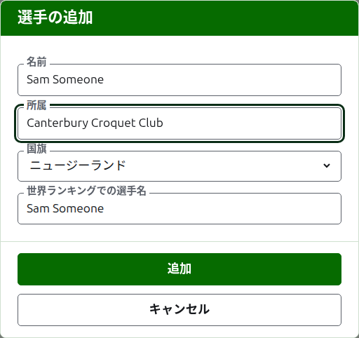
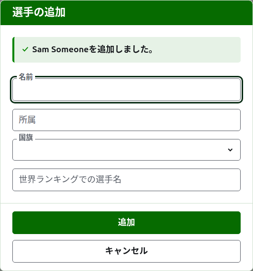
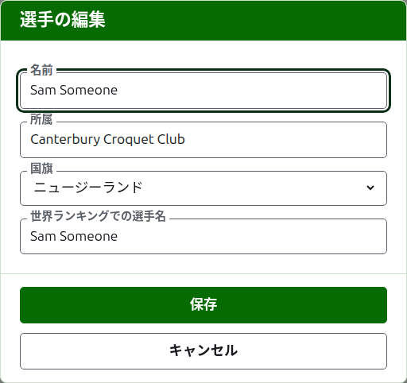
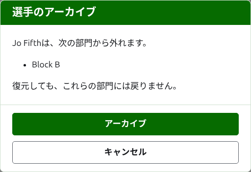

# 選手

大会のページの**選手**タブでは、大会の選手を登録し、訂正し、並べ替え、除外します。大会で最初に行うのは選手の登録なので、ページはこのタブで開きます。

選手は大会にここで一度だけ登録します。各選手がどの部門に出場するかは、あとから各部門のページで、ここで登録した選手の中から選びます。[部門への選手の登録](entering-players-in-a-competition.md)を参照してください。

## 選手の追加

一覧の上にある**選手を追加**を押します。ページの上にダイアログが開きます。

**名前**は必須です。すべてのページに表示される選手の名前で、3文字以上254文字以内です。1つの大会で2人の選手が同じ名前を持つことはできません。大文字と小文字の違いも区別されません。本当に同じ名前の選手が2人いる場合は、「Andrew Hobbs (2)」のように名前そのもので区別してください。

**所属**は選手が代表するもので、読者が言うとおりに書きます。「Canterbury Croquet Club」のようなクラブ、地域、国です。名前の後ろに括弧で表示されます。空のままでも構いません。

**国旗**は選手の名前のそばに表示される国旗です。なしのままでも構いません。ほとんどの選手はそうです。選手の所属と掲げる国旗は別に扱います。ある国のクラブに所属しながら、別の国の国旗を掲げる選手がいるからです。

**世界ランキングでの選手名**は、世界ランキングでその選手が知られている名前です。世界ランキングのある2つの競技、アソシエーションクロッケーとゴルフクロッケーの大会でだけ尋ねます。選手を追加している間は、入力する名前に追随します。ほとんどの選手はランキングでも本名で知られているからです。この項目に直接入力すると追随は止まります。空のままにすると、選手の名前として保存されます。

名前を入力すると、その文字で始まる、世界ランキングが知っている選手が候補として表示されるので、入力し切らなくても、ランキングの綴りどおりの名前を選べます。世界ランキングでの選手名のそばには、ランキングがその名前を知っていればチェックマークが、知らなければ疑問符が表示されます。綴りの誤りか、ランキングに載ったばかりの選手かもしれません。これは参考にすぎません。ランキングが知らない名前も、知っている名前と同じように保存されます。

**追加**を押します。選手が追加され、ダイアログがそう告げ、項目は次の選手のために空になり、カーソルは名前に戻ります。この方法で一覧全体を追加してから、**キャンセル**を押してダイアログを閉じます。キャンセルは、まだ追加していない内容を何も保存しません。

選手に「Bye」という名前は付けられません。ノックアウト戦の不戦勝はノックアウト戦そのものの中で、選手を登録する場所で追加するので、最初の単語が英語の「bye」である名前は受け付けられず、ダイアログがその理由を説明します。

## 選手の訂正

選手の名前か、その**編集**を押すと、同じダイアログが「選手の編集」というタイトルでその選手について開きます。誤っている箇所を直して**保存**を押すと、変更が保存されてダイアログが閉じます。名前を訂正した選手は、それまでの世界ランキングでの選手名を保ちます。ランキングはその名前で選手を知っているからです。

ここで訂正した選手は、あらゆる場所で訂正されます。出場しているすべての部門と、すべての公開ページです。

## 選手の並べ替え

選手は大会の順序で一覧表示されます。これは部門に登録するときに候補として並ぶ順序であり、ノックアウト戦の組み合わせの順序でもあります。各行の末尾にある矢印の**上へ**と**下へ**で、選手を1つ移動します。最初の選手には上へが、最後の選手には下へが表示されません。

## 選手のアーカイブ

**アーカイブ**は選手を脇に置きます。誤って登録した選手や、大会全体から棄権した選手に使います。アーカイブ済みの選手は、取り消し線付きで、使用中の選手の後に**アーカイブ済みの選手**の下に一覧表示され、**復元**だけが表示されます。アーカイブ済みの選手はどの部門にも入らず、どの公開ページにも表示されません。

試合を1つでも行った選手はアーカイブできません。その試合の相手がいなくなってしまうからです。そのため、そのような選手にはアーカイブが表示されません。試合がすべてアーカイブ済みの選手はアーカイブできます。

どの部門にも入っていない選手のアーカイブは確認を求めません。復元すればすべて元に戻るからです。いずれかの部門に入っている選手のアーカイブは、先に確認を求めます。アーカイブすると、入っていたすべての部門から外れ、復元しても元には戻らないからです。

次：[部門](competitions.md)。
