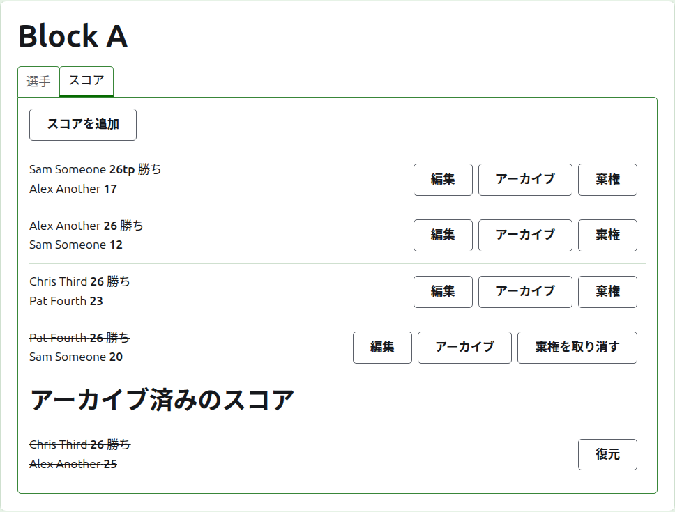
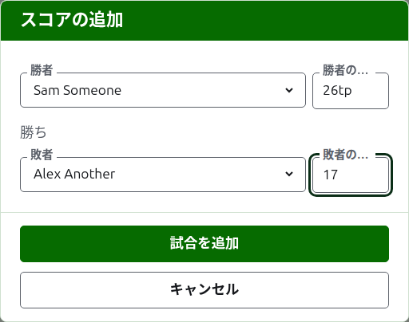
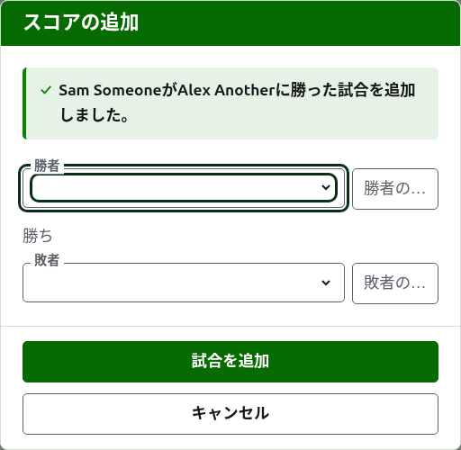
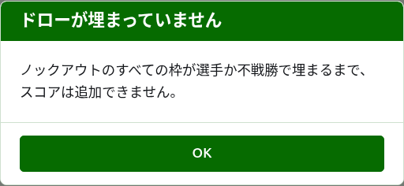
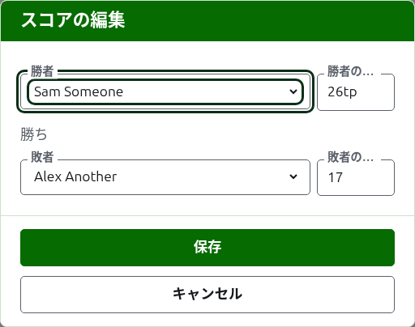

# スコア

部門のページの**スコア**タブでは、部門の試合を入力し、訂正し、除外します。記録係にはこのタブだけが表示され、ここでは運営者にできることがすべてできます。

## スコアの入力 {#entering-a-score}

一覧の上にある**スコアを追加**を押します。ダイアログは結果を口に出して言う順に並んでいます。勝者とそのスコア、「勝ち」、敗者とそのスコアです。

勝者と敗者は、それぞれ部門の出場中の選手から、部門の順序で選びます。最初は誰も選ばれていません。選んでいない選手に試合が記録されることがないようにするためです。ノックアウト戦では、勝者を選ぶと組み合わせ上の相手が敗者として選ばれます。そこで確認し、別の選手を選ぶこともできます。

スコアは記録係が書き留めたとおりに入力します。得点の数と、その後ろに続くものです。後ろに続くものは入力どおりに保存され、表示されます。たとえば「26tp」は26フープとトリプルピールです。数はスコアの先頭の数字です。数字で始まらないスコアは受け付けられません。

時間切れで止まり、別の方法で決着したときなど、同点で勝ったゲームは、勝者のスコアの後ろに印を付けて誰が勝ったかを示します。「6w」が「6」に勝ち、のようにです。Croquet Scoresでの印は「w」、「won」、「winner」です。Gateball Scoresでは「cb」と「so」も使えます。勝者のスコアは敗者より大きいか、印が付いている必要があります。ただし大会が引き分けを認めている場合は、同点で印のないスコアは引き分けとして保存されます。

**ゲームを追加**を押します。試合が追加され、ダイアログがどの試合かを告げ、項目は次のために空になります。スコアは、ラウンドの終わりに掲示板から読み取ってまとめて入力するものだからです。すべて入力したら**キャンセル**を押します。

受け付けられなかった内容は該当する項目の下に表示されます。勝者か敗者が選ばれていない、スコアが入力されていないか数字で始まっていない、勝者と敗者が同じ選手、敗者のスコアに勝ちの印が付いている、勝者のスコアが敗者より小さい、などです。ノックアウト戦では、組み合わせ上で当たらない2人の選手は、項目の上で受け付けられないと表示されます。

## ノックアウト戦の組み合わせは先に埋める {#draw-filled-first}

ノックアウト戦は、組み合わせのすべての枠に選手か不戦勝が入ってから行われます。それまでは、スコアを追加はダイアログを開く代わりに、スコアを追加できない理由を説明します。

## スコアの一覧

使用中のスコアは、入力された順に古いものから一覧表示されるので、一覧は部門が行われた順に読めます。各スコアは勝者とそのスコア、敗者とそのスコアを示し、**編集**と**アーカイブ**を表示します。

## スコアの訂正 {#correcting-a-score}

**編集**を押すと、同じダイアログが「スコアの編集」というタイトルでそのスコアについて開き、選手が選ばれ、スコアが入力されたとおりに表示されます。**保存**を押すと、訂正が保存されてダイアログが閉じます。

訂正しても結果は変わりません。勝ちの試合は勝ちのまま、引き分けの試合は引き分けのままです。結果が誤っていた試合は、アーカイブして改めて入力します。

アーカイブできるスコアでは、スコアだけでなく選手も変更できます。ノックアウト戦で、勝者がすでに次のラウンドで試合をしているスコアは、選手を変えられません。勝者を変えると、次の試合をそこまで来ていない選手が行ったことになってしまうからです。スコアだけを訂正できます。

## スコアのアーカイブ

**アーカイブ**はスコアを脇に置き、何にも数えないようにします。取り消し線付きで**アーカイブ済みのスコア**の下に一覧表示され、**復元**だけが表示されます。どちらも確認を求めません。互いに元に戻せるからです。

ノックアウト戦では、対戦の勝者が次のラウンドに進むので、勝者が次のラウンドで試合をしている対戦のスコアにはアーカイブが表示されません。先に次のラウンドの試合をアーカイブすると、その前の試合をアーカイブできます。ラウンドが3ゲーム制や5ゲーム制の場合、対戦のすべてのゲームが同じように扱われます。ブロック戦とスイスドローには互いに依存するラウンドがないので、どのスコアもアーカイブできます。

## スコアの棄権扱い

部門を離れる選手は、ふつう選手タブで棄権させます。それで十分です。その選手はもう試合をせず、行った試合は残りますが、その試合は勝敗やフープには数えられなくなります。スコアの棄権扱いは、行われた試合を集計に入れない、というまれな場合のためのものです。たとえばオーストラリアのPresident's Eightsでは、選手が棄権しても第1ラウンドの結果は残り、第2ラウンドの試合だけが集計から外されます。その試合を棄権扱いにします。

ブロック戦やスイスドローで、行われたが集計に入れないスコアは、アーカイブではなく棄権扱いにします。**棄権**を押すと、スコアは使用中のスコアの中にその位置のまま残りますが、取り消し線が引かれ、公開ページでは何にも数えられません。**棄権を取り消す**で再び数えられます。どちらも確認を求めません。ノックアウト戦のスコアには棄権が表示されません。ノックアウト戦ではスコアが順位以上のものを決めるからです。

次：[お知らせ](notes.md)。
