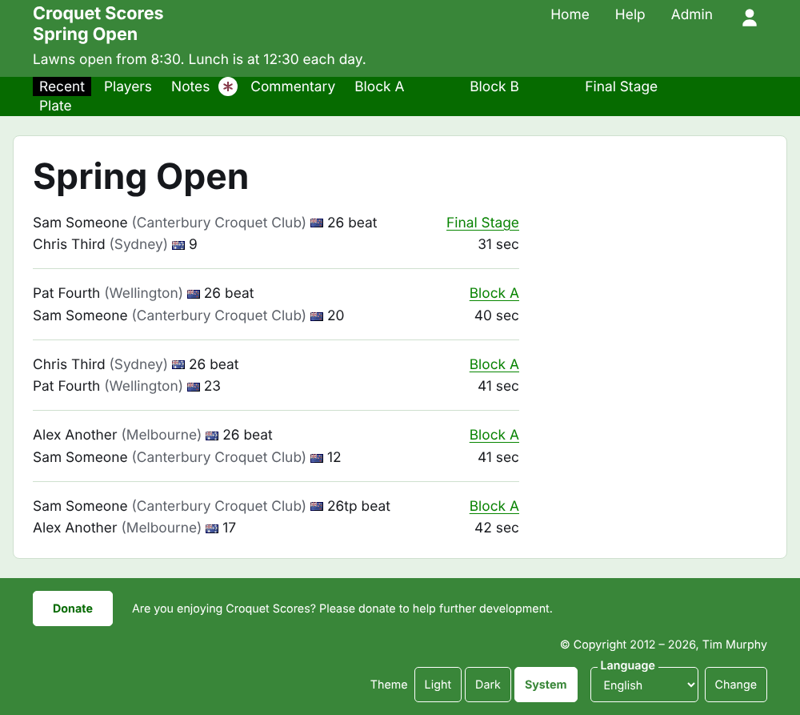
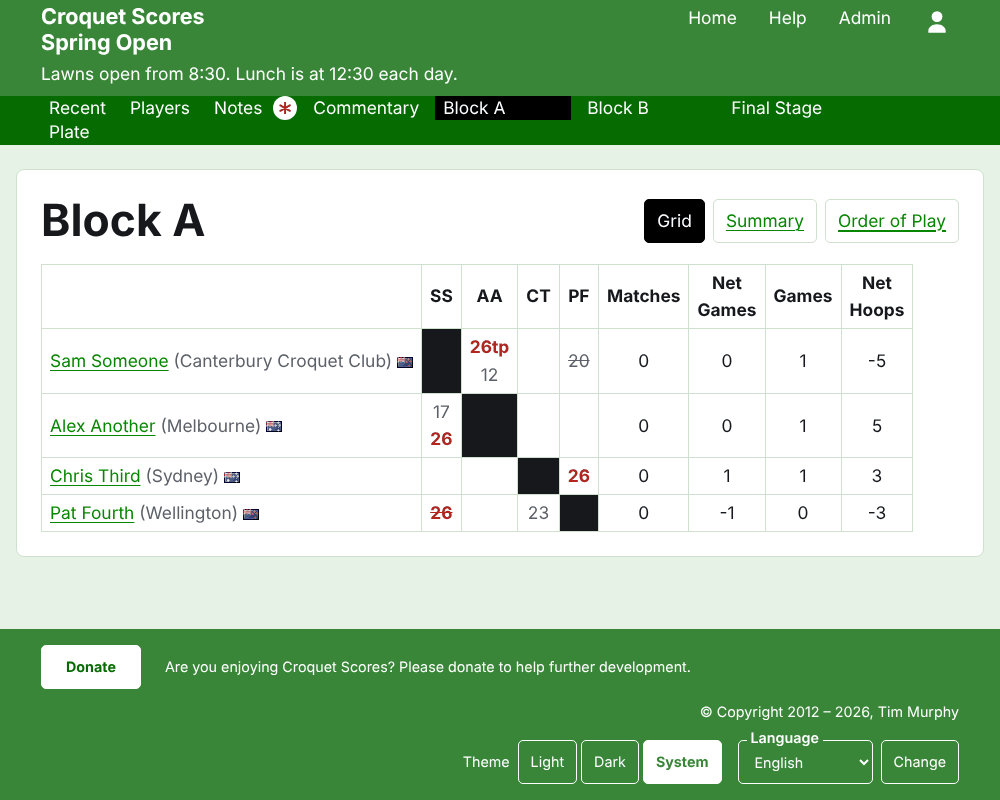
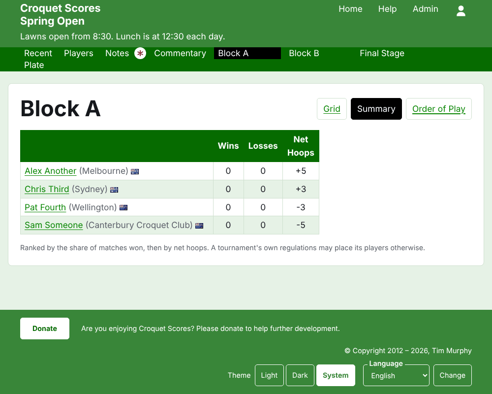
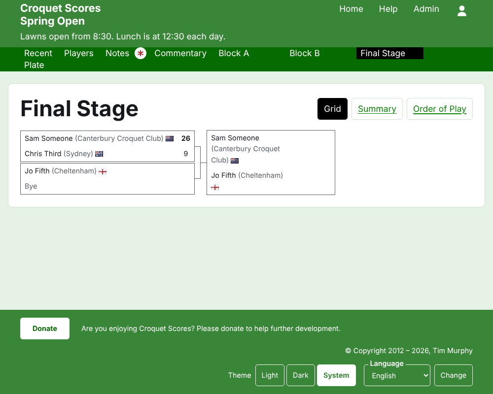
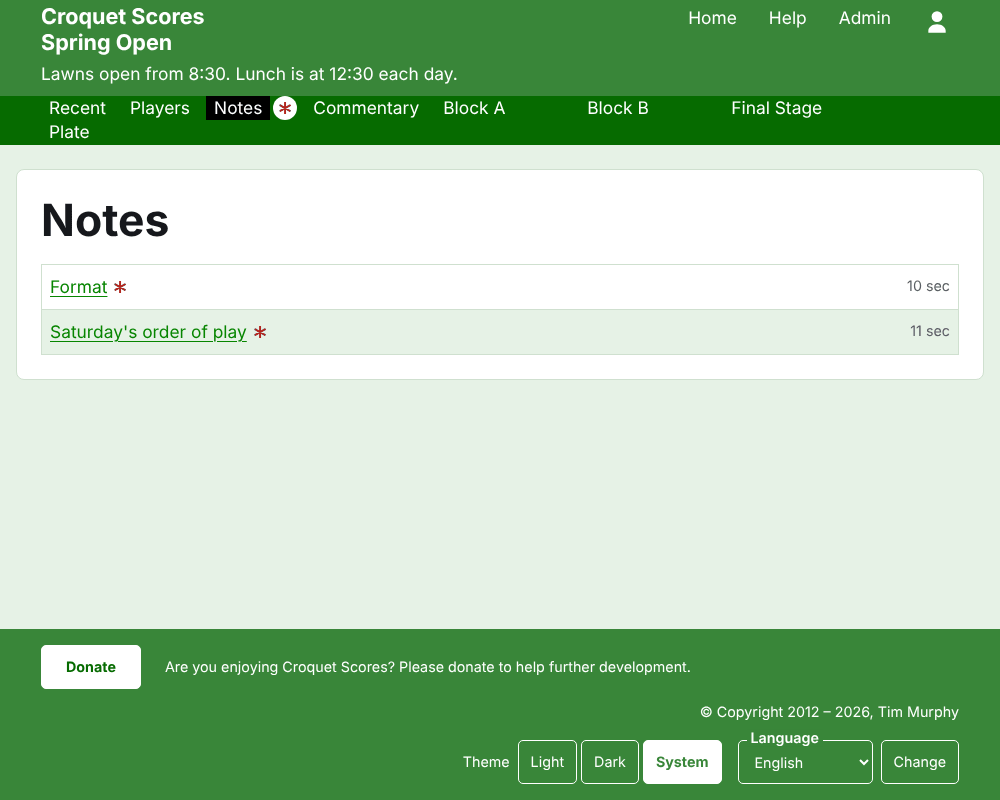

# 一般公開される内容

公開のための操作はありません。公開ページは管理画面にある内容から作られるので、入力したスコアはすぐにそこに載ります。公開ページにはアカウントもスクリプトも要らず、スマートフォン向けに配置されています。

## 大会のページ

大会のページは、年、競技、名称からなる`/2026/ac/spring-open`のようなアドレスにあります。見出しは大会の名称で、その下にサブタイトルが表示されます。使用中のすべての試合を、追加されたのが新しいものから一覧表示するので、戻ってきた読者は、その後に何が起きたかを見られます。各試合には、勝者、その所属、国旗、スコア、次に敗者とそのスコア、それが行われた部門、追加されてからの経過時間が示されます。

濃い緑色のバーには大会のセクションが並びます。このページである**最近**、**選手**、**お知らせ**、**実況**、その後に使用中の各部門が、部門タブの順に並びます。読者がまだ読んでいないお知らせがある間、お知らせには赤いアスタリスクが付きます。

## ブロック戦

ブロック戦のページは、結果を対戦表として表示します。ブロックの順序で選手ごとに行と列があり、行と列が交わる位置に2人の選手の試合があり、行の選手から見て勝ち、負け、引き分けの印が付きます。選手の列の後に、各選手の合計が並びます。各対戦が1ゲームの場合は勝ちとフープ得失差、各対戦が複数ゲームの場合は対戦、ゲーム得失差、ゲーム、フープ得失差です。

ブロック戦は3つの方法で表示され、名称の行で選べます。**対戦表**、**概要**、**試合順**です。概要はスマートフォン向けで、選手を順位付けし、勝ち、負け、フープ得失差を示します。試合順はすべての試合を古いものから一覧表示します。読者が選んだ表示は、別のものを選ぶまで、すべての部門で保たれます。

棄権した選手の行にはそう表示されます。棄権扱いのスコアは取り消し線付きで表示され、何にも数えられません。アーカイブ済みのスコアは表示されません。

## ノックアウト戦

ノックアウト戦のページは、組み合わせをラウンドごとに描きます。最初のラウンドから決勝まで、ラウンドごとに1列あり、各対戦の2つの側が上下に並び、対戦のゲーム数ぶんのセルがあります。後のラウンドの対戦は、その勝者どうしが当たる2つの対戦の横に置かれます。スマートフォンでは組み合わせが横にスクロールし、決勝へ進む矢印と戻る矢印があります。

## スイスドロー

スイスドローのページは、選手を表で順位付けします。ゲーム数、勝ち数、勝率、そして結果です。結果は相手と差で示され、4点差で勝ったゲームは「+4」のようになります。

## 選手

選手ページには、大会のアーカイブされていないすべての選手が、アルファベット順に、所属と国旗とともに一覧表示されます。

## お知らせ

お知らせページには、大会のお知らせが新しいものから一覧表示されます。それぞれが専用のページにつながり、書かれてからの経過時間を示します。読者がまだ読んでいないお知らせには、開くまで赤いアスタリスクが付きます。

## 変わるアドレス

名称を訂正しても大会のアドレスは変わりません。年か競技が変わってアドレスが変わった場合は、古いアドレスから新しいアドレスへ誘導されるので、以前のリンクはそのまま使えます。アーカイブ済みの大会のページは、復元されるまで見つかりません。
