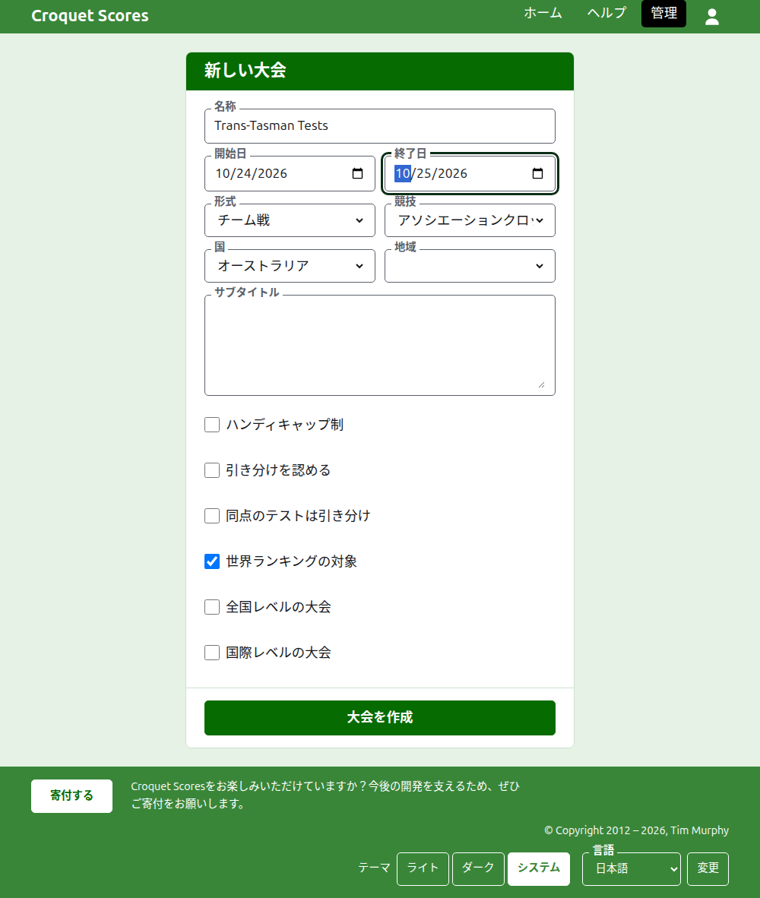
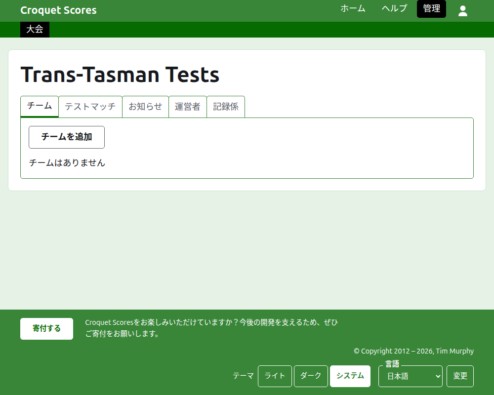

# 大会の作成

管理画面の大会一覧の上にある**新しい大会**を押します。一覧の下ではなく上にあるのは、一覧が長くなってもスマートフォンの画面から押し出されないようにするためです。

フォームでは、大会を始めるのに必要なことをすべて尋ねます。ここで最も重要なのは**形式**です。これが大会をチームで行うものにします。

## フォームで尋ねること

**名称。** 読者が大会を探すときに目にするもので、「Trans-Tasman Tests」のようなものです。3文字以上254文字以内です。すべて小文字、またはすべて大文字の名称は受け付けられません。表示されるすべてのページで誤りのように見えるからです。同じ大会は毎年開催されるので、2つの大会が同じ名称でも構いません。

**開始日**と**終了日。** 大会が行われる日です。すべてのテストマッチはこの期間内に行われるので、大会全体を覆うように設定してください。終了日を開始日より前にはできず、開始日も終了日も来年の末より後にはできません。大会は開始日の年に属し、その年がアドレスにも入ります。

**形式。** チームで行う形式のいずれかを選びます。

- **チーム戦**は、チーム間のあらゆる大会に使える一般的な形式です。
- **エイレカップ**、**インターステートシールド**、**GC世界チーム選手権**は特定の大会で、それぞれの大会の運営方法に合わせて運営できるよう、独自の形式になっています。

標準は唯一のチームで行わない形式で、ここで選ぶものではありません。Gateball Scoresには形式がありません。そこにある大会はすべてゲートボールの標準大会だからです。チームで行う大会はCroquet Scoresで作成します。

**競技。** ウェブサイトが提供する競技を、その順に並べたものです。アソシエーションクロッケー、ゴルフクロッケー、アメリカン6ウィケット、リコシェです。

**国**と**地域。** 大会が行われる場所です。地域を尋ねるのは、選んだ国がオーストラリアの州のように地域に分かれている場合だけで、その場合でも選ばなくて構いません。

**サブタイトル。** 専用の項目がないけれど読者に知ってほしいこと、たとえば駐車場の場所、昼食の時間、連絡先などを書きます。すべての公開ページで、大会の名称の下に表示されます。Markdownで書くので、単語をアスタリスクで囲めば太字になり、各行の先頭にダッシュを置けばリストになります。2000文字まで書けます。空のままでも構いません。

テストマッチをどう行い、どう集計するか、つまりハンディキャップの有無、引き分けの扱い、世界ランキングの対象にするかどうかは、テストマッチを追加するときに一つずつ決めます。

**全国レベルの大会**と**国際レベルの大会。** 大会はどちらか一方か、どちらでもないかのいずれかで、両方になることはありません。一方をチェックすると、もう一方のチェックが外れます。

## 作成する

**大会を作成**を押します。管理画面の大会のページがチームタブで開き、あなたがその最初の運営者になります。大会は管理画面で、開始日の年の下に一覧表示されます。

大会の公開アドレスは、年、競技、名称から`/2026/ac/trans-tasman-tests`のように作られます。あとで名称を訂正してもこのアドレスは変わらないので、すでに送ったリンクはそのまま使えます。アドレスが変わるのは、開始日の年か競技が変わったときだけです。

## 受け付けられなかった場合

受け付けられなかった内容は該当する項目の下に表示され、入力した文字はそのまま残ります。すべての項目が受け付けられるまで、何も保存されません。よく受け付けられないのは、すべて小文字で入力した名称、開始日より前の終了日、国が選ばれていない場合です。

次：[チーム](teams.md)。
