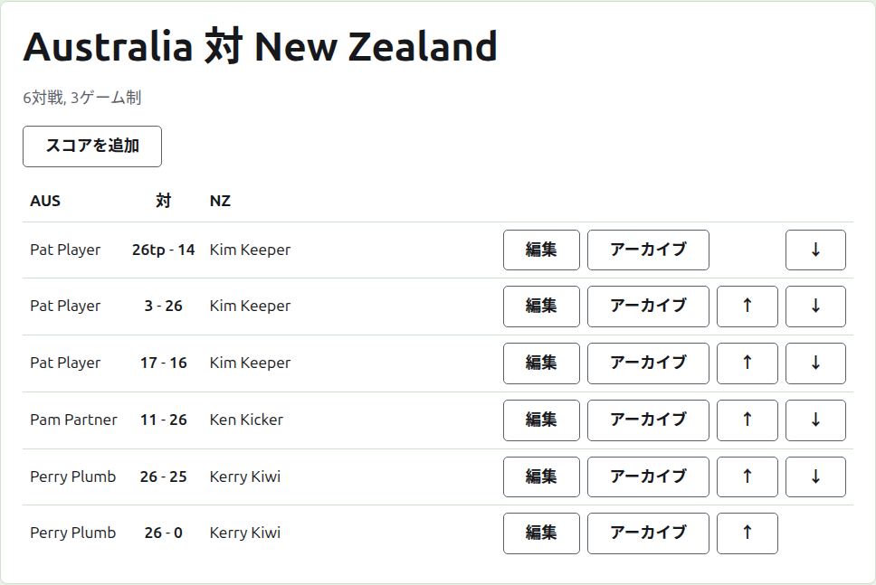
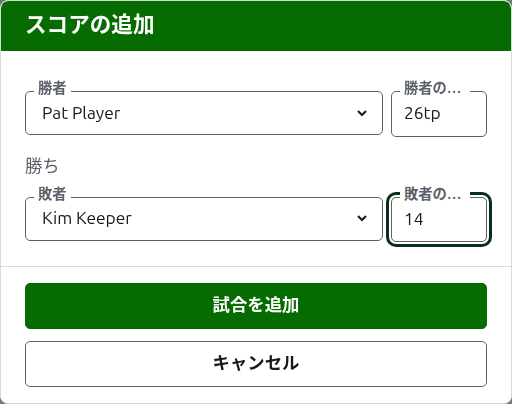

# スコア

テストマッチのページは、テストマッチタブの名前か、濃い緑色のバーから開きます。見出しは「Australia v New Zealand」のようなチームの正式名称で、その下に予定対戦数と各対戦のゲーム数が示されます。スコアがページそのもので、タブはありません。記録係はスコアに対して運営者と同じことができるので、運営者と記録係には同じページが表示されます。

## スコアの並び方

スコアは勝者ではなくチームごとに並び、先頭のチームの略称、「v」、2つ目のチームの略称を見出しとする表になります。各スコアが1行で、先頭のチームの選手、次に先頭のチームを先にした両方のスコア（「26tp - 14」のように）、次に2つ目のチームの選手の順です。どちらが勝ったかは問いません。アーカイブ済みのスコアも、その下に同じように並びます。

## スコアの入力

一覧の上にある**スコアを追加**を押します。ダイアログは結果を口に出して言う順に並んでいます。勝者とそのスコア、「勝ち」、敗者とそのスコアです。

勝者は、両チームの使用中の選手から選びます。候補は各チームの名称の下に、先頭のチームの選手から、各チームの順序で並びます。最初は誰も選ばれていません。勝者を選ぶと、敗者の候補にはもう一方のチームだけが並びます。同じチームの2人の選手の試合は、チーム間の試合ではないからです。アーカイブ済みの選手は候補に出ません。

スコアは記録係が書き留めたとおりに入力します。得点の数と、その後ろに続くものです。後ろに続くものは入力どおりに保存され、表示されます。たとえば「26tp」は26フープとトリプルピールです。数はスコアの先頭の数字です。数字で始まらないスコアは受け付けられません。

時間切れで止まり、別の方法で決着したときなど、同点で勝ったゲームは、勝者のスコアの後ろに印を付けて誰が勝ったかを示します。「6w」が「6」に勝ち、のようにです。印は「w」、「won」、「winner」です。勝者のスコアは敗者より大きいか、印が付いている必要があります。ただし大会が引き分けを認めている場合は、同点で印のないスコアは引き分けとして保存されます。

**試合を追加**を押します。試合が追加され、ダイアログがどの試合かを告げ、項目は次のために空になります。スコアは、セッションの終わりに掲示板から読み取ってまとめて入力するものだからです。すべて入力したら**キャンセル**を押します。

## 対戦

当たった2人の選手は、テストマッチのゲーム数で対戦を行います。2人の間の試合がその対戦のゲームで、すでに決着した対戦の2人の間の試合は受け付けられません。一方が、他方がこれ以上勝ちうる数より多くのゲームを勝っているか、対戦のすべてのゲームが行われたかのいずれかです。

対戦は、2人の選手の間に使用中の試合があると始まります。テストマッチは予定対戦数を超えて対戦を始めません。予定された数の対戦が始まると、まだ当たっていない2人の選手の間の試合は受け付けられず、すでに始まった対戦の別の試合は受け付けられます。テストマッチの対戦を増やす場合は、テストマッチタブで予定対戦数を変更します。

## スコアの訂正

**編集**を押すと、同じダイアログが「スコアの編集」というタイトルでそのスコアについて開き、選手が選ばれ、スコアが入力されたとおりに表示されます。スコアだけでなく選手も、追加するときと同じように選んで変更できます。**保存**を押すと、訂正が保存されてダイアログが閉じます。訂正しても結果は変わりません。勝ちの試合は勝ちのまま、引き分けの試合は引き分けのままです。結果が誤っていた試合は、アーカイブして改めて入力します。

## スコアの並べ替え

スコアは入力された順に並ぶので、使用中の各スコアには**上へ**と**下へ**があり、隣のスコアと入れ替えられます。これで一覧を試合が行われた順に並べられます。

## スコアのアーカイブ

**アーカイブ**はスコアを脇に置き、何にも数えないようにします。取り消し線付きで**アーカイブ済みのスコア**の下に一覧表示され、**復元**だけが表示されます。どちらも確認を求めません。互いに元に戻せるからです。テストマッチには互いに依存するラウンドがないので、どのスコアもアーカイブできます。

選手がその後アーカイブされたスコアは、選手が復元されるまで復元されず、ページがその旨を表示します。

次：[お知らせ](notes.md)。
