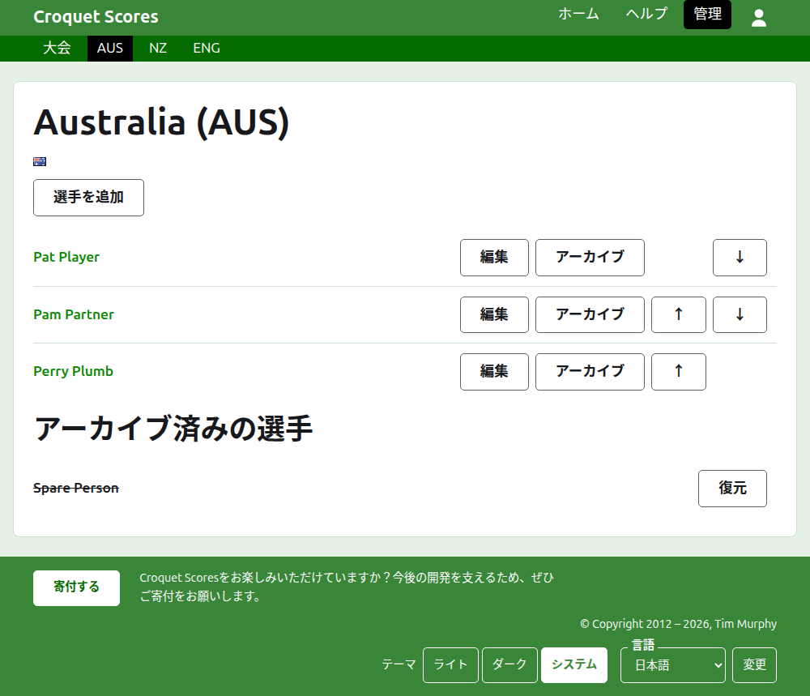
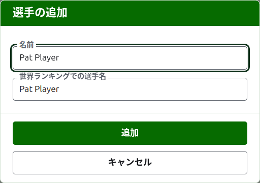

# チームの選手

チームのページは、チームタブの名称か、その**表示**から開きます。見出しはチームの名称に括弧で略称を添えたもので、国旗も表示されるので、違うチームに来てしまった運営者はすぐに気づけます。このページに表示するのはチームの選手だけなので、一覧がページそのものです。

チームのページの濃い緑色のバーからは、大会と、使用中の各チームへその略称で移動できるので、チームタブに戻らずにチームごとに選手を登録できます。

チームの選手はそのチームだけに属し、チームを代表し、自分の国旗ではなくチームの国旗を掲げます。同じ人が2つのチームで、または2つの大会で出場する場合、それぞれで別の選手です。

## 選手の追加 {#adding-a-player}

一覧の上にある**選手を追加**を押します。ページの上にダイアログが開きます。

**名前**は必須で、3文字以上254文字以内です。1つのチームで2人の選手が同じ名前を持つことはできません。大文字と小文字の違いも区別されません。別のチームの選手なら同じ名前でも構いません。

**世界ランキングの選手名**は、世界ランキングでその選手が知られている名前です。世界ランキングが選手の一覧を持つ2つの競技、アソシエーションクロッケーとゴルフクロッケーの大会でだけ尋ねます。アメリカン6ウィケットの選手はランキングでも本名で知られているので、そこでは尋ねず、各選手の世界ランキングでの選手名は常にその選手の名前です。選手を追加している間は、入力する名前に追随し、この項目に直接入力すると追随は止まります。空のままにすると、選手の名前として保存されます。入力すると、その文字で始まる、世界ランキングが知っている選手が候補として表示され、世界ランキングでの選手名のそばには、ランキングがその名前を知っていればチェックマークが、知らなければ疑問符が表示されます。これは参考にすぎません。ランキングが知らない名前も、知っている名前と同じように保存されます。

選手に「Bye」という名前は付けられません。最初の単語が英語の「bye」である名前は受け付けられません。

**追加**を押します。選手が追加され、ダイアログがそう告げ、項目は次の選手のために空になり、カーソルは名前に戻ります。この方法でチーム全体を追加してから、**キャンセル**を押してダイアログを閉じます。

## 選手の訂正 {#correcting-a-player}

選手の名前か、その**編集**を押すと、同じダイアログが「選手の編集」というタイトルでその選手について開きます。**保存**を押すと変更が保存されます。名前を訂正した選手は、それまでの世界ランキングでの選手名を保ちます。ただしアメリカン6ウィケットでは、選手の世界ランキングでの選手名は常にその選手の名前です。

## 順序

選手はチームの順序で一覧表示されます。これはテストマッチのスコアを入力するときに候補として並ぶ順序です。**上へ**と**下へ**で、チーム内で選手を1つ移動します。

## 選手のアーカイブ

**アーカイブ**は選手を脇に置きます。誤って登録した選手や、チームを離れた選手に使います。アーカイブ済みの選手は、取り消し線付きで、使用中の選手の後に**アーカイブ済みの選手**の下に一覧表示され、**復元**だけが表示されます。アーカイブは確認を求めません。チームの選手はほかのどこにも登録されておらず、復元すればすべて元に戻るからです。

テストマッチで使用中の試合を1つでも行った選手はアーカイブできません。その試合の相手がいなくなってしまうからです。そのため、そのような選手にはアーカイブが表示されません。試合がすべてアーカイブ済みの選手はアーカイブできます。

次：[テストマッチ](tests.md)。
