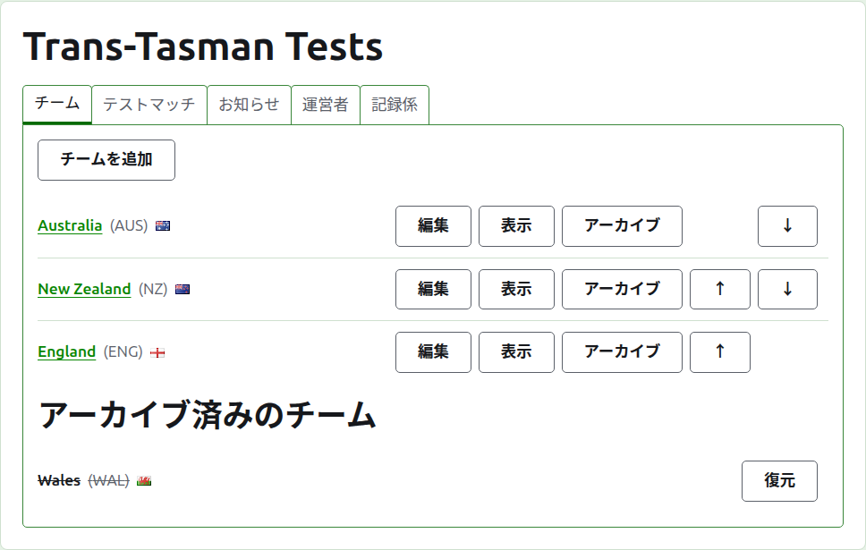
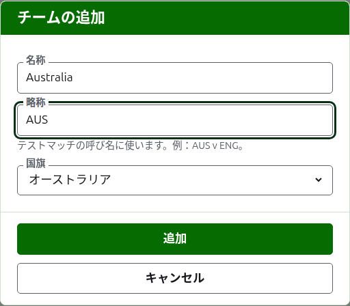
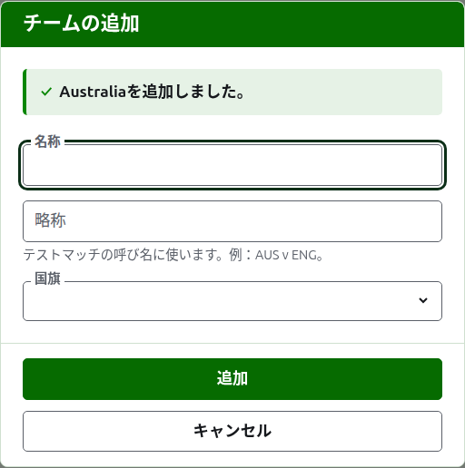
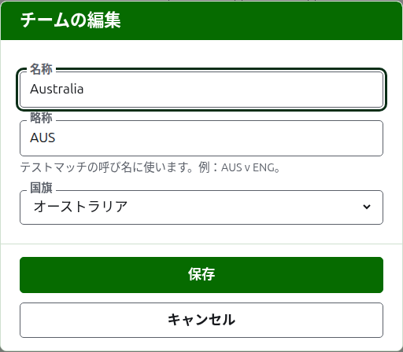

# チーム

大会のページの**チーム**タブでは、大会のチームを追加し、訂正し、並べ替え、除外します。最初に設定するのはチームなので、ページはこのタブで開きます。テストマッチは2つのチームの間で行うので、テストマッチを追加する前に少なくとも2チームが必要です。

## チームの追加

一覧の上にある**チームを追加**を押します。ページの上にダイアログが開きます。

**名称**は必須です。「Australia」のようなチームの正式名称で、チームのページと公開ページの表の見出しになります。1つの大会で2つのチームが同じ名称を持つことはできません。

**略称**も必須です。「AUS v ENG」のようにチームのテストマッチを呼ぶときに使われ、濃い緑色のバーでチームを表すのもこれです。10文字以内で、名称より長くはできません。名称より長い略称は、2つを逆に入力したものだからです。2つのチームが同じ略称を持つこともできません。

**国旗**は、チームの名称が表示されるあらゆる場所でそのそばに表示されます。クラブや地域のチームのように、なしのままでも構いません。

**追加**を押します。チームが追加され、ダイアログがそう告げ、項目は次のために空になります。この方法で一覧全体を追加してから、**キャンセル**を押してダイアログを閉じます。キャンセルは、まだ追加していない内容を何も保存しません。

## チームの訂正

チームの**編集**を押すと、同じダイアログが「チームの編集」というタイトルでそのチームについて開きます。誤っている箇所を直して**保存**を押します。略称を変更したチームは、あらゆる場所で新しい略称で呼ばれるので、そのテストマッチの名前も変わります。

## 順序

チームは大会の順序で一覧表示されます。これはテストマッチを追加するときに候補として並ぶ順序であり、濃い緑色のバーに並ぶ順序であり、公開の選手ページに並ぶ順序でもあります。各行の末尾にある矢印の**上へ**と**下へ**で、チームを1つ移動します。

## チームへ移動する

チームの名称か**表示**を押すと、チーム専用のページが開きます。そこで選手を登録します。[チームの選手](team-players.md)を参照してください。

## チームのアーカイブ

**アーカイブ**はチームを脇に置きます。選手はチームとともに保たれ、復元すると戻るので、アーカイブは確認を求めません。アーカイブ済みのチームは、取り消し線付きで**アーカイブ済みのチーム**の下に一覧表示され、**復元**だけが表示され、そのページは復元されるまで閉じられます。

使用中のテストマッチに出場しているチームはアーカイブできません。そのテストマッチの相手がいなくなってしまうからです。そのため、そのようなチームにはアーカイブが表示されません。テストマッチがすべてアーカイブ済みのチームはアーカイブできます。

次：[チームの選手](team-players.md)。
