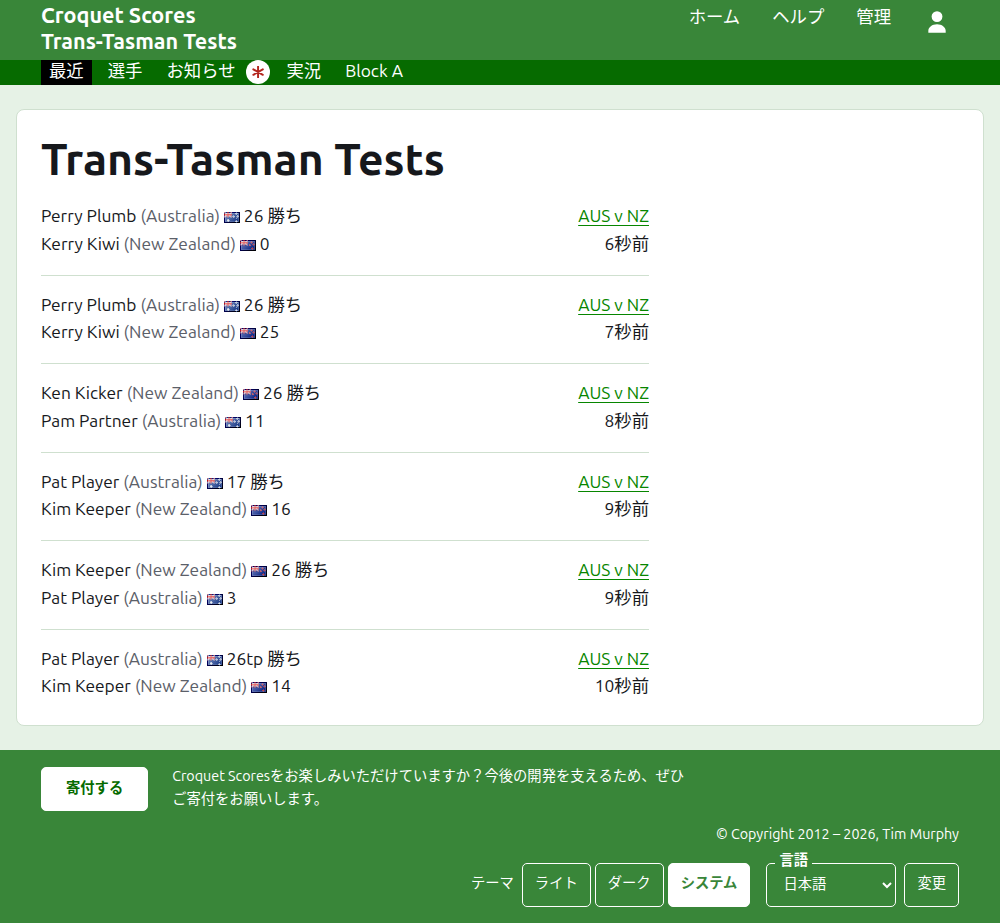
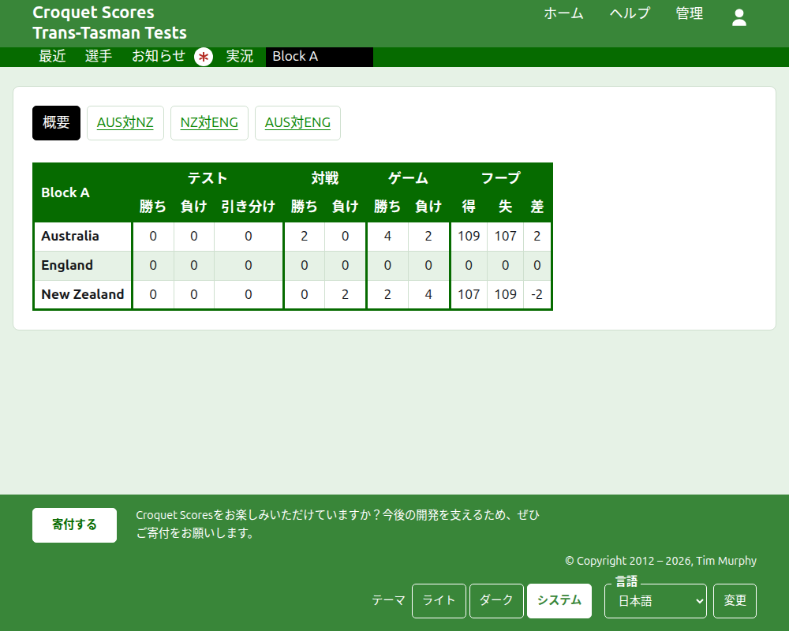
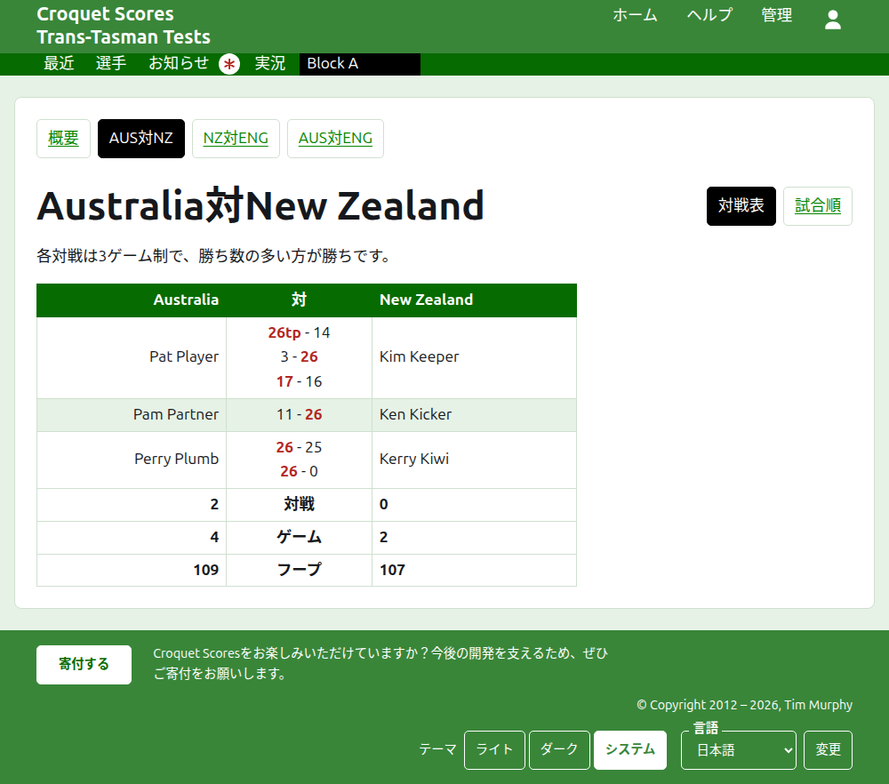
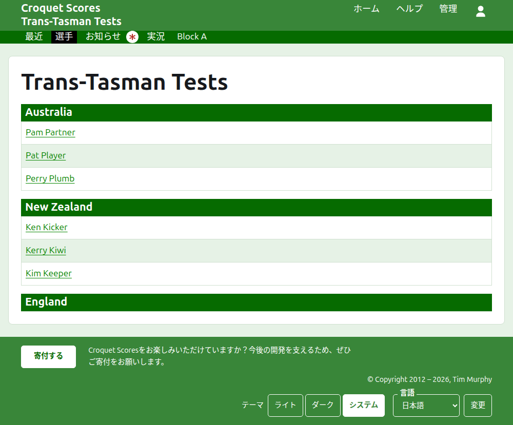

# 一般公開される内容

公開のための操作はありません。公開ページは管理画面にある内容から作られるので、入力したスコアはすぐにそこに載ります。公開ページにはアカウントもスクリプトも要らず、スマートフォン向けに配置されています。

## 大会のページ

大会のページは、年、競技、名称からなる`/2026/ac/trans-tasman-tests`のようなアドレスにあります。見出しは大会の名称で、その下にサブタイトルが表示されます。使用中のすべての試合を、追加されたのが新しいものから一覧表示するので、戻ってきた読者は、その後に何が起きたかを見られます。各試合には、勝者、そのチーム、スコア、次に敗者とそのスコア、それが行われたテストマッチ、追加されてからの経過時間が示されます。

濃い緑色のバーには大会のセクションが並びます。このページである**最近**、**サマリー**、**選手**、**お知らせ**、**実況**、その後にテストマッチです。テストマッチは「AUS対NZ」のように、チームの略称を「対」でつないで示されます。グループに入っているテストマッチは個別には並びません。グループが1つのセクションになり、グループの名前で、その最初のテストマッチがあるべき位置に置かれます。読者がまだ読んでいないお知らせがある間、お知らせには赤いアスタリスクが付きます。

## サマリー

テストマッチがどのグループにも入っていない大会には**サマリー**があります。すべてのチームを順位付けした1つの表で、テストマッチの勝ち、負け、引き分け、ゲームの勝ちと負け、フープの得、失、差を示します。いずれかのテストマッチの対戦が複数ゲームの場合、対戦の勝ちと負けがテストマッチの後に続きます。サマリーは、読者が各チームの全体を見る場所です。

グループに入っているテストマッチがある大会にはサマリーがありません。代わりに各グループのページがそのグループのチームの順位を示します。互いに対戦しないグループをまたいで1つの表にチームを並べても、何も順位付けできないからです。

## グループ

グループのページは、そのグループのテストマッチだけを数えて、グループのチームの順位をサマリーと同じ表で示します。表の上には専用の行があり、このページである**サマリー**と、グループの各テストマッチが並び、それぞれのテストマッチのページにつながります。

## テストマッチ

テストマッチのページの見出しは「Australia対New Zealand」のようなチームの正式名称で、各対戦のゲーム数を示します。表の見出しは2つのチームで、先頭のチームが左です。行われた各対戦が1行で、始まった順に並び、先頭のチームの選手が左、2つ目のチームの選手が右、その間に対戦のゲームが並びます。各ゲームは先頭の側のスコア、次に2つ目の側のスコアの順で、勝者に印が付きます。対戦の下には各チームのゲームとフープが、各対戦が複数ゲームの場合は対戦の勝ち数も、それぞれの側に示されます。

テストマッチは2つの方法で表示され、名前の行で選べます。この表である**対戦表**と、テストマッチのすべての試合を古いものから一覧表示する**試合順**です。グループに入っているテストマッチは、見出しの上の行にグループのサマリーとテストマッチを並べ、このテストマッチに印を付けます。

## 選手

選手ページには、選手がチームごとに一覧表示されます。各チームがその名称の見出しの下に、大会のチームの順序で並び、その下に選手がアルファベット順に並びます。

## お知らせ

お知らせページには、大会のお知らせが新しいものから一覧表示されます。それぞれが専用のページにつながり、書かれてからの経過時間を示します。読者がまだ読んでいないお知らせには、開くまで赤いアスタリスクが付きます。

## 変わるアドレス

名称を訂正しても大会のアドレスは変わりません。年か競技が変わってアドレスが変わった場合は、古いアドレスから新しいアドレスへ誘導されるので、以前のリンクはそのまま使えます。アーカイブ済みの大会のページは、復元されるまで見つかりません。
