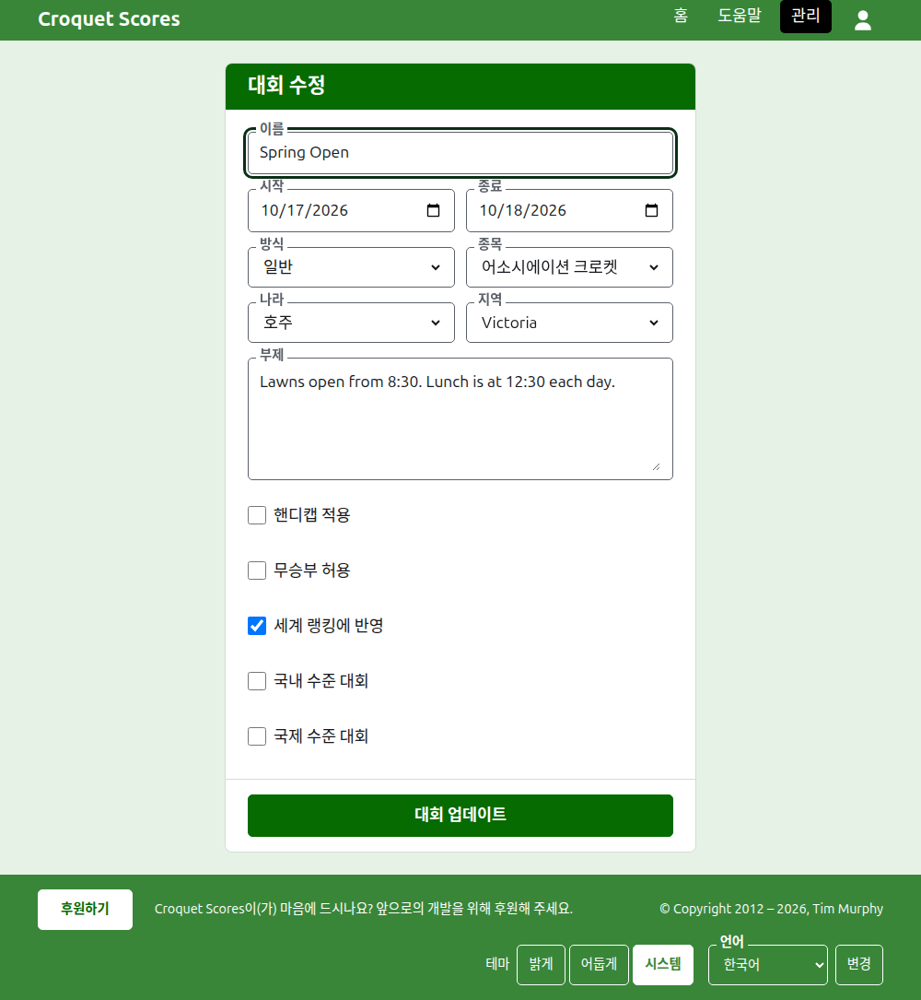
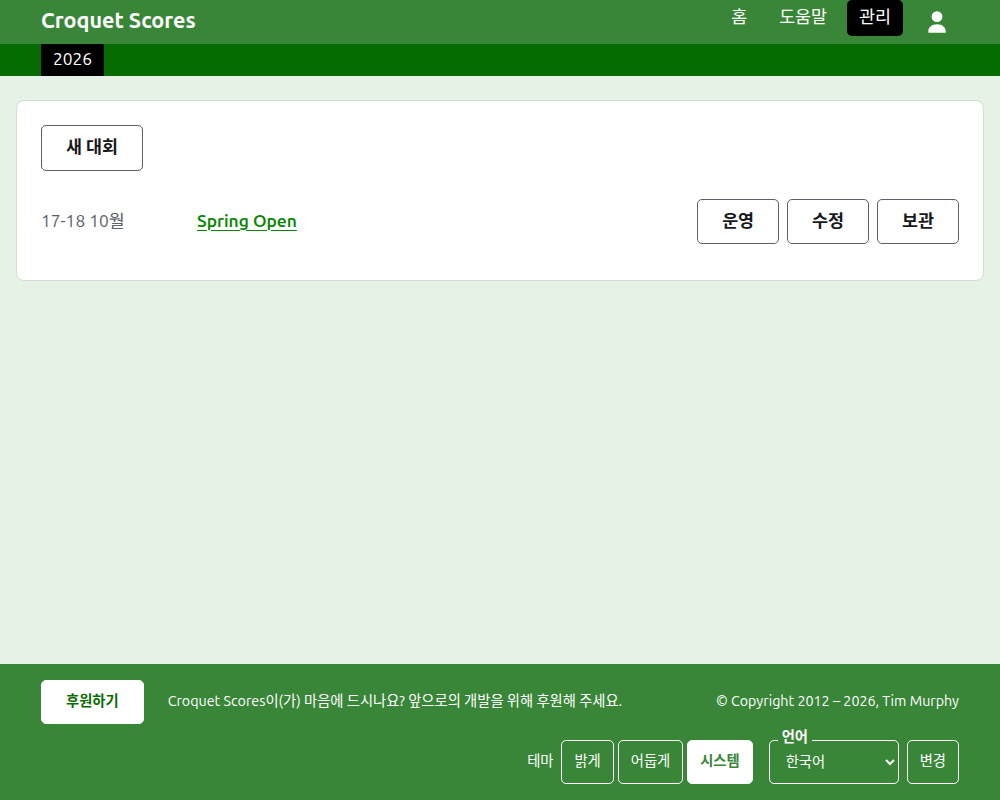
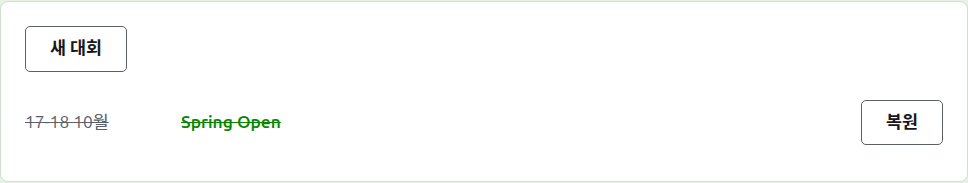

# 대회 수정, 보관, 복원

## 대회의 세부 내용 바꾸기

관리 화면의 대회 목록에서 대회의 **수정**을 눌러요. 양식은 대회를 만들 때의 것이고, 대회의 지금 상태로 시작해요. 틀린 것을 고치고 **대회 업데이트**를 눌러요.

대회에 선수나 부문이 하나라도 있으면, 보관된 것까지 포함해서, 방식을 팀으로 치르는 것으로 바꿀 수 없어요. 그 방식에는 선수와 부문 대신 팀과 테스트가 있으니까요.

이름을 고쳐도 대회의 주소는 그대로여서, 누군가 이미 보낸 링크로도 찾을 수 있어요. 시작하는 해나 종목이 바뀔 때만 주소가 옮겨지고, 그때는 옛 주소가 새 주소로 이어져요. 저장하면 대회가 지금 있는 곳으로 이동해요.

대회는 운영자만 바꿀 수 있어요. 기록원이나 그 밖의 사람에게는 양식을 보여 주는 대신 그렇게 알려 줘요.

## 대회 목록

관리 화면은 올해부터 시작해 한 해씩, 가장 새 대회부터 나열해요. 내 대회가 있는 해들은 짙은 녹색 막대에 가장 최근 해부터 탭으로 있어요. 휴대폰에 다 들어가지 않을 만큼 많으면, 가장 오래된 해들은 줄 끝의 드롭다운 목록에 들어가요. 연도는 주소에 들어 있어서, 특정 해로 링크를 걸 수 있어요.

## 대회 보관하기

목록에서 대회의 **보관**을 누르면 대회를 치워 두어요. 여전히 목록에 있지만 줄이 그어진 채 쓰이고 있는 대회들 뒤에 놓이고, **복원**만 할 수 있어요. 관리 화면의 대회 페이지와 공개 페이지는 복원할 때까지 닫혀요. 복원하면 되돌려지기 때문에, 보관할 때 먼저 묻지 않아요.

다음: [공개 페이지에 보이는 것](what-the-public-sees.md).
