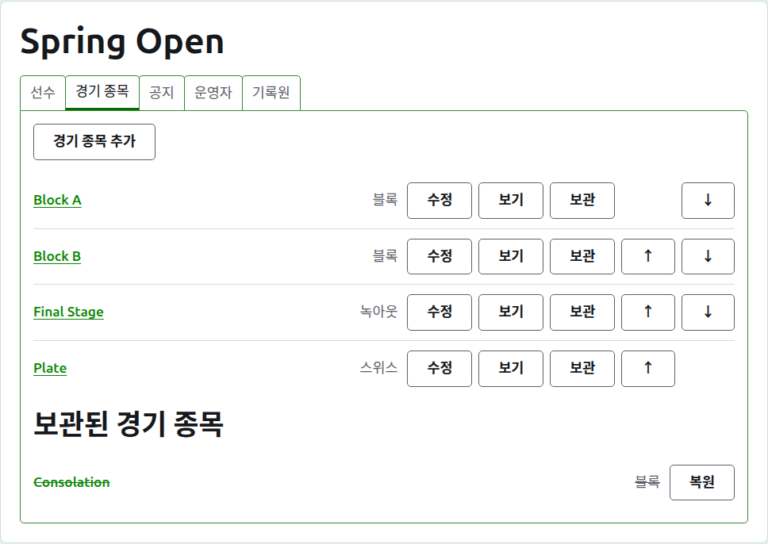
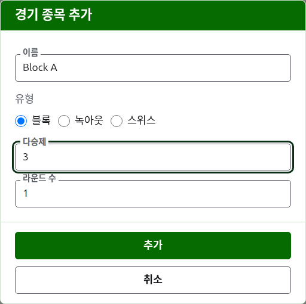
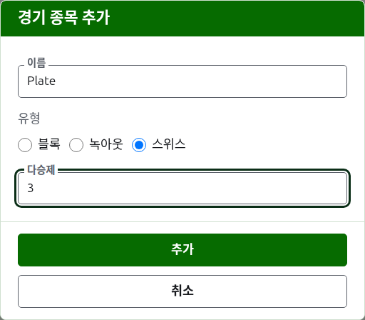
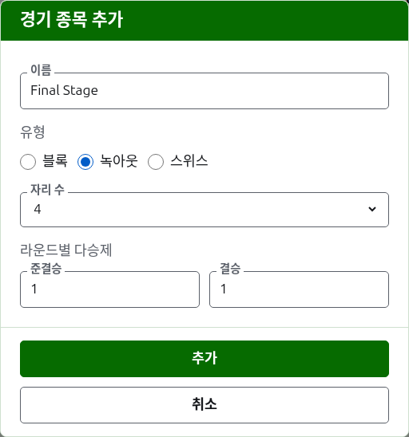

# 부문

대회 페이지의 **부문** 탭은 대회의 부문을 추가하고, 순서를 정하고, 치워 두는 곳이에요. 부문은 블록, 녹아웃, 스위스 중 하나예요. 부문마다 페이지가 하나씩 있어서, 거기서 선수를 넣고 점수를 입력해요.

## 부문 추가하기

목록 위의 **부문 추가**를 눌러요. 페이지 위에 대화 상자가 열리고, 부문의 이름, 종류, 그리고 그 종류의 형태를 물어요.

**이름**은 선수들이 자기 게임을 찾으려고 대회 페이지에서 보는 것이에요. 1자 이상 254자 이하이고, 블록은 글자 하나로 부르는 일이 많기 때문에 글자 하나만으로도 돼요. 한 대회의 두 부문은 같은 이름을 가질 수 없어요.

**종류**은 블록, 녹아웃, 스위스 중 하나예요. 대부분의 부문이 블록이기 때문에, 대화 상자는 블록으로 시작해요.

### 블록이나 스위스

블록과 스위스는 각 매치가 몇 판 **다승제(판 수)**인지만 물어요. 처음에는 1이에요. 3판 다승제는 두 게임을 이긴 쪽이 매치를 이겨요. 짝수여도 괜찮아요. 블록이나 스위스에서는 이긴 게임 수로 순위를 매기기 때문에, 두 게임을 하나씩 나눠 가진 매치도 다른 결과와 똑같은 결과예요.

### 녹아웃

녹아웃은 대진표의 **자리 수**가 몇인지, 그리고 각 라운드가 몇 판 다승제인지 물어요. 자리 수는 2, 4, 8, 16, 32, 64, 128 중에서 골라요. 다른 수로는 라운드마다 절반씩 줄여 결승에 이를 수 없기 때문이에요. 대화 상자는 8로 시작해요. 선수를 넣고 남은 자리는 부전승으로 채우고, 부전승은 선수를 넣는 곳에서 추가해요.

대진표의 라운드 수는 자리 수를 절반씩 줄여 하나가 될 때까지의 횟수예요. 그래서 8자리 대진표에는 라운드가 셋 있어요. 대화 상자는 각 라운드가 몇 판 다승제인지를 **라운드별 판 수** 아래에 치르는 순서대로 함께 물어요. 마지막 세 라운드는 대진표의 라운드를 부르는 대로 **8강**, **준결승**, **결승**이라 하고, 그 앞의 라운드는 1라운드부터 번호로 불러요. 자리 수를 늘리면 대진표의 앞쪽에 라운드가 더해지고, 줄이면 앞쪽에서 빼기 때문에, 결승에 입력한 값은 그대로 결승의 것이에요. 녹아웃의 매치에는 승자가 있어야 하므로, 각 라운드는 홀수 판 다승제예요.

### 치르는 방식과 집계 방식

모든 종류가 형태 아래에서 같은 세 가지를 물어요.

**핸디캡 적용.** 핸디캡으로 치르는 부문이라면 체크해요.

**무승부 허용.** 어느 선수도 이기지 않은 채 게임이 끝날 수 있다면 체크해요. 대부분의 부문은 허용하지 않아요. 체크했을 때는 점수가 같고 표시가 없으면 무승부로 저장돼요. 체크하지 않았을 때는 점수가 같은 게임에 "6w"처럼 승자의 점수 뒤에 표시를 붙여 누가 이겼는지 말해야 해요. 녹아웃의 매치에는 늘 승자가 있어야 하므로, 무승부 게임이 매치의 승자를 정하지는 않아요.

**세계 랭킹에 반영.** 반영될 수 있을 때만 물어요. 핸디캡을 적용하지 않고 무승부도 허용하지 않는 어소시에이션 크로케 또는 골프 크로케 부문이에요. 처음에는 체크되어 있으니, 반영하지 않을 부문이라면 체크를 지워요.

### 여러 개를 한 번에 추가하기

**추가**를 눌러요. 부문이 추가되고, 대화 상자가 그렇게 알려 주고, 다음 것을 위해 이름이 비워지며 종류과 형태는 그대로 남아요. 함께 추가하는 부문은 대개 서로 비슷하기 때문에, "Block A" 다음의 "Block B"는 이름만 다를 뿐이에요. 모두 넣었으면 **취소**를 눌러 대화 상자를 닫아요.

## 부문 바꾸기

**수정**을 누르면 같은 대화 상자가 그 부문으로 열리고, 제목은 부문 수정이며, 이름, 형태, 그리고 치르는 방식과 집계 방식은 지금 그대로예요. 종류은 묻지 않아요. 블록을 바꿔서 녹아웃으로 만들 수는 없으니까요. 종류이 잘못된 부문은 보관하고 다시 추가해요. **저장**을 눌러 변경 내용을 저장하고 대화 상자를 닫아요.

게임이 있는 녹아웃은 선수들이 대진표에 자리를 잡은 상태여서, 자리 수를 바꾸면 선수들이 옮겨지기 때문에, 게임이 하나라도 입력되면 자리 수 변경은 거부돼요. 라운드별 다승제는 여전히 바꿀 수 있어요.

## 순서

부문은 대회의 순서대로 나열돼요. 이 순서는 공개 페이지와 짙은 녹색 막대에 나타나는 순서예요. **위로**와 **아래로**는 부문을 한 자리씩 옮겨요.

## 부문으로 가기

부문의 이름이나 **보기**를 누르면 그 페이지가 열리고, 거기서 선수를 넣고 점수를 입력해요. 헤더 아래의 짙은 녹색 막대로도 대회의 어느 페이지에서든 그곳에 갈 수 있어요.

## 부문 보관하기

**보관**은 부문을 치워 두어요. 게임이 있든 없든 상관없고, 게임은 함께 보관되어 복원하면 함께 돌아와요. 보관된 부문은 **보관된 부문** 아래에 줄이 그어진 채 나열되고, **복원**만 할 수 있으며, 공개 페이지에는 보이지 않아요. 복원하면 되돌려지기 때문에, 보관할 때 먼저 묻지 않아요.

다음: [부문에 선수 넣기](entering-players-in-a-competition.md).
