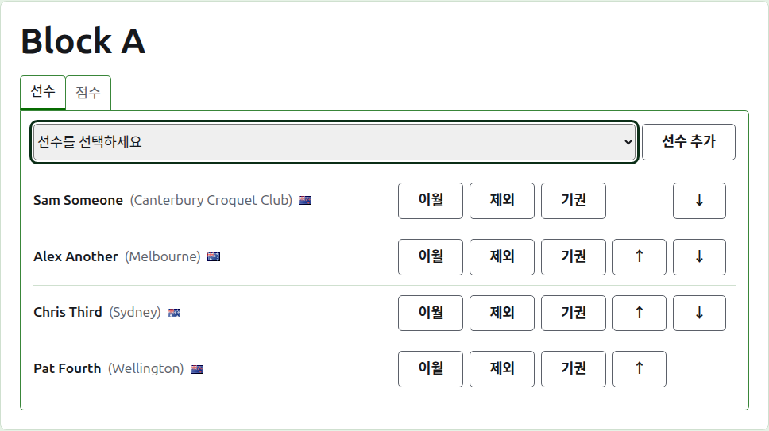
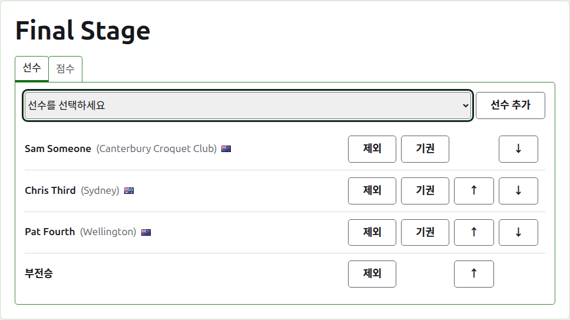
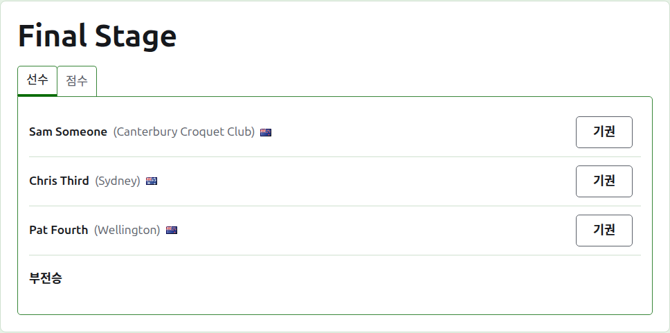
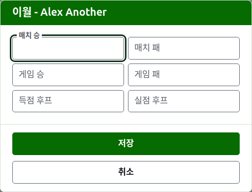
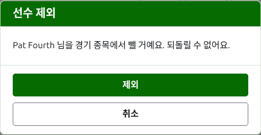
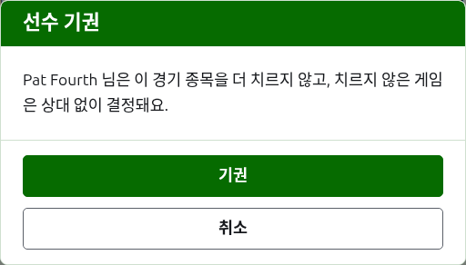
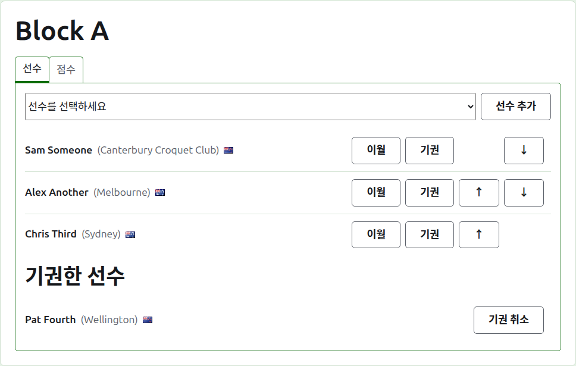

# 부문에 선수 넣기

부문 페이지는 부문 탭에서 이름을 누르거나 짙은 녹색 막대에서 열어요. 부문의 이름이 제목이고, 그 아래에 두 탭이 있어요: **선수**와 **점수**. 무엇을 치르기 전에 선수를 먼저 넣기 때문에, 선수 탭에서 열려요.

부문의 선수는 대회의 선수 중 한 명이기 때문에, 입력하는 대신 골라서 넣어요. 부문 안에서의 자리와 이월해 오는 것 말고는, 선수에 관한 모든 것은 대회의 선수 탭에서 바꿔요.

## 선수 추가하기

목록 위의 드롭다운에는 아직 이 부문에 들어 있지 않은 대회의 모든 선수가 대회의 순서대로 있어요. 한 명을 고르고 **선수 추가**를 눌러요. 선수는 이미 들어 있는 선수들 사이에 대회의 순서대로 들어가고, 드롭다운에서는 더 이상 제안되지 않으며, 커서는 드롭다운으로 돌아가서 다음 선수를 키보드로 고를 수 있어요. 대회의 모든 선수가 부문에 들어 있으면 드롭다운은 보이지 않고 탭이 그렇게 알려 줘요.

대회의 보관된 선수는 제안되지 않아요.

## 녹아웃의 부전승

녹아웃은 대진표의 모든 자리가 채워진 뒤에야 치르고, 선수를 넣고 남은 자리는 부전승으로 채워요. 그래서 녹아웃에서는 드롭다운이 선수들보다 앞에 **부전승**을 먼저 제안하고, 부전승을 몇 개 추가하더라도 계속 제안해요. 대진표에 여러 개가 필요할 수 있으니까요.

부전승은 선수처럼 대진표에 자리를 잡아요. 위아래로 옮기고 제거할 수 있지만, 아무것도 치르지 않기 때문에 기권할 수는 없어요. 모든 자리가 채워진 녹아웃에 선수를 넣으면 거부되고, 탭이 드롭다운 아래에서 그렇게 알려 줘요.

녹아웃의 선수 순서가 곧 대진표예요. 첫 두 자리가 첫 매치에서 만나고, 다음 두 자리가 다음 매치에서 만나고, 그렇게 이어져요. 점수를 하나라도 입력하기 전에 대진표를 치를 순서대로 선수를 놓아 주세요. 녹아웃에 쓰이고 있는 게임이 하나 생기면 선수가 고정되어, 누구도 추가하거나 제거하거나 옮길 수 없어요. 기권은 여전히 할 수 있어요.

## 순서

선수는 부문의 순서대로 나열돼요. 이 순서는 녹아웃의 대진이 짜이는 순서이고, 블록의 공개 페이지에 나열되는 순서예요. **위로**와 **아래로**는 선수를 한 자리씩 옮겨요.

## 이월

**이월**은 여기서 점수를 매기지 않은 경기에서 선수가 부문에 가져오는 것을 말해요. 앞 단계의 결과이거나, 여기서 점수를 매기기 전에 치른 게임이에요. 이월이 반영될 순위가 있는 블록과 스위스에서 제공되고, 녹아웃에서는 제공되지 않아요.

대화 상자는 여섯 가지 수를 물어요. 매치 승과 패, 게임 승과 패, 득점 후프와 실점 후프예요. 어느 것도 꼭 쓸 필요는 없어요. 비워 둔 수는 아무것도 이월하지 않는데, 이것은 0을 이월하는 것과 달라서, 나중에 바꾸는 사람이 비워 둔 그대로 볼 수 있어요. **저장**을 눌러 여섯 가지를 모두 저장해요.

## 선수 제거하기

**제거**는 잘못 넣은 선수를 빼요. 그 선수는 여전히 대회의 선수이고 드롭다운에 다시 제안되지만, 부문 안에서의 자리에 관한 것은 아무것도 남지 않기 때문에, 제거는 먼저 물어요.

부문에서 쓰이고 있는 게임이 하나라도 있는 선수는 제거할 수 없어요. 그러면 그 게임들이 이제는 없는 사람과 치른 것이 되기 때문에, 제거가 제공되지 않아요. 게임이 모두 보관된 선수는 제거할 수 있고, 보관된 점수도 함께 빠져요.

## 선수 기권시키기

**기권**은 부문을 더 치르지 않을 선수를 위한 것이에요. 그 선수는 치른 게임과 함께 부문에 남고, 아직 치르는 선수들 뒤에 **기권한 선수** 아래에 나열돼요. 녹아웃에서는 아직 결정되지 않은 매치의 상대가 다음 라운드로 올라가요.

기권은 부문의 결과를 바꾸기 때문에 먼저 물어요. 그 선수가 치르지 않은 게임은 그 선수 없이 결정돼요.

기권한 선수에게는 **기권 취소**만 제공돼요. 이것은 묻지 않고 선수를 남아 있던 선수들 뒤에, 치르는 선수들 사이로 되돌려요.

다음: [점수](scores.md).
