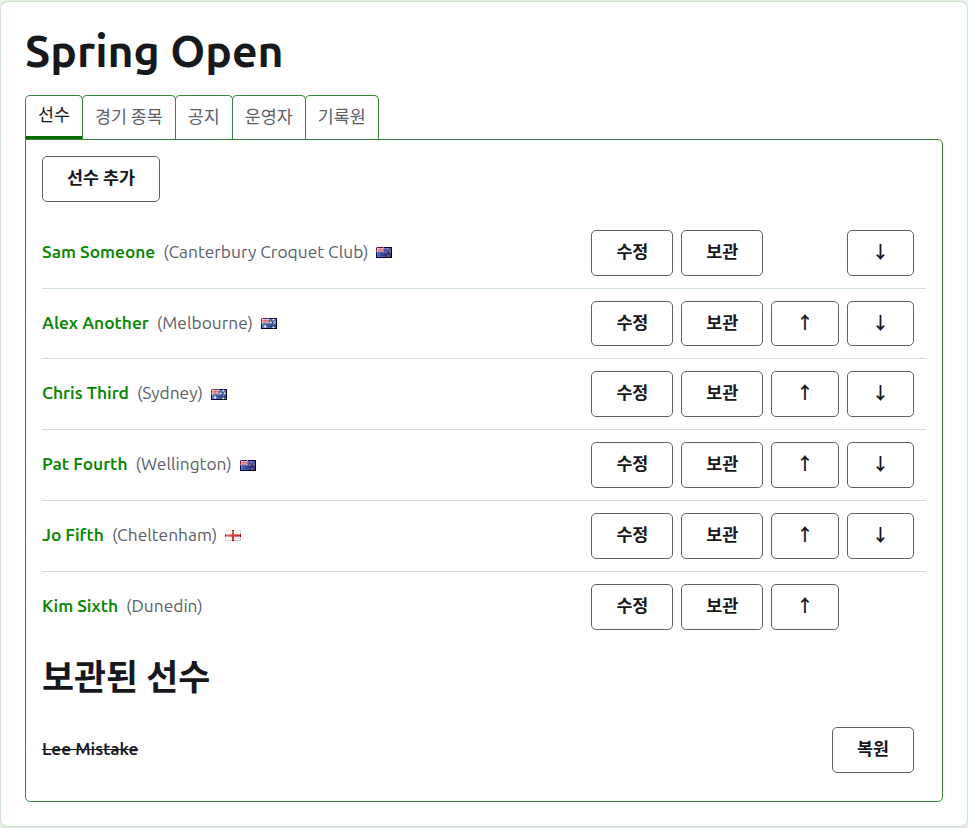
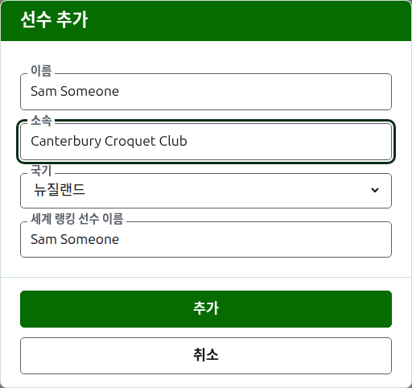
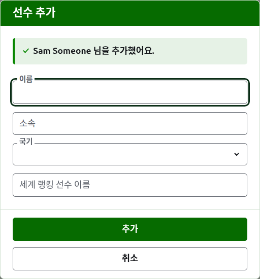
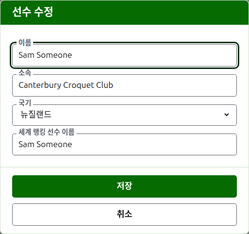
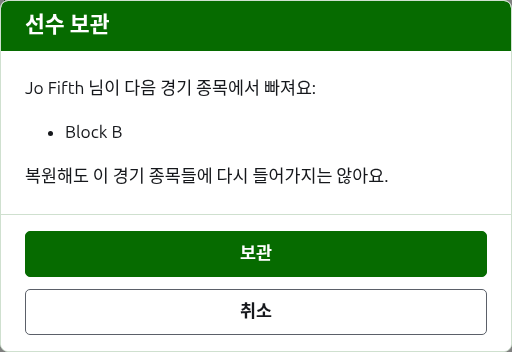

# 선수

대회 페이지의 **선수** 탭은 대회의 선수를 등록하고, 고치고, 순서를 정하고, 치워 두는 곳이에요. 선수 등록이 대회에서 가장 먼저 하는 일이기 때문에, 페이지는 이 탭에서 열려요.

선수는 여기서 대회에 한 번만 등록해요. 각 선수가 어느 부문에 나가는지는 그 뒤에, 각 부문의 페이지에서 여기 등록된 선수 중에서 골라요. [부문에 선수 넣기](entering-players-in-a-competition.md)를 보세요.



## 선수 추가하기 {#add-a-player}

목록 위의 **선수 추가**를 눌러요. 페이지 위에 대화 상자가 열려요.



**이름**은 꼭 써야 해요. 모든 페이지에 보일 선수의 이름으로, 3자 이상 254자 이하예요. 한 대회의 두 선수는 대소문자가 달라도 같은 이름을 가질 수 없어요. 정말로 이름이 같은 두 선수가 있다면, "Andrew Hobbs (2)"처럼 이름 자체에서 구별해 주세요.

**소속**은 선수가 어디를 대표해 뛰는지로, 읽는 사람이 말하는 대로 써요. "Canterbury Croquet Club"처럼 클럽, 지역, 나라예요. 이름 뒤에 괄호 안에 보여요. 비워 둘 수 있어요.

**국기**는 선수 이름 옆에 보이는 국기예요. 없음으로 둘 수 있고, 대부분의 선수가 그래요. 한 나라의 클럽을 위해 뛰면서 다른 나라의 국기를 달 수도 있기 때문에, 선수의 소속과 국기는 따로 두어요.

**세계 랭킹 선수 이름**은 세계 랭킹이 선수를 알고 있는 이름이에요. 선수 목록을 가지고 있는 두 종목인 어소시에이션 크로케와 골프 크로케 대회에서만 물어요. 아메리칸 6 위켓의 선수는 랭킹에 자기 이름으로 올라 있으므로 거기서는 묻지 않고, 모든 선수의 세계 랭킹 이름은 언제나 선수의 이름이에요. 대부분의 선수는 랭킹에 자기 이름으로 올라 있기 때문에, 선수를 추가하는 동안에는 이름을 입력하는 대로 따라 채워지고, 여기에 직접 입력하기 시작하면 따라오기를 멈춰요. 비워 두면 선수의 이름으로 저장돼요.

이름을 입력하면 세계 랭킹이 아는 선수 중 그렇게 시작하는 이름들을 제안하기 때문에, 다 입력하지 않고 랭킹에 적힌 철자 그대로 가져올 수 있어요. 세계 랭킹 이름 옆의 체크 표시는 랭킹이 그 이름을 안다는 뜻이고, 물음표는 모른다는 뜻이에요. 철자가 틀렸거나, 랭킹에 새로 오른 선수일 수 있어요. 참고 사항일 뿐이에요. 랭킹이 모르는 이름도 아는 이름과 똑같이 저장돼요.

**추가**를 눌러요. 선수가 추가되고, 대화 상자가 그렇게 알려 주고, 다음 선수를 위해 필드가 비워지며 커서는 이름으로 돌아가요. 이렇게 명단을 전부 추가한 뒤 **취소**를 눌러 대화 상자를 닫아요. 취소는 아직 추가하지 않은 것은 저장하지 않아요.



선수의 이름을 "Bye"로 할 수는 없어요. 녹아웃의 부전승은 녹아웃 자체에서, 선수를 넣는 자리에서 추가하기 때문에, 첫 단어가 영어 단어 "bye"인 이름은 거부되고, 대화 상자가 그 이유를 설명해요.

## 선수 여러 명 추가하기 {#adding-multiple-players}

명단을 한꺼번에 추가하려면 **선수 추가** 옆의 **선수 여러 명 추가**를 눌러요. 페이지 위에 대화 상자가 열리고, 여러 줄의 글을 받는 상자가 하나 있어요. 스프레드시트에서 명단을 복사해 상자에 붙여 넣을 수 있어요.

**첫 줄은 필드의 이름**이에요. 쉼표나 탭으로 나누고, **Name**과 함께 **Representing**, **Flag**, **Handicap**, **WorldRankingPlayerName** 중 원하는 것을 어떤 순서로든 쓸 수 있어요. 이 이름들은 사이트가 어떤 언어로 보이든 영어로 입력해요. **Name**은 꼭 있어야 해요. **그다음 줄마다 선수 한 명**이에요. 필드마다 같은 순서로 값을 쓰고, 같은 방식으로 나눠요. 어떤 필드가 비는 선수는 그 자리를 비워 두되 쉼표나 탭은 남겨 두어요. 예를 들어 쉼표로 나누면 이래요.

```
Name,Representing,Flag
Sam Someone,Canterbury Croquet Club,New Zealand
Alex Another,,England
```

- **이름, 소속, 세계 랭킹 선수 이름**은 선수를 한 명씩 추가할 때와 같은 규칙을 따라요([선수 추가하기](players.md#add-a-player) 참고). 이름은 3자 이상 254자 이하이고, 대소문자가 달라도 이미 대회에 있는 이름일 수 없고, "Bye"일 수 없어요.
- **국기**는 선수 추가 대화 상자의 목록에 나오는 대로, 읽는 사람의 언어로 쓴 나라나 지역의 이름이에요. 예를 들면 뉴질랜드예요.
- **핸디캡**은 부호와 두 자리까지의 정수, 소수점 아래 한 자리까지의 수예요. 예를 들면 4, +4, -1.5예요.
- **세계 랭킹 선수 이름**을 적지 않은 선수는 한 명씩 추가할 때처럼 자기 이름으로 알려져요.
- **쉼표나 탭.** 스프레드시트에서 복사한 칸은 탭으로 나뉘고, 손으로 입력한 명단은 보통 쉼표로 나뉘어요. 어느 쪽이든 돼요. 첫 줄에 탭이 있으면 명단 전체를 탭으로, 없으면 쉼표로 읽어요.
- 값 안에 구분 문자가 있으면 스프레드시트가 하듯 큰따옴표로 감싸요. 쉼표로 나눈 명단에서는 "Smith, John"처럼요. 값 안의 큰따옴표는 두 번 써요.
- 모든 값은 양 끝의 공백이 지워지고, 아무것도 없는 줄은 무시돼요.
- 한 명단에는 선수를 최대 500명까지 넣을 수 있어요. 나머지는 다른 명단으로 추가해 주세요.

**추가**를 눌러요. 명단 전체를 먼저 검사하고 나서 저장하기 때문에, 잘못된 곳이 하나라도 있으면 아무도 추가되지 않아요. 무엇이 잘못됐는지는 상자 아래에, 해당하는 줄에 맞춰 알려 주고, 첫 줄을 1줄로 세요. 첫 번째 오류만이 아니라 모든 오류를 보여 주고, 입력한 내용은 그대로 남아서 바로 고칠 수 있어요. 명단이 저장되면 대화 상자가 닫히고, 새 선수들이 쓴 순서대로 선수 탭에 나타나요. 다음 선수를 위해 열려 있는 **선수 추가**와 달리 여기에는 다음이 없어요. 명단이 곧 다음이었으니까요.

대화 상자 제목 표시줄의 **?**를 누르면 여기로 와요.

## 선수 고치기 {#correcting-a-player}

선수의 이름이나 **수정**을 누르면 같은 대화 상자가 그 선수로 열리고, 제목은 선수 수정이에요. 틀린 것을 고치고 **저장**을 누르면 변경 내용이 저장되고 대화 상자가 닫혀요. 이름을 고친 선수는 가지고 있던 세계 랭킹 이름을 그대로 유지해요. 랭킹은 여전히 그 이름으로 선수를 알고 있으니까요. 아메리칸 6 위켓에서는 선수의 세계 랭킹 이름이 언제나 선수의 이름이므로, 이름을 고치면 이것도 함께 고쳐져요.



여기서 고친 선수는 모든 곳에서 고쳐져요. 들어 있는 모든 부문에서, 그리고 모든 공개 페이지에서요.

## 선수 순서 정하기

선수는 대회의 순서대로 나열돼요. 이 순서는 부문에 선수를 넣을 때 제안되는 순서이고, 녹아웃의 대진이 짜이는 순서이기도 해요. 각 줄 끝의 화살표인 **위로**와 **아래로**는 선수를 한 자리씩 옮겨요. 첫 선수에게는 위로가, 마지막 선수에게는 아래로가 없어요.

## 선수 보관하기 {#archiving-a-player}

**보관**은 선수를 치워 두어요. 잘못 등록했거나, 대회 전체에서 기권한 선수예요. 보관된 선수는 쓰이고 있는 선수들 뒤에 **보관된 선수** 아래에 줄이 그어진 채 나열되고, **복원**만 할 수 있어요. 보관된 선수는 어느 부문에도 들어 있지 않고, 어느 공개 페이지에도 보이지 않아요.

게임을 하나라도 치른 선수는 보관할 수 없어요. 그러면 그 게임들이 이제는 없는 사람과 치른 것이 되기 때문에, 그런 선수에게는 보관이 제공되지 않아요. 게임이 모두 보관된 선수는 보관할 수 있어요.

어느 부문에도 들어 있지 않은 선수를 보관할 때는 먼저 묻지 않아요. 복원하면 모든 것이 돌아오니까요. 어느 부문에든 들어 있는 선수를 보관할 때는 먼저 물어요. 보관하면 들어 있던 모든 부문에서 빠지고, 복원해도 다시 들어가지 않기 때문이에요.



다음: [부문](competitions.md).
