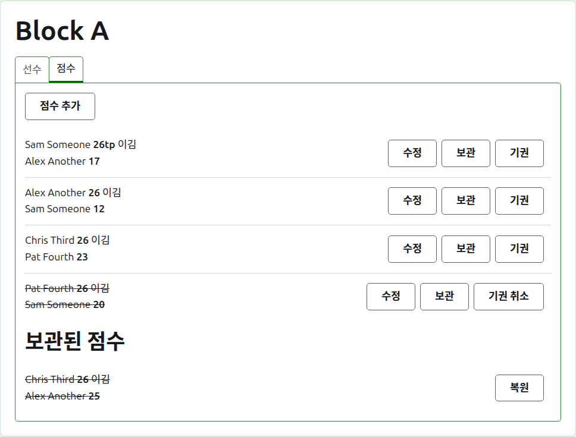
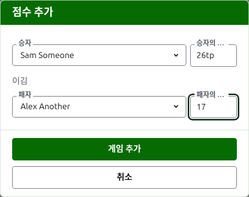
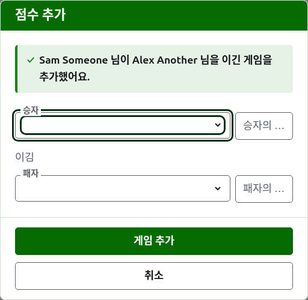
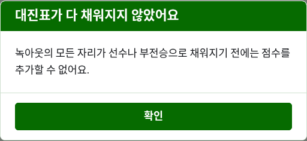
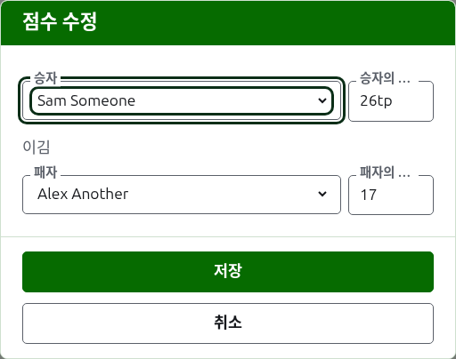

# 점수

부문 페이지의 **점수** 탭은 게임을 입력하고, 정정하고, 치워 두는 곳이에요. 기록원은 이 탭만 볼 수 있고, 이 탭에서는 운영자가 할 수 있는 모든 것을 할 수 있어요.

## 점수 입력하기

목록 위의 **점수 추가**를 눌러요. 대화 상자는 결과를 소리 내어 말하는 순서대로 읽혀요. 승자와 그 점수, 그다음 "이김", 그다음 패자와 그 점수예요.

승자와 패자는 각각 부문에서 치르고 있는 선수 중에서 부문의 순서대로 골라요. 처음에는 누구도 골라져 있지 않아서, 고르지 않은 선수에게 게임이 기록되는 일은 없어요. 녹아웃에서는 승자를 고르면 대진에서 만나는 상대가 패자로 골라지며, 그것을 보고 다른 사람으로 바꿀 수 있어요.

점수는 기록원이 받아 적은 대로 입력해요. 득점 수와 그 뒤에 따라오는 것으로, 뒤에 오는 것은 입력한 그대로 저장되고 보여요. 예를 들어 "26tp"는 26후프와 트리플 필이에요. 수는 점수가 시작하는 숫자들이에요. 숫자로 시작하지 않는 점수는 거부돼요.

시간 종료로 멈춰 다른 방법으로 결정된 때처럼 같은 점수로 이긴 게임은, 승자의 점수 뒤에 표시를 붙여 누가 이겼는지 말해요. "6w"가 "6"을 이김, 같은 식이에요. Croquet Scores에서 쓰는 표시는 "w", "won", "winner"예요. Gateball Scores에서는 "cb"와 "so"도 받아요. 대회가 무승부를 허용하지 않는 한, 승자의 점수는 패자보다 높거나 표시가 있어야 해요. 허용하는 대회에서는 같은 점수에 표시가 없으면 무승부로 저장돼요.

**게임 추가**를 눌러요. 게임이 추가되고, 대화 상자가 어느 게임인지 알려 주고, 다음을 위해 필드가 비워져요. 점수는 라운드가 끝날 때 보드에서 읽어 한 묶음으로 들어오니까요. 모두 넣었으면 **취소**를 눌러요.

거부된 것은 해당 필드 아래에서 알려 줘요. 승자나 패자를 고르지 않았거나, 점수를 입력하지 않았거나 숫자로 시작하지 않거나, 같은 선수를 양쪽에 골랐거나, 패자의 점수에 승리 표시를 했거나, 승자의 점수가 패자보다 낮은 경우예요. 녹아웃에서 대진상 만나지 않는 두 선수는 필드 위에서 거부돼요.

## 녹아웃은 대진표를 먼저 채워야 해요

녹아웃은 대진표의 모든 자리에 선수나 부전승이 있어야 치러요. 그때까지는 점수 추가가 대화 상자를 여는 대신 왜 점수를 추가할 수 없는지 설명해요.

## 점수 목록

쓰이고 있는 점수는 입력한 순서대로, 오래된 것부터 나열돼요. 그래서 목록이 부문이 치러진 순서대로 읽혀요. 각 점수는 승자와 그 점수, 그다음 패자와 그 점수를 말하고, **수정**과 **보관**을 제공해요.

## 점수 정정하기

**수정**을 누르면 같은 대화 상자가 그 점수로 열리고, 제목은 점수 수정이며, 선수들이 골라져 있고 점수는 입력한 그대로예요. **저장**을 눌러 정정 내용을 저장하고 대화 상자를 닫아요.

정정해도 결과는 그대로예요. 이긴 게임은 이긴 채로, 비긴 게임은 비긴 채로 남아요. 결과가 틀린 게임은 보관하고 다시 입력해요.

보관할 수 있는 점수는 점수뿐 아니라 선수도 바꿀 수 있어요. 녹아웃에서 승자가 이미 다음 라운드를 치른 점수는 선수가 그대로예요. 누가 이겼는지를 바꾸면 다음 게임을 거기까지 오지 않은 사람이 치른 것이 되니까요. 점수만 정정할 수 있어요.

## 점수 보관하기

**보관**은 점수를 치워 두어 아무것에도 반영되지 않게 해요. **보관된 점수** 아래에 줄이 그어진 채 나열되고, **복원**만 할 수 있어요. 서로가 서로를 되돌리기 때문에 둘 다 먼저 묻지 않아요.

녹아웃에서는 매치의 승자가 다음 라운드로 올라가기 때문에, 승자가 다음 라운드를 치른 매치의 점수에는 보관이 제공되지 않아요. 다음 라운드의 게임을 먼저 보관하고 나면 그 앞의 게임들을 보관할 수 있어요. 라운드가 3판이나 5판 다승제인 곳에서는 매치의 모든 게임이 같은 식으로 묶여요. 블록과 스위스에는 서로 의존하는 라운드가 없어서, 모든 점수를 보관할 수 있어요.

## 점수 기권 처리하기

부문을 떠나는 선수는 보통 선수 탭에서 기권 처리하고, 그것으로 충분해요. 선수는 더 치르지 않고, 치른 게임은 남아 있지만 승패와 후프에는 더 이상 반영되지 않아요. 점수의 기권 처리는 치른 게임을 반영하지 않기로 하는 더 드문 경우를 위한 것이에요. 예를 들어 호주의 President's Eights에서는 선수가 기권하면 1라운드 결과는 남고 2라운드 게임만 집계에서 빼요. 그 게임들을 기권 처리하면 돼요.

블록이나 스위스에서 치렀지만 반영하지 않을 점수는 보관하는 대신 기권 처리해요. **기권**은 그 점수를 쓰이고 있는 점수들 사이의 제자리에 두되, 줄을 긋고 공개 페이지에서 아무것에도 반영하지 않아요. **기권 취소**는 다시 반영되게 해요. 둘 다 먼저 묻지 않아요. 녹아웃에서는 점수가 순위보다 더 많은 것을 결정하기 때문에, 녹아웃의 점수에는 기권이 제공되지 않아요.

다음: [공지](notes.md).
