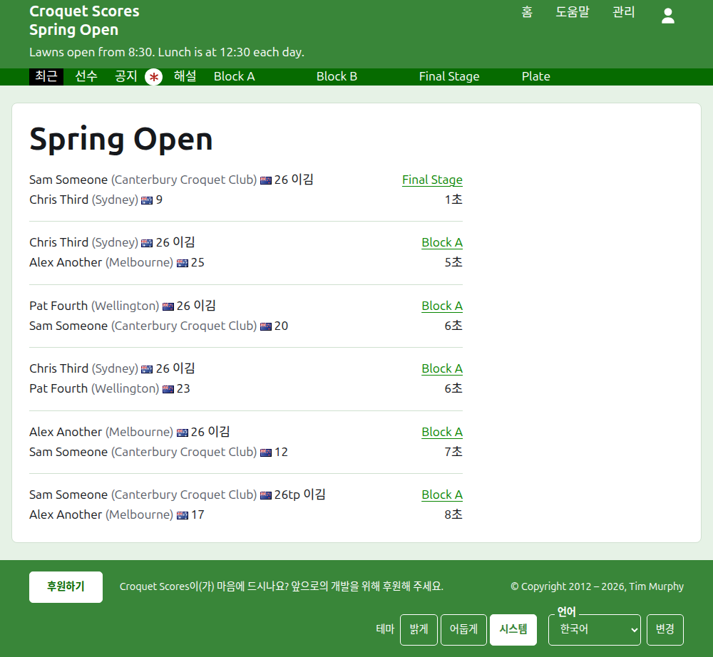
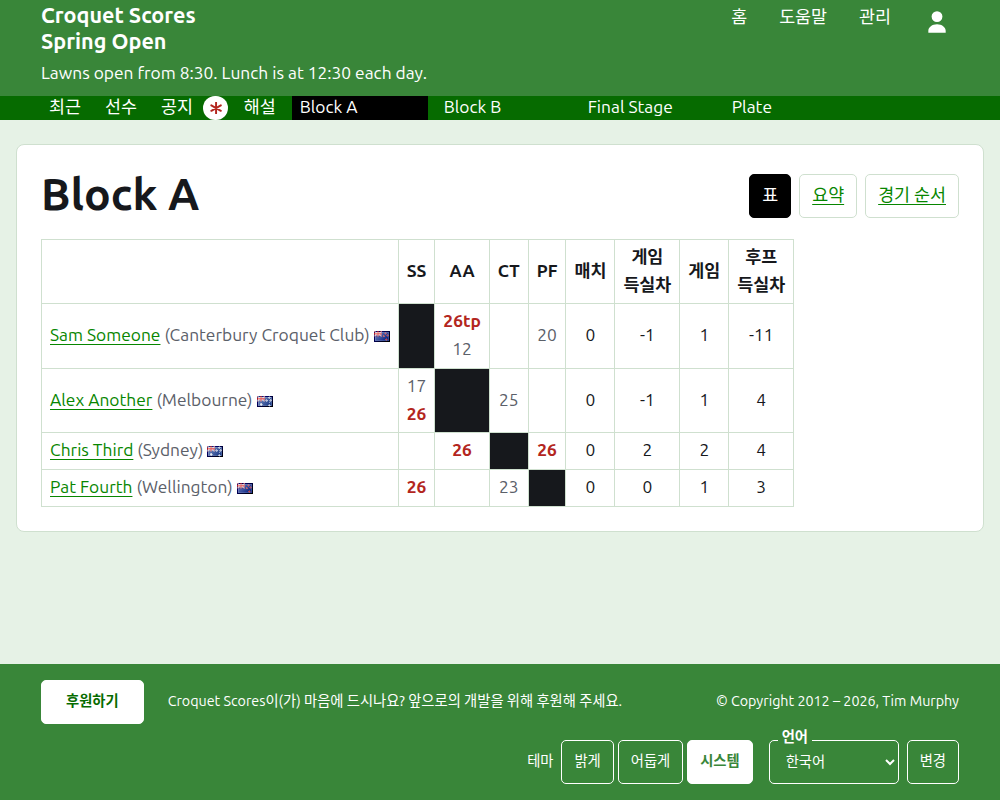
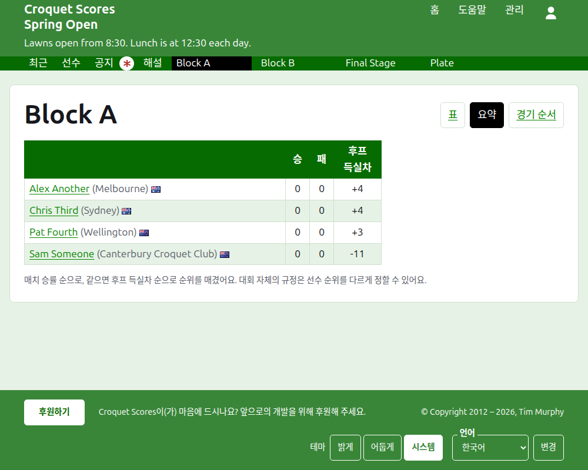
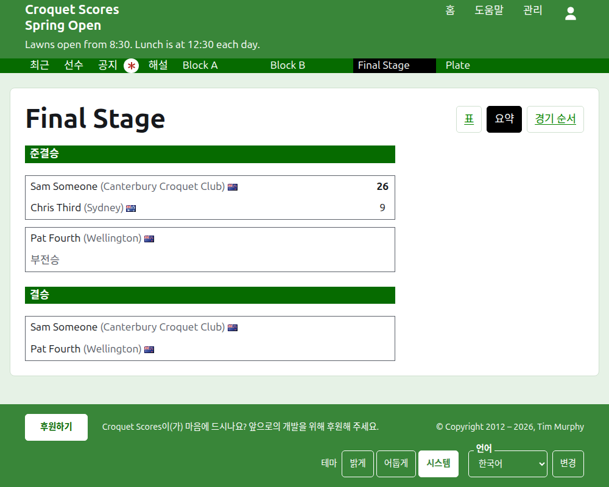
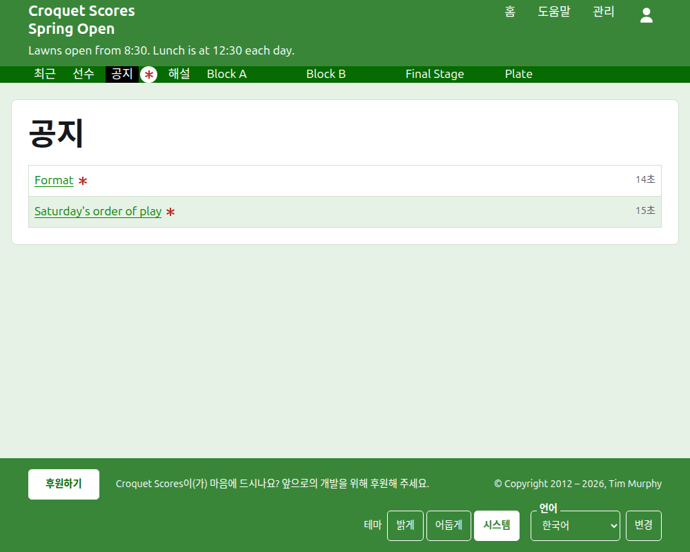

# 공개 페이지에 보이는 것

따로 게시하는 것은 없어요. 공개 페이지는 관리 화면에 담긴 내용을 그대로 보여 주기 때문에, 입력한 점수는 바로 올라가요. 계정도 스크립트도 필요 없고, 휴대폰에 맞게 짜여 있어요.

## 대회 페이지

대회 페이지는 `/2026/ac/spring-open`처럼 연도, 종목, 이름의 주소에 있어요. 대회 이름이 제목이고, 그 아래에 부제가 있어요. 쓰이고 있는 모든 게임을 가장 최근에 추가된 것부터 나열하기 때문에, 다시 돌아온 사람은 그동안 무슨 일이 있었는지 볼 수 있어요. 각 게임은 승자, 소속, 국기, 점수를 말하고, 그다음 패자와 그 점수를 말하며, 치른 부문과 추가된 지 얼마나 되었는지도 함께 보여 줘요.

짙은 녹색 막대는 대회의 섹션을 제공해요. 이 페이지인 **최근**, **선수**, **공지**, **해설**, 그다음 부문 탭의 순서대로 쓰이고 있는 각 부문이에요. 읽지 않은 공지가 있는 동안에는 공지에 빨간 별표가 붙어요.

## 블록

블록 페이지는 결과를 표로 보여 줘요. 블록의 순서대로 선수마다 행과 열이 하나씩 있고, 두 선수 사이의 게임은 행과 열이 만나는 자리에 있으며, 각각 행의 선수를 기준으로 승, 패, 무로 표시돼요. 선수들의 열 뒤에는 각 선수의 합계가 와요. 각 매치가 한 게임이면 승과 후프 득실차이고, 매치가 여러 판 다승제이면 매치, 게임 득실차, 게임, 후프 득실차예요. 마지막 열은 제목이 **#**이고 각 선수의 순위예요. 1위는 1, 가를 수 없는 선수들이 2위를 함께 가지면 =2로 표시돼요. 이긴 매치의 비율이 같은 선수가 있으면 표 아래 한 줄에 블록의 동률 처리 설정에 따라 어떻게 가르는지 알려 줘요(부문 참고).

블록은 이름이 있는 줄에서 세 가지 보기를 제공해요: **대진표**, **요약**, **경기 순서**. 요약은 휴대폰을 위한 것으로, 선수들을 승, 패, 후프 득실차, 순위와 함께 순서대로 보여 줘요. 경기 순서는 모든 게임을 오래된 것부터 나열해요. 보기를 고르면 다른 것을 고를 때까지 모든 부문에서 그 보기가 유지돼요.

기권한 선수의 행은 그렇게 표시돼요. 기권 처리된 점수는 줄이 그어진 채 보이고 아무것에도 반영되지 않아요. 보관된 점수는 보이지 않아요.

## 녹아웃

녹아웃 페이지는 대진표를 라운드별로 그려요. 첫 라운드부터 결승까지 라운드마다 열이 하나씩 있고, 각 매치의 두 쪽이 위아래로 놓이며, 매치의 다승제 판 수만큼 게임 칸이 있어요. 다음 라운드의 매치는 그 승자들이 만나는 두 매치 옆에 놓여요. 휴대폰에서는 대진표가 가로로 스크롤되고, 결승 쪽으로 가거나 돌아오는 화살표가 있어요.

## 스위스

스위스 페이지는 선수들을 표로 순위를 매겨요. 게임 수, 승 수, 승률, 그리고 결과예요. 결과는 각각 상대와 점수 차로 말하는데, 예를 들어 "+4"는 네 점 차로 이긴 게임이에요.

## 선수

선수 페이지는 보관되지 않은 대회의 모든 선수를 이름순으로 소속과 국기와 함께 나열해요.

## 공지

공지 페이지는 대회의 공지를 가장 최근에 쓴 것부터 나열하고, 각 공지는 자기 페이지로 이어지며 쓴 지 얼마나 되었는지 말해 줘요. 읽지 않은 공지는 열어 볼 때까지 빨간 별표로 표시돼요.

## 옮겨지는 주소

이름을 고쳐도 대회의 주소는 그대로예요. 연도나 종목이 바뀌어 주소가 옮겨지면, 옛 주소가 새 주소로 이어지기 때문에 전에 간직해 둔 링크도 여전히 작동해요. 보관된 대회의 페이지는 복원할 때까지 찾을 수 없어요.
