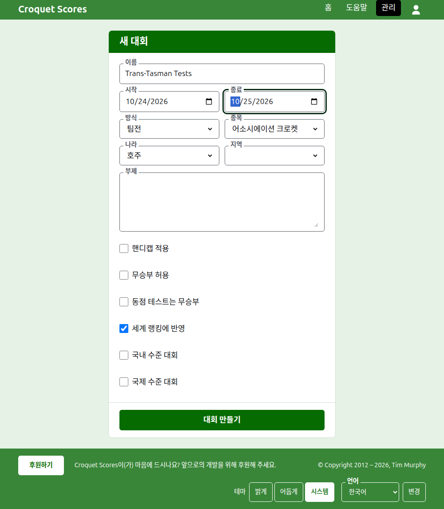
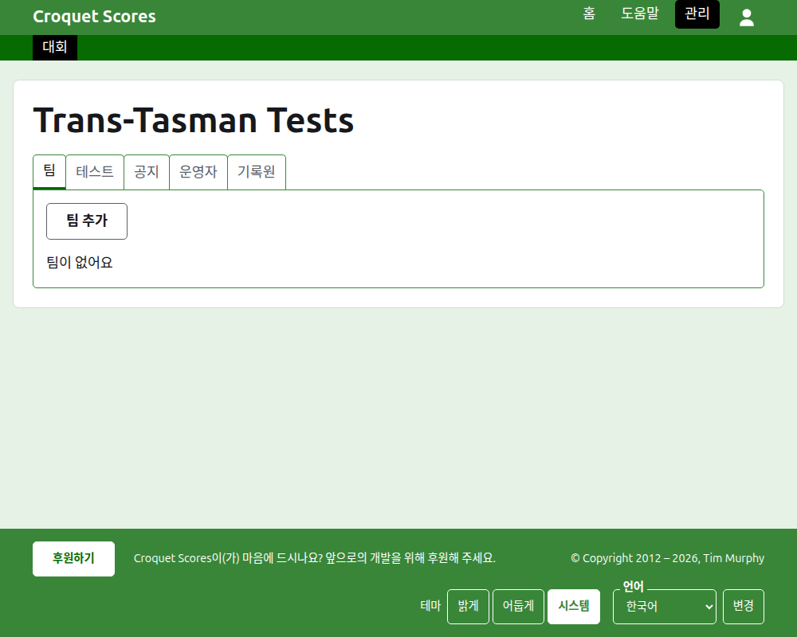

# 대회 만들기

관리 화면의 대회 목록 위에 있는 **새 대회**를 눌러요. 목록이 길어져도 휴대폰 화면 밖으로 밀려나지 않도록, 목록 아래가 아니라 위에 있어요.

양식은 대회가 시작하는 데 필요한 모든 것을 물어요. 여기서 가장 중요한 것은 **방식**이에요. 방식이 대회를 팀으로 치르는 대회로 만들어 주니까요.

## 양식이 묻는 것

**이름.** 읽는 사람이 대회를 찾을 때 보는 것으로, "Trans-Tasman Tests" 같은 이름이에요. 3자 이상 254자 이하예요. 모두 소문자이거나 모두 대문자인 이름은 거부돼요. 보이는 모든 페이지에서 실수처럼 보일 테니까요. 같은 대회가 매년 열리기 때문에, 두 대회가 같은 이름을 가질 수는 있어요.

**시작**과 **종료.** 대회가 열리는 날들이에요. 모든 테스트는 이 기간 안에 치러지므로, 행사 전체를 덮도록 정해 주세요. 대회는 시작하기 전에 끝날 수 없고, 내년 말보다 늦게 시작하거나 끝날 수도 없어요. 대회는 시작하는 해에 속하고, 그 해가 주소에도 들어가요.

**방식.** 팀으로 치르는 방식 중 하나를 골라요:

- **팀전**은 팀 사이의 어떤 행사에나 쓰는 일반적인 방식이에요.
- **Eire Cup**, **Interstate Shield**, **GC World Team Championship**은 특정 행사로, 각각 그 행사가 운영되는 방식대로 운영할 수 있도록 따로 방식으로 두었어요.

일반은 팀으로 치르지 않는 유일한 방식이어서, 여기서 고를 것은 아니에요. Gateball Scores에서는 모든 대회가 게이트볼의 일반 대회이기 때문에 방식을 제공하지 않아요. 팀으로 치르는 대회는 Croquet Scores에서 만들어요.

**종목.** 웹사이트가 제공하는 종목이 그 순서대로 있어요. 어소시에이션 크로켓, 골프 크로켓, 아메리칸 6후프 크로켓, 리코셰예요.

**나라**와 **지역.** 대회가 열리는 곳이에요. 지역은 고른 나라가 호주의 주처럼 지역으로 나뉘어 있을 때만 묻고, 그때도 꼭 고를 필요는 없어요.

**부제.** 따로 필드가 없지만 읽는 사람에게 알리고 싶은 것은 무엇이든 써요. 주차할 곳, 점심 시간, 연락할 사람 같은 것이에요. 모든 공개 페이지에서 대회 이름 아래에 보여요. 마크다운으로 쓰기 때문에, 단어 양쪽에 별표를 붙이면 굵게 되고, 줄마다 앞에 대시를 붙이면 목록이 돼요. 2000자까지 쓸 수 있고, 비워 둘 수도 있어요.

**핸디캡 적용.** 핸디캡 행사라면 체크해요.

**무승부 허용.** 어느 선수도 이기지 않은 채 게임이 끝날 수 있다면 체크해요. 체크했을 때는 점수가 같고 표시가 없으면 무승부로 저장돼요. 체크하지 않았을 때는 점수가 같은 게임에 "6w"처럼 승자의 점수 뒤에 표시를 붙여 누가 이겼는지 말해야 해요.

**동점 테스트는 무승부.** 팀으로 치르는 방식을 고른 뒤에만 물어요. 테스트는 매치를 더 많이 이긴 팀이 이기고, 매치 수가 같으면 게임 득실차로, 그다음 후프 득실차로 결정돼요. 다만 이것을 체크하면 매치 수가 같은 테스트는 무승부가 되는데, 일부 팀 행사가 그렇게 해요. 팀전에서는 체크되지 않은 채로, GC World Team Championship에서는 체크된 채로 시작해요. 그 대회는 늘 동점 테스트를 무승부로 해 왔으니까요.

**세계 랭킹에 반영.** 반영될 수 있을 때만 물어요. 핸디캡을 적용하지 않고 무승부도 허용하지 않는 어소시에이션 크로켓, 골프 크로켓, 아메리칸 6후프 크로켓 대회예요. 처음에는 체크되어 있어요.

**국내 수준 대회**와 **국제 수준 대회.** 대회는 둘 중 하나일 수도, 둘 다 아닐 수도 있지만, 둘 다일 수는 없어요. 하나를 체크하면 다른 하나의 체크가 지워져요.

## 만들기

**대회 만들기**를 눌러요. 관리 화면의 대회 페이지로 이동하는데, 팀 탭이 열린 상태이고, 내가 그 대회의 첫 운영자가 돼요. 대회는 관리 화면에서 시작하는 해 아래에 나열돼요.

대회의 공개 주소는 `/2026/ac/trans-tasman-tests`처럼 연도, 종목, 이름으로 만들어져요. 나중에 이름을 고쳐도 주소는 그대로여서, 이미 보낸 링크로도 찾을 수 있어요. 시작하는 해나 종목이 바뀔 때만 주소가 옮겨져요.

## 거부되었을 때

거부된 것은 해당 필드 아래에서 알려 주고, 입력한 내용은 그대로 남아요. 모든 필드가 받아들여지기 전까지는 아무것도 저장되지 않아요. 가장 자주 거부되는 것은 모두 소문자로 쓴 이름, 시작보다 앞선 종료, 고르지 않은 나라예요.

다음: [팀](teams.md).
