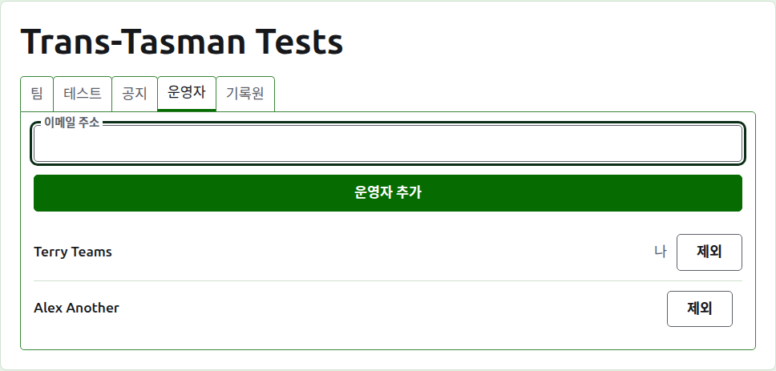
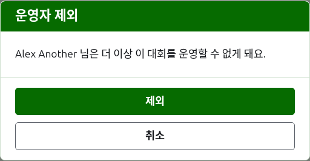
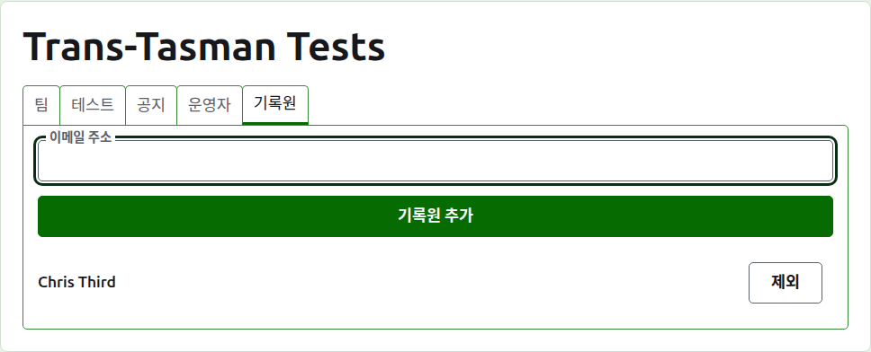
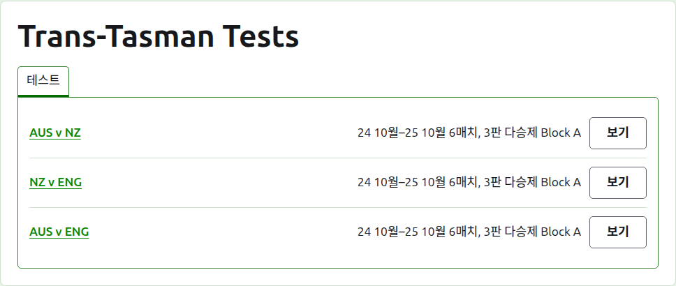

# 운영자와 기록원

대회에는 대회에 할 수 있는 모든 일을 할 수 있는 운영자가 있고, 점수만 입력하고 다른 것은 하지 않는 기록원을 둘 수 있어요. 대회를 만든 사람이 첫 운영자예요.

## 운영자

**운영자** 탭에는 대회를 운영하는 사람들이 운영자가 된 순서대로 나열되고, 내 이름은 나라고 표시돼요. 대회를 함께 운영하거나 넘겨주는 곳이에요.

운영자는 이메일 주소로 만들어요. 목록 위의 필드에 주소를 입력하고 **운영자 추가**를 눌러요. 주소는 가입하고 확인을 마친 계정의 것이어야 해요. 그런 계정이 없는 주소는 필드 아래에서 거부되고, 사이트는 그 이상은 말하지 않아요. 운영자가 된 기록원은 더 이상 기록원이 아니에요.

**제거**는 운영자를 빼요. 제거된 운영자에 관한 것은 아무것도 남지 않기 때문에, 제거는 먼저 물어요. 다시 필요하면 주소로 다시 운영자로 만들어요. 대회에는 항상 운영자가 있어야 하므로, 마지막 운영자에게는 제거가 제공되지 않아요.

자기 자신을 뺄 수도 있어요. 그때는 질문이 그것이 무엇을 뜻하는지 말해 줘요. 대회로 돌아올 길을 스스로 잃게 되고, 이 페이지의 누구도 그것을 되돌려 줄 수 없어요. 다른 운영자가 다시 운영자로 만들어 줄 수 있어요.

## 기록원

**기록원** 탭은 기록원을 위한 운영자 탭으로, 같은 방식으로 작동해요. 목록 위에 이메일 주소와 **기록원 추가**가 있고, 각 사람에게 **제거**가 있어요.

기록원은 관리 화면의 자기 목록에서 대회를 보는데, 운영 대신 **점수**가 있고, 테스트만 제공돼요. 팀, 공지, 운영자, 기록원, 랭킹은 없어요. 팀에 누가 뛰는지는 운영자가 정하기 때문에, 기록원은 팀 페이지를 열 수 없어요. 테스트 페이지에서는 운영자처럼 점수를 입력하고, 정정하고, 보관하고, 복원하고, 순서를 바꿀 수 있어요.

운영자는 기록원이 할 수 있는 모든 것을 이미 할 수 있기 때문에, 운영자를 기록원으로 만들지는 않아요. 대회에 기록원이 꼭 있어야 하는 것은 아니어서, 마지막 기록원까지 모두 제거할 수 있어요.

다음: [랭킹](rankings.md).
