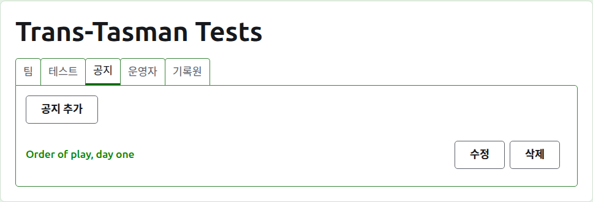
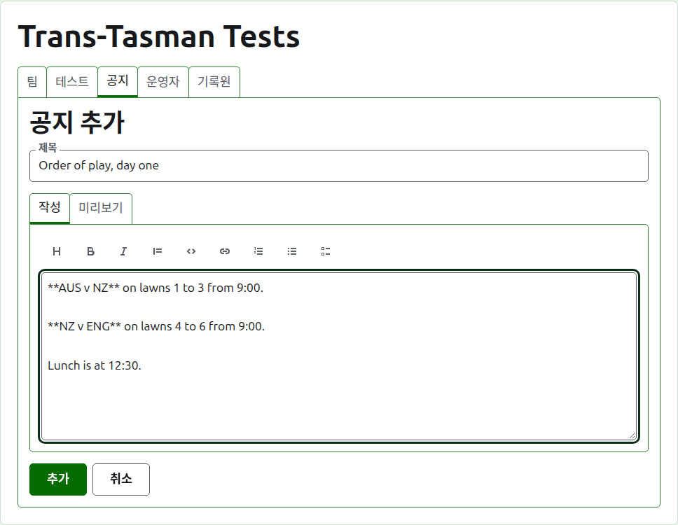
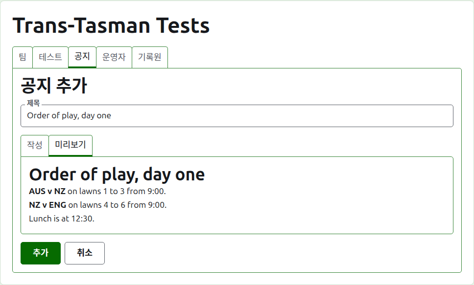
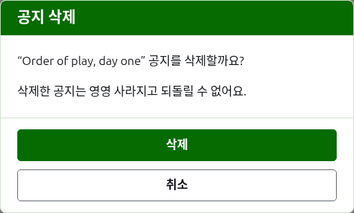

# 공지

대회 페이지의 **공지** 탭은 대회가 진행되는 동안 선수들이 알아야 할 것을 운영자가 쓰는 곳이에요. 경기 순서, 코트 변경, 점심 시간 같은 것이에요. 읽는 사람은 대회의 공개 공지 페이지에서 공지를 보고, 아직 읽지 않은 공지는 거기에 빨간 별표로 표시돼요. 그 별표는 열어 볼 때까지 대회의 모든 페이지에서 공지 섹션에도 표시돼요.

## 공지 쓰기

목록 위의 **공지 추가**를 눌러요. 공지는 길게 쓰는 것이라 자리가 필요하기 때문에, 목록 자리에 패널이 들어와요.

**제목**은 꼭 써야 하고, 공지가 목록에 오르는 이름이에요. 일반 텍스트예요.

**내용**은 마크다운으로 쓰고, 제목이 할 말을 다 했다면 비워 둘 수 있어요. 입력란 위의 도구 모음이 마크다운을 대신 써 줘요: 제목, 굵게, 기울임, 인용, 코드, 링크, 번호 목록, 글머리 기호 목록, 할 일 목록. 각 도구는 선택한 부분에, 또는 선택한 각 줄의 처음에 적용되거나, 글이 들어갈 자리에 커서를 놓아요.

**미리보기**는 읽는 사람이 공지 페이지에서 보게 될 모습을 보여 줘요.

**추가**를 눌러요. 공지가 저장되고, 목록이 그 공지를 맨 위에 두고 돌아오며, 공개 공지 페이지에 바로 올라가요.

## 공지 수정하기

공지의 제목이나 **수정**을 누르면 그 공지로 패널이 열려요. **저장**을 눌러 변경 내용을 저장해요. 읽는 사람이 읽은 뒤에 수정된 공지는 그 사람에게 다시 표시돼요.

## 공지 삭제하기

더 이상 해당되지 않는 공지는 삭제해요. 삭제한 공지는 영영 사라지기 때문에, **삭제**는 먼저 물어요.

다음: [운영자와 기록원](managers-and-scorers.md).
