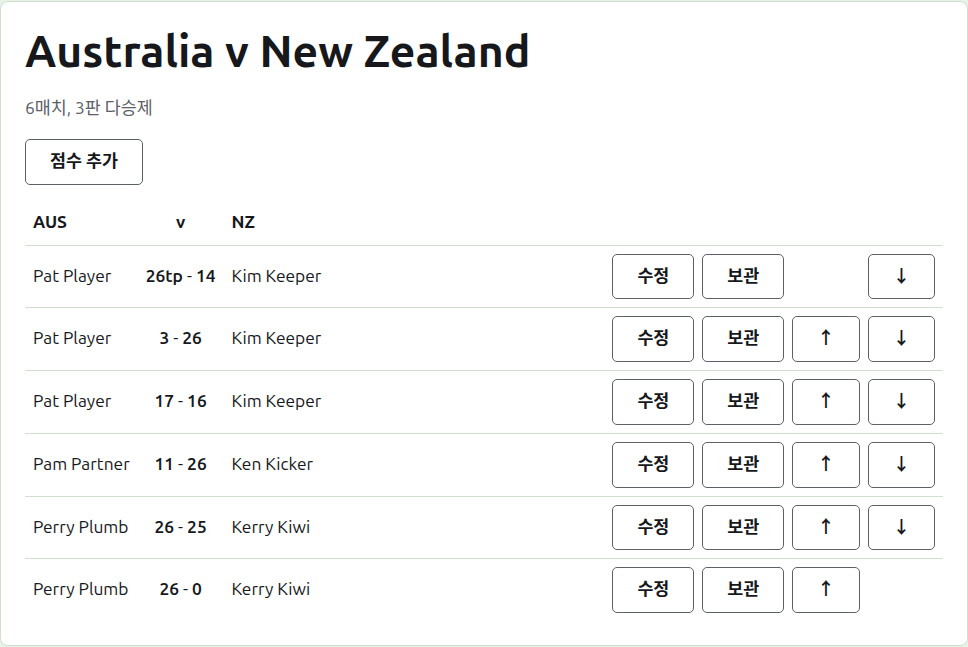
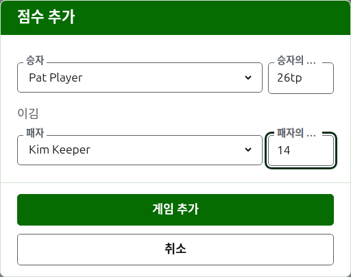

# 점수

테스트 페이지는 테스트 탭에서 이름을 누르거나 짙은 녹색 막대에서 열어요. "Australia v New Zealand"처럼 두 팀의 전체 이름이 제목이고, 그 아래에 예정된 매치 수와 각 매치의 다승제가 있어요. 점수가 곧 페이지이고, 탭은 없어요. 기록원은 점수에 운영자가 할 수 있는 모든 것을 할 수 있기 때문에, 운영자와 기록원은 같은 페이지를 봐요.

## 점수가 놓이는 방식

점수는 누가 이겼는지가 아니라 팀을 기준으로, 첫 번째 팀의 약칭, "v", 두 번째 팀의 약칭을 제목으로 하는 표에 놓여요. 각 점수는 한 행이에요. 첫 번째 팀의 선수, 그다음 "26tp - 14"처럼 첫 번째 팀의 점수를 앞에 둔 두 점수, 그다음 두 번째 팀의 선수예요. 누가 이겼는지는 상관없어요. 보관된 점수도 그 아래에 같은 방식으로 놓여요.

## 점수 입력하기

목록 위의 **점수 추가**를 눌러요. 대화 상자는 결과를 소리 내어 말하는 순서대로 읽혀요. 승자와 그 점수, 그다음 "이김", 그다음 패자와 그 점수예요.

승자는 양 팀에서 쓰이고 있는 선수 중에서 골라요. 각 팀의 이름 아래에, 첫 번째 팀의 선수들이 먼저, 각 팀 안에서는 팀의 순서대로 있어요. 처음에는 누구도 골라져 있지 않아요. 승자를 고르면 패자는 다른 팀에서만 제안돼요. 같은 팀 두 선수 사이의 게임은 팀 사이의 게임이 아니니까요. 보관된 선수는 제안되지 않아요.

점수는 기록원이 받아 적은 대로 입력해요. 득점 수와 그 뒤에 따라오는 것으로, 뒤에 오는 것은 입력한 그대로 저장되고 보여요. 예를 들어 "26tp"는 26후프와 트리플 필이에요. 수는 점수가 시작하는 숫자들이에요. 숫자로 시작하지 않는 점수는 거부돼요.

시간 종료로 멈춰 다른 방법으로 결정된 때처럼 같은 점수로 이긴 게임은, 승자의 점수 뒤에 표시를 붙여 누가 이겼는지 말해요. "6w"가 "6"을 이김, 같은 식이에요. 표시는 "w", "won", "winner"예요. 대회가 무승부를 허용하지 않는 한, 승자의 점수는 패자보다 높거나 표시가 있어야 해요. 허용하는 대회에서는 같은 점수에 표시가 없으면 무승부로 저장돼요.

**게임 추가**를 눌러요. 게임이 추가되고, 대화 상자가 어느 게임인지 알려 주고, 다음을 위해 필드가 비워져요. 점수는 세션이 끝날 때 보드에서 읽어 한 묶음으로 들어오니까요. 모두 넣었으면 **취소**를 눌러요.

## 매치

만나는 두 선수는 테스트의 다승제로 한 매치를 치러요. 두 선수 사이의 게임이 그 매치의 게임이고, 매치가 이미 결정된 두 선수 사이의 게임은 거부돼요. 한쪽이 다른 쪽이 더 이길 수 있는 수보다 많은 게임을 이겼거나, 매치의 모든 게임을 치른 경우예요.

매치는 두 선수에게 쓰이고 있는 게임이 생기면 시작돼요. 테스트는 예정된 수보다 많은 매치를 시작하지 않아요. 예정된 수만큼 시작되면, 아직 만나지 않은 두 선수 사이의 게임은 거부되고, 이미 시작된 매치의 다음 게임은 받아들여져요. 테스트에 매치가 더 있어야 한다면, 테스트 탭에서 예정 수를 바꿔요.

## 점수 정정하기

**수정**을 누르면 같은 대화 상자가 그 점수로 열리고, 제목은 점수 수정이며, 선수들이 골라져 있고 점수는 입력한 그대로예요. 점수뿐 아니라 선수도 바꿀 수 있고, 추가할 때처럼 골라요. **저장**을 눌러 정정 내용을 저장하고 대화 상자를 닫아요. 정정해도 결과는 그대로예요. 이긴 게임은 이긴 채로, 비긴 게임은 비긴 채로 남아요. 결과가 틀린 게임은 보관하고 다시 입력해요.

## 점수 순서 정하기

점수는 입력한 순서대로 들어오기 때문에, 쓰이고 있는 각 점수에는 **위로**와 **아래로**가 있어서 옆의 점수와 자리를 바꿔요. 그래서 목록을 게임을 치른 순서대로 놓을 수 있어요.

## 점수 보관하기

**보관**은 점수를 치워 두어 아무것에도 반영되지 않게 해요. **보관된 점수** 아래에 줄이 그어진 채 나열되고, **복원**만 할 수 있어요. 서로가 서로를 되돌리기 때문에 둘 다 먼저 묻지 않아요. 테스트에는 서로 의존하는 라운드가 없어서, 테스트의 모든 점수를 보관할 수 있어요.

그 뒤에 선수가 보관된 점수는 선수가 복원되기 전에는 복원되지 않고, 페이지가 그렇게 알려 줘요.

다음: [공지](notes.md).
