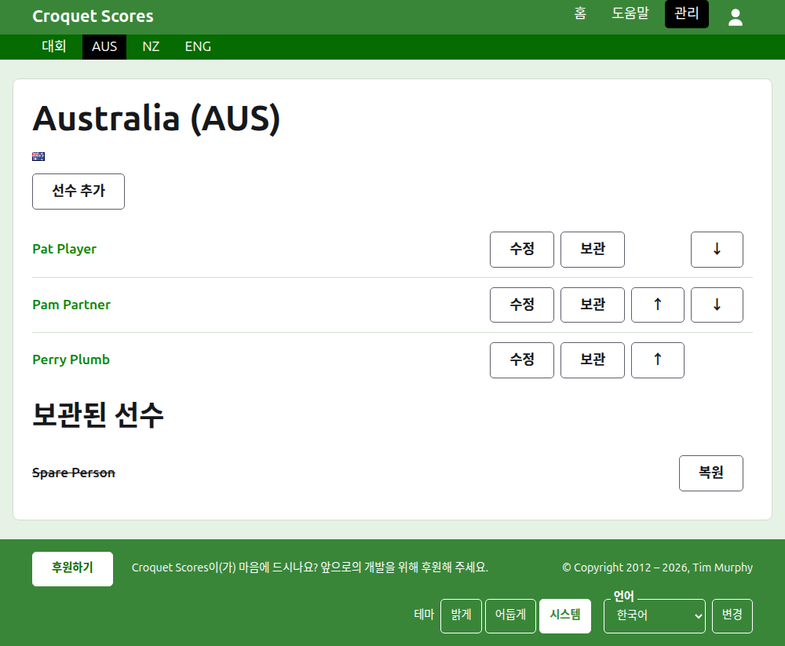
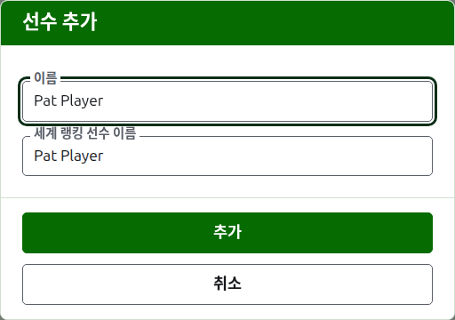

# 팀의 선수

팀 페이지는 팀 탭에서 팀의 이름이나 **보기**를 눌러 열어요. 팀 이름과 괄호 안의 약칭, 그리고 국기가 제목이어서, 잘못된 팀에 온 운영자가 바로 알아볼 수 있어요. 보여 줄 것은 팀의 선수 하나뿐이라서, 목록이 곧 페이지예요.

팀 페이지의 짙은 녹색 막대는 대회와, 쓰이고 있는 각 팀의 약칭으로 이어져요. 그래서 팀 탭으로 돌아가지 않고 팀별로 선수를 등록할 수 있어요.

팀의 선수는 그 팀에만 속하고, 그 팀을 대표하며, 자기 국기가 아닌 팀의 국기를 달아요. 같은 사람이 두 팀에서 뛰거나 두 대회에 나가면, 각각에서 따로 선수예요.

## 선수 추가하기 {#adding-a-player}

목록 위의 **선수 추가**를 눌러요. 페이지 위에 대화 상자가 열려요.

**이름**은 꼭 써야 하고, 3자 이상 254자 이하예요. 한 팀의 두 선수는 대소문자가 달라도 같은 이름을 가질 수 없어요. 다른 팀의 선수는 같은 이름을 가질 수 있어요.

**세계 랭킹 선수 이름**은 세계 랭킹이 선수를 알고 있는 이름이에요. 선수 목록을 가지고 있는 두 종목인 어소시에이션 크로케와 골프 크로케 대회에서만 물어요. 아메리칸 6 위켓의 선수는 랭킹에 자기 이름으로 올라 있으므로 거기서는 묻지 않고, 모든 선수의 세계 랭킹 이름은 언제나 선수의 이름이에요. 선수를 추가하는 동안에는 이름을 입력하는 대로 따라 채워지고, 여기에 직접 입력하기 시작하면 따라오기를 멈춰요. 비워 두면 선수의 이름으로 저장돼요. 입력하는 동안 세계 랭킹이 아는 선수 중 그렇게 시작하는 이름들을 제안하고, 세계 랭킹 이름 옆의 체크 표시는 랭킹이 그 이름을 안다는 뜻, 물음표는 모른다는 뜻이에요. 참고 사항일 뿐이에요. 랭킹이 모르는 이름도 아는 이름과 똑같이 저장돼요.

선수의 이름을 "Bye"로 할 수는 없어요. 첫 단어가 영어 단어 "bye"인 이름은 거부돼요.

**추가**를 눌러요. 선수가 추가되고, 대화 상자가 그렇게 알려 주고, 다음 선수를 위해 필드가 비워지며 커서는 이름으로 돌아가요. 이렇게 팀 전체를 추가한 뒤 **취소**를 눌러 대화 상자를 닫아요.

## 선수 고치기 {#correcting-a-player}

선수의 이름이나 **수정**을 누르면 같은 대화 상자가 그 선수로 열리고, 제목은 선수 수정이에요. **저장**을 눌러 변경 내용을 저장해요. 이름을 고친 선수는 가지고 있던 세계 랭킹 이름을 그대로 유지해요. 다만 아메리칸 6 위켓에서는 선수의 세계 랭킹 이름이 언제나 선수의 이름이에요.

## 순서

선수는 팀의 순서대로 나열돼요. 이 순서는 테스트의 점수를 입력할 때 제안되는 순서예요. **위로**와 **아래로**는 팀 안에서 선수를 한 자리씩 옮겨요.

## 선수 보관하기

**보관**은 선수를 치워 두어요. 잘못 등록했거나, 더 이상 팀에 없는 선수예요. 보관된 선수는 쓰이고 있는 선수들 뒤에 **보관된 선수** 아래에 줄이 그어진 채 나열되고, **복원**만 할 수 있어요. 팀의 선수는 다른 어디에도 들어 있지 않고 복원하면 모든 것이 돌아오기 때문에, 보관할 때 먼저 묻지 않아요.

테스트에서 쓰이고 있는 게임을 하나라도 치른 선수는 보관할 수 없어요. 그러면 그 게임들이 이제는 없는 사람과 치른 것이 되기 때문에, 그런 선수에게는 보관이 제공되지 않아요. 게임이 모두 보관된 선수는 보관할 수 있어요.

다음: [테스트](tests.md).
