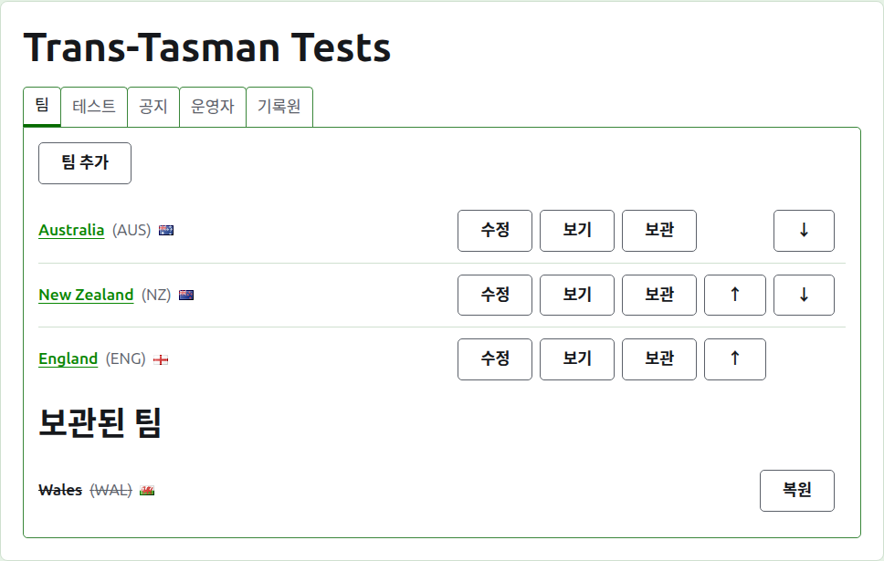
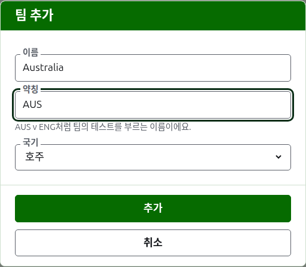
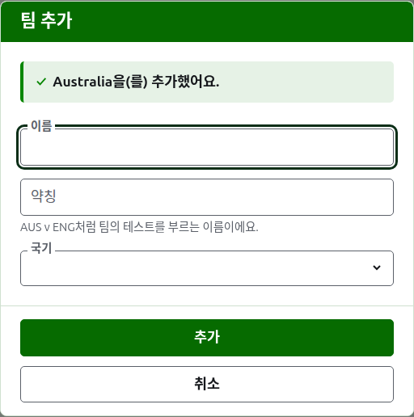
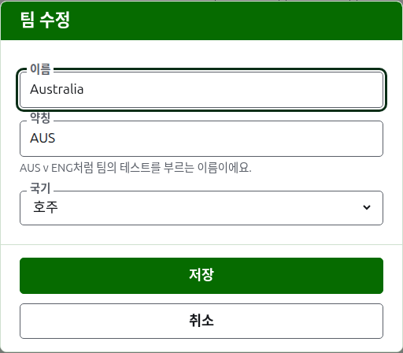

# 팀

대회 페이지의 **팀** 탭은 대회의 팀을 추가하고, 고치고, 순서를 정하고, 치워 두는 곳이에요. 팀을 가장 먼저 만들기 때문에, 페이지는 이 탭에서 열려요. 테스트는 두 팀 사이에서 치르므로, 테스트를 추가하려면 먼저 팀이 둘 이상 있어야 해요.

## 팀 추가하기

목록 위의 **팀 추가**를 눌러요. 페이지 위에 대화 상자가 열려요.

**이름**은 꼭 써야 해요. "Australia"처럼 팀의 전체 이름으로, 팀 페이지와 공개 페이지의 표에서 제목이 돼요. 한 대회의 두 팀은 같은 이름을 가질 수 없어요.

**약칭**도 꼭 써야 해요. "AUS v ENG"처럼 팀의 테스트를 부르는 이름이고, 짙은 녹색 막대가 팀을 부르는 이름이에요. 10자 이하이고, 이름보다 길 수 없어요. 줄인 이름이 원래 이름보다 길다면 둘을 바꿔 입력한 것일 테니까요. 두 팀이 같은 약칭을 가질 수도 없어요.

**국기**는 팀 이름이 나오는 모든 곳에서 그 옆에 보여요. 클럽이나 지역의 팀처럼 없음으로 둘 수 있어요.

**추가**를 눌러요. 팀이 추가되고, 대화 상자가 그렇게 알려 주고, 다음 팀을 위해 필드가 비워져요. 이렇게 명단을 전부 추가한 뒤 **취소**를 눌러 대화 상자를 닫아요. 취소는 아직 추가하지 않은 것은 저장하지 않아요.

## 팀 고치기

팀의 **수정**을 누르면 같은 대화 상자가 그 팀으로 열리고, 제목은 팀 수정이에요. 틀린 것을 고치고 **저장**을 눌러요. 약칭을 바꾼 팀은 모든 곳에서 새 약칭으로 불리기 때문에, 그 팀의 테스트도 함께 이름이 바뀌어요.

## 순서

팀은 대회의 순서대로 나열돼요. 이 순서는 테스트를 추가할 때 제안되는 순서이고, 짙은 녹색 막대에 놓이는 순서이며, 공개 선수 페이지에 나열되는 순서예요. 각 줄 끝의 화살표인 **위로**와 **아래로**는 팀을 한 자리씩 옮겨요.

## 팀으로 가기

팀의 이름이나 **보기**를 누르면 팀의 페이지가 열리고, 거기서 선수를 등록해요. [팀의 선수](team-players.md)를 보세요.

## 팀 보관하기

**보관**은 팀을 치워 두어요. 선수들은 팀과 함께 남아 있다가 복원하면 함께 돌아오기 때문에, 보관할 때 먼저 묻지 않아요. 보관된 팀은 **보관된 팀** 아래에 줄이 그어진 채 나열되고, **복원**만 할 수 있으며, 복원할 때까지 팀 페이지는 닫혀요.

쓰이고 있는 테스트에 나가는 팀은 보관할 수 없어요. 그러면 그 테스트가 이제는 없는 팀과 치른 것이 되기 때문에, 그런 팀에게는 보관이 제공되지 않아요. 테스트가 모두 보관된 팀은 보관할 수 있어요.

다음: [팀의 선수](team-players.md).
