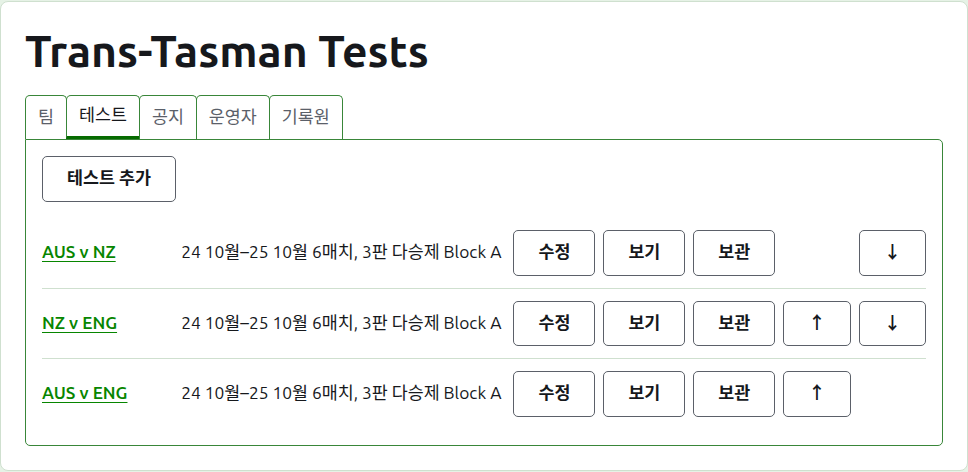
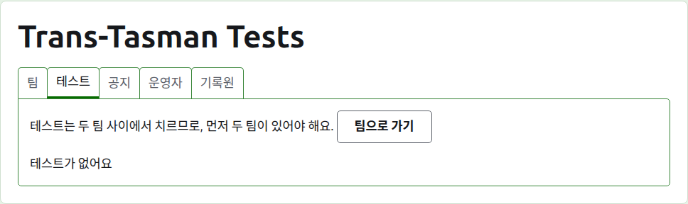
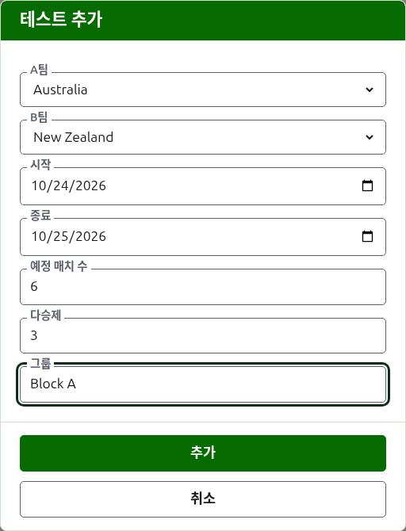
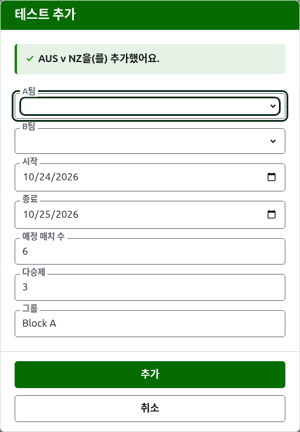
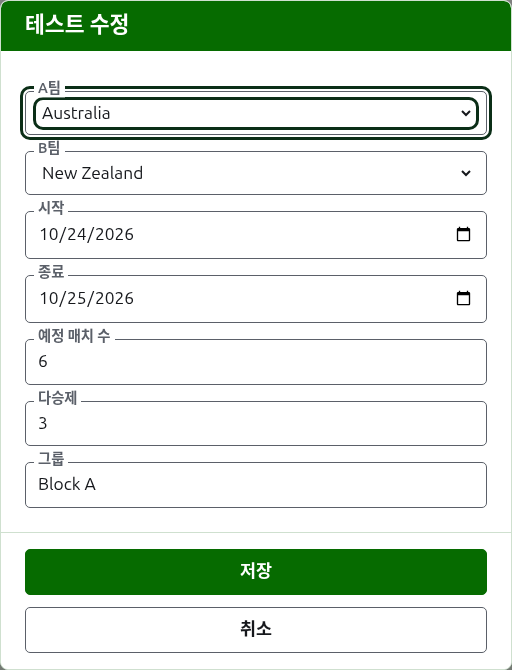

# 테스트

대회 페이지의 **테스트** 탭은 팀 사이의 테스트를 추가하고, 바꾸고, 순서를 정하고, 치워 두는 곳이에요. 테스트는 대회의 부문 중 하나로, 두 팀 사이의 대결이며, "AUS v NZ"처럼 약칭으로 부르고, 양 팀 선수 한 명씩 사이의 여러 매치로 치러요. 테스트마다 페이지가 하나씩 있어서, 거기서 점수를 입력해요.

각 테스트는 이름, 치르는 날짜, 예정된 매치 수와 각 매치의 다승제를 "6매치, 3판 다승제"처럼 말하고, 그룹에 들어 있다면 그룹도 말해요.

## 먼저 두 팀이 있어야 해요

테스트는 쓰이고 있는 두 팀 사이에서 치르므로, 대회에 팀이 둘보다 적은 동안에는 테스트 추가가 있을 자리에서 탭이 그렇게 알려 주고, 팀 탭으로 이어 줘요.

## 테스트 추가하기

목록 위의 **테스트 추가**를 눌러요. 페이지 위에 대화 상자가 열리고, 테스트를 소리 내어 말하는 순서대로 읽혀요.

**A팀**과 **B팀**은 각각 쓰이고 있는 대회의 팀 중에서 이름으로, 대회의 순서대로 골라요. 처음에는 어느 쪽도 골라져 있지 않아서, 고르지 않은 팀 사이에 테스트가 추가되는 일은 없어요. B팀에는 A팀으로 고른 팀을 뺀 모든 팀이 제안돼요. 한 팀이 자기 팀과 테스트를 치를 수는 없으니까요. A팀이 첫 번째 팀이에요. 그 팀의 선수들이 테스트 페이지와 공개 페이지에서 왼쪽에 와요. 테스트에는 따로 입력하는 이름이 없고, 두 팀의 약칭으로 불러요.

**시작일**과 **종료일**은 테스트를 치르는 날들로, 대회의 첫날로 시작해요. 테스트는 대회 안에서 치르므로, 대회가 시작하기 전이나 끝난 뒤의 날짜는 거부돼요.

**예정 매치 수**는 테스트에 있을 매치의 수로, 행사가 시작하기 전에 정해 두어, 점수를 읽는 사람이 얼마나 진행되었는지 볼 수 있게 해요. 1 이상의 정수예요. 한도이기도 해요. 예정된 수만큼 매치가 시작되면, 새 매치를 시작하게 될 게임은 거부되고, 이미 시작된 매치는 끝까지 치러요. 매치가 더 있어야 하는 테스트는 수정해서 예정 수를 늘려요.

**다승제(판 수)**는 각 매치가 몇 판 다승제인지예요. 매치는 나눠 가질 수 있으므로 짝수여도 돼요.

**핸디캡 적용**, **무승부 허용**, **세계 랭킹에 반영**은 다른 부문과 똑같이 물어요. 마지막은 반영될 수 있을 때만 물어요. 핸디캡을 적용하지 않고 무승부도 허용하지 않는 어소시에이션 크로케 또는 골프 크로케 테스트예요. 처음에는 체크되어 있어요.

**그룹**은 행사가 그룹으로 치러질 때 테스트가 속하는 그룹으로, "Block A" 같은 것이에요. 꼭 쓸 필요는 없어요. 비워 두면 어느 그룹에도 속하지 않아요. 한 그룹의 테스트들은 공개 사이트에 자기 페이지가 있어서, 그룹 팀들의 순위를 보여 줘요. **에이레 컵**과 **인터스테이트 실드**에는 그룹이 없어서, 대화 상자가 그룹을 묻지 않아요.

**추가**를 눌러요. 테스트가 추가되고, 대화 상자가 이름으로 어느 테스트인지 알려 주고, 다음을 위해 팀이 비워지며, 날짜, 예정 매치 수, 다승제, 그룹은 그대로 남아요. 테스트는 같은 날 만나는 팀들 사이에서 한 라운드씩 추가하기 때문에, 라운드의 다음 테스트는 두 팀만 다를 뿐이에요. 모두 넣었으면 **취소**를 눌러요.

## 테스트 바꾸기

**수정**을 누르면 같은 대화 상자가 그 테스트로 열리고, 제목은 테스트 수정이며, 테스트의 지금 상태로 시작해요. **저장**을 눌러 변경 내용을 저장해요.

쓰이고 있는 게임이 있는 테스트는 팀이 그대로예요. 대화 상자에 보이지만 바꿀 수는 없어요. 나머지는 이미 치른 범위 안에서 바꿀 수 있어요. 이미 시작된 매치보다 적은 예정 매치 수는 거부되고, 어느 두 선수가 치른 가장 많은 게임 수보다 적은 다승제도 거부돼요.

## 순서

테스트는 대회의 순서대로 나열돼요. 이 순서는 공개 페이지와 짙은 녹색 막대에 나타나는 순서예요. **위로**와 **아래로**는 테스트를 한 자리씩 옮겨요.

## 테스트로 가기

테스트의 이름이나 **보기**를 누르면 그 페이지가 열리고, 거기서 점수를 입력해요. 짙은 녹색 막대로도 대회 페이지나 다른 어느 테스트 페이지에서든 그곳에 갈 수 있어요.

## 테스트 보관하기

**보관**은 테스트를 치워 두고, **복원**으로 되돌리기 때문에, 둘 다 먼저 묻지 않아요. 보관된 테스트는 **보관된 테스트** 아래에 줄이 그어진 채 나열되고, 복원만 할 수 있으며, 공개 페이지에는 보이지 않아요.

쓰이고 있는 게임이 있는 테스트는 치러진 것이어서, 게임들이 보관되기 전에는 보관할 수 없어요. 게임이 모두 보관된 테스트는 보관할 수 있어요. 보관된 게임은 아무것에도 반영되지 않으니까요. 그 뒤에 팀이 보관된 테스트는 팀이 복원되기 전에는 복원되지 않고, 탭이 그렇게 알려 줘요.

다음: [점수](scores.md).
