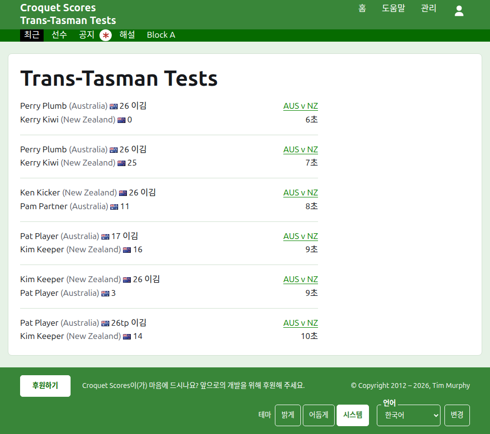
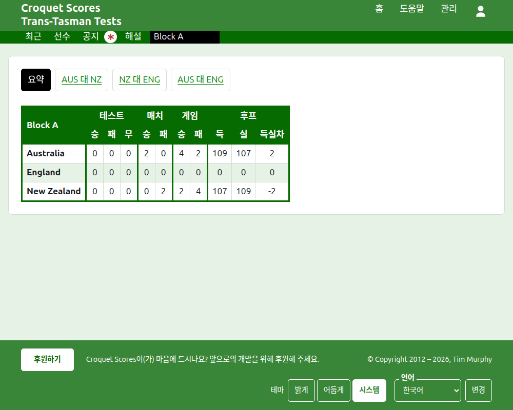
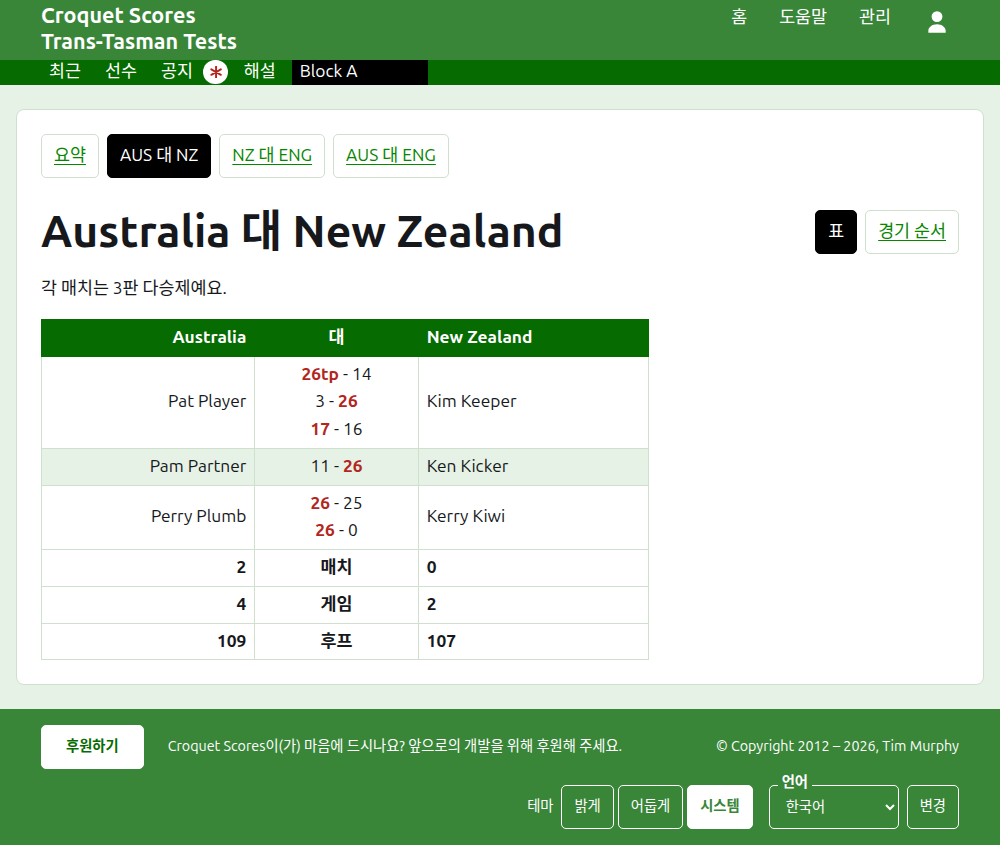
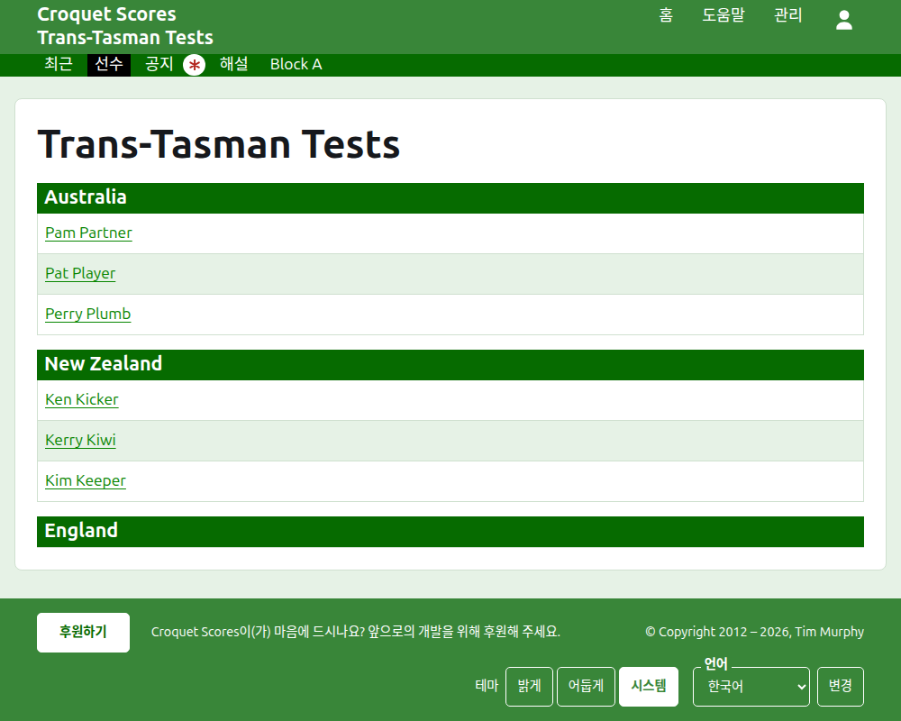

# 공개 페이지에 보이는 것

따로 게시하는 것은 없어요. 공개 페이지는 관리 화면에 담긴 내용을 그대로 보여 주기 때문에, 입력한 점수는 바로 올라가요. 계정도 스크립트도 필요 없고, 휴대폰에 맞게 짜여 있어요.

## 대회 페이지

대회 페이지는 `/2026/ac/trans-tasman-tests`처럼 연도, 종목, 이름의 주소에 있어요. 대회 이름이 제목이고, 그 아래에 부제가 있어요. 쓰이고 있는 모든 게임을 가장 최근에 추가된 것부터 나열하기 때문에, 다시 돌아온 사람은 그동안 무슨 일이 있었는지 볼 수 있어요. 각 게임은 승자, 그 팀, 점수를 말하고, 그다음 패자와 그 점수를 말하며, 치른 테스트와 추가된 지 얼마나 되었는지도 함께 보여 줘요.

짙은 녹색 막대는 대회의 섹션을 제공해요. 이 페이지인 **최근**, **요약**, **선수**, **공지**, **해설**, 그다음 테스트들이에요. 테스트는 "AUS 대 NZ"처럼 두 팀의 약칭 사이에 "대"를 넣어 말해요. 그룹에 속한 테스트는 하나씩 제공되지 않아요. 그룹이 하나의 섹션이 되어 그룹의 이름으로, 첫 테스트가 있었을 자리에 놓여요. 읽지 않은 공지가 있는 동안에는 공지에 빨간 별표가 붙어요.

## 요약

테스트가 어느 그룹에도 속하지 않은 대회에는 **요약**이 있어요. 모든 팀을 순위대로 놓은 하나의 표로, 이기고 지고 비긴 테스트 수, 이기고 진 게임 수, 득점·실점 후프와 득실차를 보여 줘요. 어느 테스트든 매치가 여러 판 다승제라면, 이기고 진 매치 수가 테스트 뒤에 와요. 요약은 읽는 사람이 각 팀을 전체로 살펴보는 곳이에요.

그룹에 속한 테스트가 있는 대회에는 요약이 없어요. 대신 각 그룹의 페이지가 그 그룹 팀들의 순위를 보여 줘요. 서로 치른 적이 없는 그룹들의 팀을 한 표에 놓으면 아무것도 순위를 매기지 못하니까요.

## 그룹

그룹 페이지는 그룹의 테스트만 세어 그룹 팀들의 순위를 요약과 같은 표로 보여 줘요. 표 위의 따로 된 줄에서 이 페이지인 **요약**과, 그룹의 각 테스트를 제공하고, 테스트는 그 페이지로 이어져요.

## 테스트

테스트 페이지는 "Australia 대 New Zealand"처럼 두 팀의 전체 이름이 제목이고, 각 매치가 몇 판 다승제인지 말해요. 표의 제목은 두 팀이고, 첫 번째 팀이 왼쪽이에요. 치른 각 매치가 시작된 순서대로 한 행이 되고, 첫 번째 팀의 선수가 왼쪽, 두 번째 팀의 선수가 오른쪽, 그 사이에 매치의 게임들이 있어요. 각 게임은 첫 번째 쪽의 점수 다음에 두 번째 쪽의 점수를 보여 주고, 승자의 점수가 표시돼요. 매치들 아래에는 각 팀의 게임과 후프가 있고, 각 매치가 여러 판 다승제라면 이긴 매치 수도 각자의 쪽에 있어요.

테스트는 이름이 있는 줄에서 두 가지 보기를 제공해요. 이 표인 **표**와, 테스트의 모든 게임을 오래된 것부터 나열하는 **경기 순서**예요. 그룹에 속한 테스트는 제목 위의 줄에서 그룹의 요약과 테스트들을 제공하고, 이 테스트가 표시돼요.

## 선수

선수 페이지는 선수를 팀별로 나열해요. 각 팀은 자기 이름의 제목 아래에, 대회의 팀 순서대로 놓이고, 그 아래에 선수들이 이름순으로 있어요.

## 공지

공지 페이지는 대회의 공지를 가장 최근에 쓴 것부터 나열하고, 각 공지는 자기 페이지로 이어지며 쓴 지 얼마나 되었는지 말해 줘요. 읽지 않은 공지는 열어 볼 때까지 빨간 별표로 표시돼요.

## 옮겨지는 주소

이름을 고쳐도 대회의 주소는 그대로예요. 연도나 종목이 바뀌어 주소가 옮겨지면, 옛 주소가 새 주소로 이어지기 때문에 전에 간직해 둔 링크도 여전히 작동해요. 보관된 대회의 페이지는 복원할 때까지 찾을 수 없어요.
