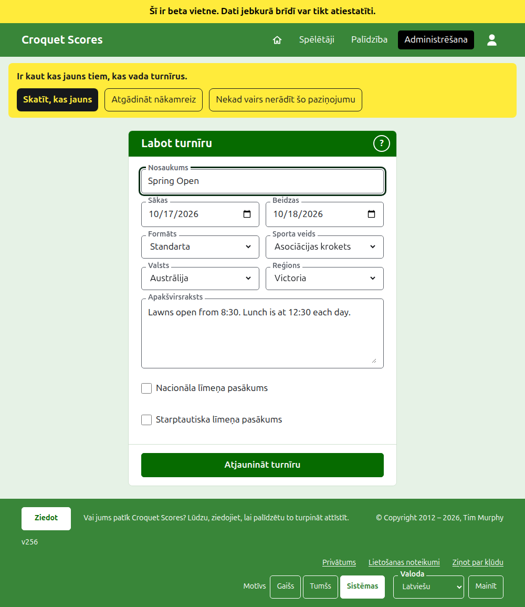
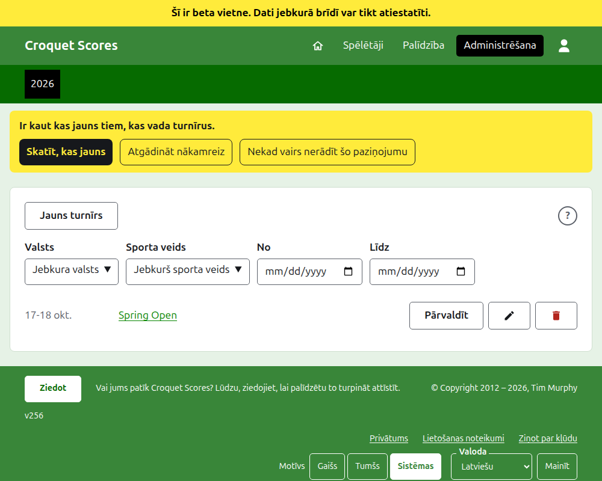
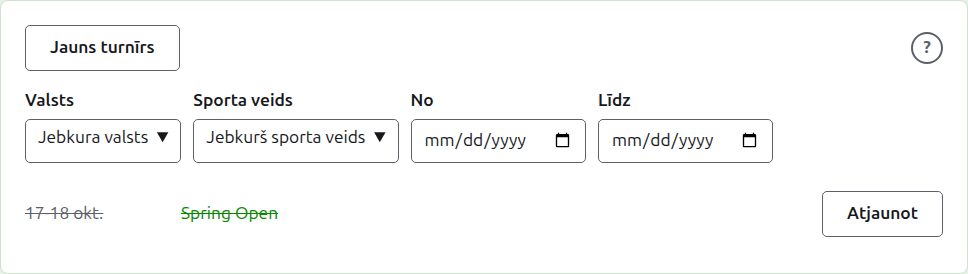

# Turnīra maiņa, arhivēšana un atjaunošana

## Turnīra informācijas maiņa

Turnīru sarakstā administrēšanas sadaļā nospiediet turnīra **Labot**. Veidlapa ir tā pati, kas to izveidoja, aizpildīta tā, kāds ir turnīrs. Izmainiet to, kas nav pareizi, un nospiediet **Atjaunināt turnīru**.

Kad turnīrā ir kāds spēlētājs vai kādas sacensības, arī arhivētie ieskaitot, tā formātu vairs nevar nomainīt uz tādu, ko spēlē komandas, kuram ir komandas un testi.

Turnīrs saglabā savu adresi, kad tā nosaukums tiek izlabots, lai kāda jau nosūtīta saite to joprojām atrastu. Tā mainās tikai tad, kad mainās gads, kurā tas sākas, vai tā sporta veids, un tad vecā adrese ved uz jauno. Saglabājot jūs tiekat aizvests uz turnīru, kur tas tagad atrodas.

Turnīru var mainīt tikai pārvaldnieks. Rezultātu ievadītājam vai ikvienam citam to pasaka, nevis parāda veidlapu.

## Turnīru saraksts

Administrēšana uzskaita vienu gadu reizē, sākot ar šo gadu, jaunākais turnīrs pirmais. Gadi, kuros jums ir turnīrs, ir cilnes tumši zaļajā joslā, jaunākais pirmais; ja to ir vairāk, nekā ietilpst telefonā, vecākie ir nolaižamajā sarakstā rindas beigās. Gads ir adresē, tāpēc uz gadu var norādīt ar saiti.

Virs saraksta **Valsts**, **Reģions**, **Sporta veids**, **No** un **Līdz** sašaurina to, tiklīdz tiek izvēlēti, bez pogas, kas jānospiež. Tiek piedāvātas tikai izvēles, kas kaut ko uzskaitītu, un reģions tiek piedāvāts, kad ir izvēlēta valsts. **No** un **Līdz** ir dienas: saraksts ir par turnīriem, kas sākas no vienas līdz otrai, abas ieskaitot, un lai sarakstu sašaurinātu pēc dienām, jāizvēlas abas. Izvēlētais ir adresē, tāpēc sašaurinātu sarakstu var norādīt ar saiti; izvēloties citu gadu, tas tiek notīrīts. Gads ar vairāk nekā simt turnīriem tiek uzskaitīts pa simts lapā ar **Iepriekšējā** un **Nākamā** zem tā. Nacionāls vai starptautisks turnīrs ir iestatīts treknrakstā visā tā rindas garumā.

## Turnīra arhivēšana

**Arhivēt** uz turnīra sarakstā to atliek malā. Tas joprojām ir uzskaitīts, pārsvītrots un aiz lietotajiem turnīriem, bet piedāvā tikai **Atjaunot**: tā lapa administrēšanas sadaļā un tā publiskās lapas ir slēgtas, kamēr tas nav atjaunots. Arhivēšana nejautā iepriekš, jo atjaunošana to atsauc.

Tālāk: [Ko redz publika](what-the-public-sees.md).
