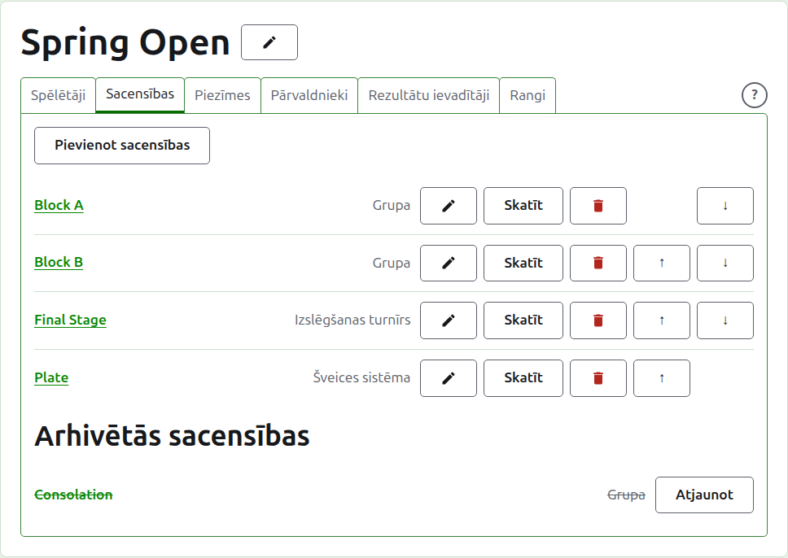
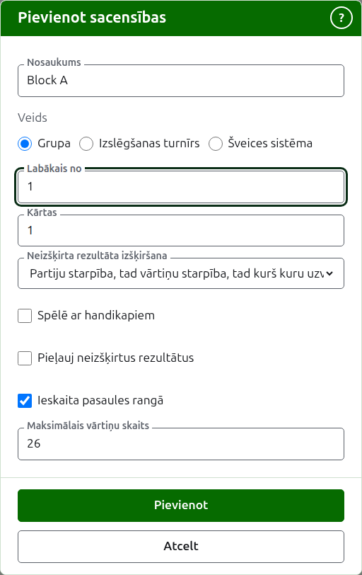
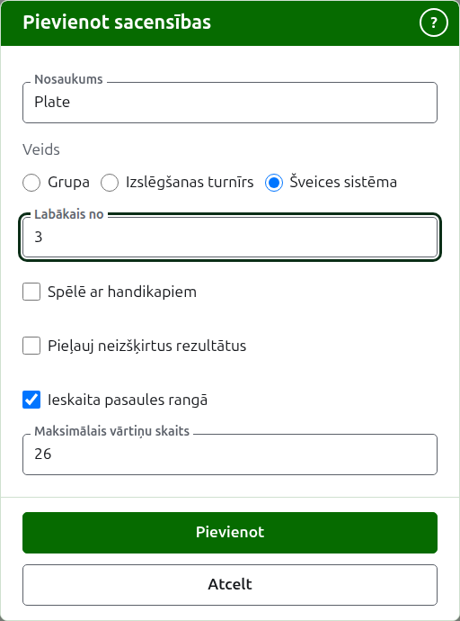
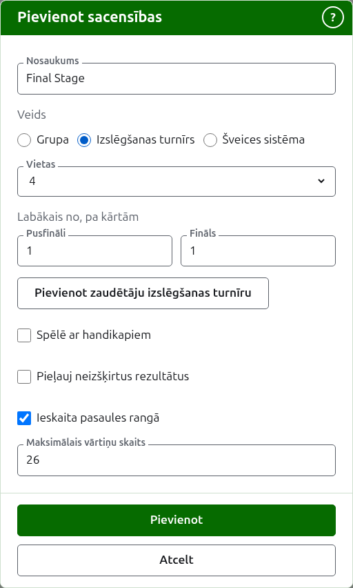

# Sacensības

Turnīra lapas cilne **Sacensības** ir vieta, kur tiek pievienotas, sakārtotas un atliktas malā tā sacensības. Sacensības ir grupa, izslēgšanas turnīrs vai Šveices sistēma. Katrām ir sava lapa, kurā tiek ievadīti to spēlētāji un rezultāti.

## Sacensību pievienošana {#adding-a-competition}

Nospiediet **Pievienot sacensības** virs saraksta. Virs lapas atveras dialogs, kas prasa sacensību nosaukumu, to veidu un formu, kāda ir šim veidam.

**Nosaukums** ir tas, ko spēlētāji meklē turnīra lapā, lai atrastu savas partijas. Tas ir no 1 līdz 254 rakstzīmēm, un pietiek ar vienu burtu, jo grupu bieži sauc ar vienu. Divām sacensībām vienā turnīrā nevar būt viens un tas pats nosaukums.

**Veids** ir grupa, izslēgšanas turnīrs vai Šveices sistēma. Dialogs sākas ar grupu, kas ir lielākajai daļai sacensību.

### Grupa

Grupa jautā, kāds ir katra mača **labākais no**, cik **kārtās** tā tiek spēlēta un kā tiek šķirti spēlētāji ar vienādu uzvarēto maču skaitu, to norāda **Neizšķirta rezultāta izšķiršana**.

**Labākais no** sākas ar 1. Labākais no 3 tiek uzvarēts, uzvarot divas partijas. Tas var būt pāra skaitlis, jo grupā spēlētājs tiek ranžēts pēc uzvarētajām partijām, un mačs ar divām partijām, kas dalītas pa vienai, ir tāds pats rezultāts kā jebkurš cits.

**Kārtas** ir tas, cik reižu katrs spēlētāju pāris grupā tiekas, ar mačiem katrā kārtā. Tas sākas ar 1, un 1 ir gandrīz vienmēr tas, ko grupa vēlas: katrs spēlētājs spēlē ar katru citu vienu reizi. Palieliniet to tikai grupai, kurā viņi tiekas atkal, piemēram, dubultā apļa turnīram, kur 2 liek katram pārim spēlēt divus mačus.

**Neizšķirta rezultāta izšķiršana** ir tas, kā tiek šķirti spēlētāji, kas uzvarējuši vienādu daļu savu maču. Ir trīs veidi, un viena turnīra grupas var izmantot dažādus, jo noteikumi atšķiras. **Partiju starpība, tad vārtiņu starpība, tad kurš kuru uzvarēja** ir tā, kā grupas vienmēr ir ranžētas, un ar to sākas jauna grupa: spēlētāji ar vienādu uzvarēto maču skaitu tiek šķirti pēc partiju starpības, tie, kas joprojām vienādi, pēc vārtiņu starpības, un tie, kas joprojām vienādi, pēc tā, kurš kuru starp viņiem uzvarēja. Kur katrs mačs ir viena partija, partiju starpība tiek izlaista. **Kurš kuru uzvarēja** skatās tikai uz mačiem, ko vienādie spēlētāji spēlēja viens pret otru. **Cits** ir noteikumiem, ko vietne nezina, un nešķir nevienu. Spēlētāji, ko nevar šķirt, dala vietu, kas tiek rādīta kā =2, un lapa zem režģa saka, kā vienādie spēlētāji tiek šķirti.

### Šveices sistēma

Šveices sistēma jautā tikai, kāds ir katra mača **labākais no**, kas sākas ar 1, tāpat kā grupai. Labākais no 3 tiek uzvarēts, uzvarot divas partijas. Tas var būt pāra skaitlis, jo Šveices sistēmā spēlētājs tiek ranžēts pēc uzvarētajām partijām, un mačs ar divām partijām, kas dalītas pa vienai, ir tāds pats rezultāts kā jebkurš cits.

### Izslēgšanas turnīrs

Izslēgšanas turnīrs jautā, cik **vietu** ir tā izlozei un kāds ir katras kārtas labākais no. Vietas tiek piedāvātas kā 2, 4, 8, 16, 32, 64 un 128, jo jebkurš cits skaitlis nevarētu dalīties uz pusēm kārtu pa kārtai līdz finālam, un dialogs sākas ar 8. Vietas, kas paliek pāri, kad spēlētāji ir ievadīti, tiek aizpildītas ar bye, ko pievieno tur, kur spēlētāji.

Izlozei ir tik kārtu, cik vajag, lai tās vietas sadalītu uz pusēm līdz vienai, tāpēc 8 vietu izlozei ir trīs kārtas. Dialogs jautā, kāds ir katras labākais no, kopā zem **Labākais no, pa kārtām**, tādā secībā, kādā tās tiek spēlētas. Pēdējās trīs ir nosauktas tā, kā par izlozes kārtām runā, **Ceturtdaļfināli**, **Pusfināli** un **Fināls**, un jebkuras pirms tām pēc to numura, sākot ar 1. kārtu. Izvēloties vairāk vietu, kārtas tiek pievienotas izlozes sākumā, un izvēloties mazāk, tās tiek noņemtas no sākuma, tāpēc tas, kas rakstīts finālam, joprojām ir fināla. Katra kārta ir labākais no nepāra partiju skaita, jo izslēgšanas turnīra mačam jābūt uzvarētājam.

### Zaudētāju izslēgšanas turnīrs {#losers-knockout}

Izslēgšanas turnīrs var nosūtīt tos, kas zaudē kārtu, uz savu izslēgšanas turnīru, zaudētāju izslēgšanas turnīru. Zem izslēgšanas turnīra **Labākais no, pa kārtām** nospiediet **Pievienot zaudētāju izslēgšanas turnīru**. Dialogs jautā **Zaudētāji no**, kārtu, kuras zaudētāji spēlē tālāk, no katras kārtas, izņemot finālu, un **Zaudētāju izslēgšanas turnīra nosaukums**. Nospiediet **Pievienot**, lai to ievietotu sarakstā zem pogas, kur **Noņemt** to izņem atkal. Tas tiek pievienots kopā ar izslēgšanas turnīru, kad tas tiek pievienots, un, ja kāds no tiem tiek noraidīts, netiek pievienots neviens.

Zaudētāju izslēgšanas turnīrā ir vieta katram šīs kārtas mačam, un katra tā kārta ir labākais no 1, ko var mainīt ar **Labot**. Tā spēlētāji tiek ielikti, kad šīs kārtas mači tiek izšķirti, tādā secībā, kādā tika izlozēti, tāpēc tā cilne **Spēlētāji** tos tikai rāda. Ja partija tiek izlabota vai atlikta malā, zaudētājs tiek pārvietots vai atkal izņemts, ja vien viņš nav spēlējis tālāk.

Izslēgšanas turnīra lapai ir trešā cilne **Zaudētāji** pēc cilnēm Spēlētāji un Rezultāti, kas uzskaita izslēgšanas turnīrus, kas ņem tā zaudētājus, katrs ved uz savu lapu. **Pievienot zaudētāju izslēgšanas turnīru** ir arī tur un prasa tās pašas divas lietas; šeit zaudētāju izslēgšanas turnīrs tiek pievienots uzreiz. Cilne ir tikai izslēgšanas turnīram, un rezultātu ievadītājam tā netiek piedāvāta.

Izslēgšanas turnīram, kas jau ir pievienots, **Labot** rāda to pašu pogu, un zaudētāju izslēgšanas turnīrs tiek pievienots uzreiz, tāpat kā no cilnes Zaudētāji. Izslēgšanas turnīru, kura zaudētājus ņem cits izmantots, nevar arhivēt vai mainīt tā vietas: vispirms arhivējiet zaudētāju izslēgšanas turnīru.

### Kā tiek spēlēts un skaitīts

Katrs veids zem savas formas jautā tās pašas četras lietas.

**Spēlē ar handikapiem.** Atzīmējiet to sacensībām, kas tiek spēlētas ar handikapiem.

**Pieļauj neizšķirtus rezultātus.** Atzīmējiet to, kur partija var beigties bez uzvarētāja. Lielākā daļa sacensību to nepieļauj. Kur tas atzīmēts, rezultāts, kas ievadīts ar vienādiem punktiem un bez atzīmes, tiek saglabāts kā neizšķirts; kur nē, partijai ar vienādiem punktiem jāsaka, kurš to uzvarēja, ar atzīmi aiz uzvarētāja rezultāta, piemēram, "6w". Izslēgšanas turnīra mačam vienmēr ir uzvarētājs, tāpēc neizšķirta partija to neizšķir.

**Ieskaita pasaules rangā.** Tiek prasīts tikai tur, kur to var ieskaitīt: Asociācijas kroketa vai Golfa kroketa sacensībām, kas netiek spēlētas ar handikapiem un nepieļauj neizšķirtus rezultātus. Sākumā tas ir atzīmēts, tāpēc noņemiet atzīmi sacensībām, kas nav jāieskaita.

**Maksimālais vārtiņu skaits.** Vislielākais vārtiņu skaits, līdz kuram tiek spēlēta partija sacensībās, vesels skaitlis vismaz 1. Tas sākas ar sporta veida parasto, 26, vai 13 Golfa kroketā, tāpēc mainiet to sacensībām, kas tiek spēlētas īsāk, piemēram, grupai ar 14 vārtiņu partijām. Iztukšojiet to sacensībām, kuru partijas netiek spēlētas līdz vārtiņu skaitam. Sacensības, kas tiek spēlētas līdz citam skaitam nekā parastais, to saka savā publiskajā lapā, piemēram, "Spēlē līdz 14 vārtiņiem".

### Vairāku pievienošana uzreiz

Nospiediet **Pievienot**. Sacensības tiek pievienotas, dialogs to saka, un nosaukums tiek iztukšots nākamajām, veidu un tā formu atstājot tādu, kāda bija: kopā pievienotas sacensības lielākoties ir līdzīgas, tāpēc "Block B" pēc "Block A" ir tikai tā nosaukums. Nospiediet **Atcelt**, lai aizvērtu dialogu, kad visas ir ievadītas.

## Sacensību maiņa {#changing-a-competition}

**Labot** atver to pašu dialogu par sacensībām ar nosaukumu Labot sacensības, ar to nosaukumu, formu un to, kā tās tiek spēlētas un skaitītas, tādiem, kādi tie ir. To veids netiek prasīts, jo grupu nepadara par izslēgšanas turnīru, to mainot: nepareiza veida sacensības tiek arhivētas un pievienotas no jauna. Nospiediet **Saglabāt**, lai saglabātu izmaiņu un aizvērtu dialogu.

Izslēgšanas turnīram, kuram ir partija, izlozē ir ievietoti spēlētāji, un vietu maiņa tos pārvietotu, tāpēc tā tiek noraidīta, tiklīdz partija ir ievadīta. Tā kārtu labākais no joprojām var mainīt.

## Kārtība

Sacensības tiek uzskaitītas turnīra kārtībā, kādā tās parādās publiskajās lapās un tumši zaļajā joslā. **Uz augšu** un **Uz leju** pārvieto sacensības par vienu vietu.

## Došanās uz sacensībām

Sacensību nosaukums vai **Skatīt** atver to lapu, kurā tiek ievadīti spēlētāji un rezultāti. Tumši zaļā josla zem galvenes ved turp arī no jebkuras turnīra lapas.

## Sacensību arhivēšana

**Arhivēt** noliek sacensības malā, vai nu tām ir partijas, vai nav; partijas tiek paturētas kopā ar tām un atgriežas, kad sacensības tiek atjaunotas. Arhivētās sacensības tiek uzskaitītas zem **Arhivētās sacensības**, pārsvītrotas, tām tiek piedāvāts tikai **Atjaunot**, un tās nav publiskajās lapās. Arhivēšana nejautā iepriekš, jo atjaunošana to atceļ.

Tālāk: [Spēlētāju ievadīšana sacensībās](entering-players-in-a-competition.md).
