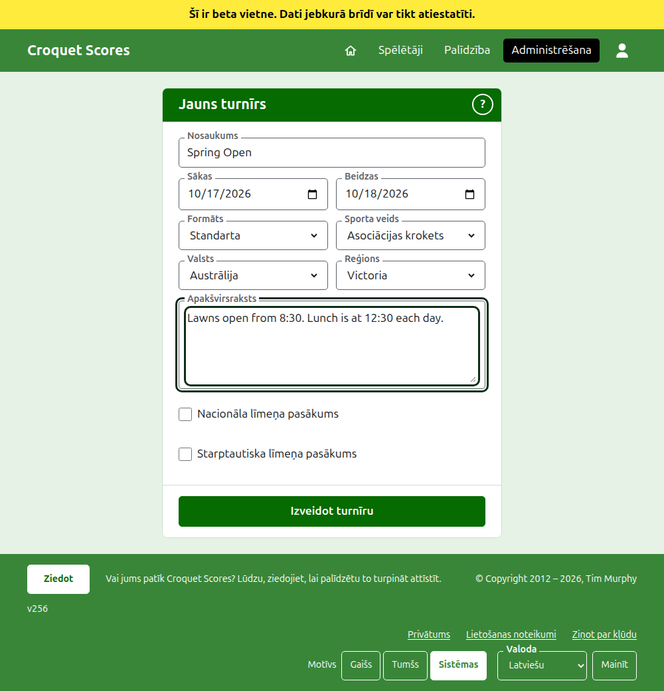

# Turnīra izveide

Nospiediet **Jauns turnīrs** virs turnīru saraksta administrēšanas sadaļā. Tā ir virs saraksta, nevis zem tā, lai garš saraksts to neaizstumtu ārpus telefona ekrāna.

Veidlapa jautā visu, ar ko turnīrs sākas. Parasta veida turnīrs ir nosaukums, divas dienas un valsts: viss pārējais jums tiek izlemts un to var mainīt.

## Ko veidlapa jautā

**Nosaukums.** Ko lasītāji meklē, lai atrastu turnīru, piemēram, "Spring Open". Tajā ir no 3 līdz 254 rakstzīmēm. Nosaukums, kas ir tikai ar mazajiem vai tikai ar lielajiem burtiem, tiek atteikts, jo tas izskatītos kā kļūda katrā lapā, kurā tas tiek rādīts. Diviem turnīriem var būt vienāds nosaukums, jo tas pats turnīrs tiek spēlēts katru gadu.

**Sākas** un **Beidzas.** Dienas, kad turnīrs notiek. Turnīrs nevar beigties pirms tas sākas un nevar sākties vai beigties vēlāk par nākamā gada beigām. Turnīrs pieder tam gadam, kurā tas sākas, kas ir arī gads tā adresē, tāpēc turnīrs, kas ilgst pāri jaunajam gadam, tiek uzskaitīts tajā gadā, kurā tas sākas.

**Formāts.** Izvēlieties **Standarta** turnīram, ko spēlē spēlētāji. Pārējie formāti ir turnīriem, ko spēlē komandas, un tiem ir sava pamācība.

**Sporta veids.** Sporta veidi, ko vietne piedāvā, tās kārtībā: Croquet Scores tie ir asociācijas krokets, golfa krokets, amerikāņu 6 vārtiņu krokets un Ricochet. **Sporta veids**, **Valsts** un **Reģions** ir nolaižamie saraksti: izvēlieties no saraksta vai ierakstiet nosaukuma sākumu, lai pārietu uz to. Gateball Scores nejautā ne sporta veidu, ne formātu, jo tur katrs turnīrs ir standarta gateball turnīrs.

**Valsts** un **Reģions.** Kur turnīrs tiek spēlēts. Valstis, kurās spēlē visvairāk turnīru, ir uzskaitītas pirmās. Reģions tiek jautāts tikai tad, ja izvēlētā valsts ir sadalīta reģionos, piemēram, Austrālijas štatos; valsts, kas pati ir viens reģions, neprasa nevienu. Reģions nav jāizvēlas arī tad, ja tāds tiek piedāvāts.

**Apakšvirsraksts.** Viss, ko vēlaties, lai lasītāji zinātu un kam nav sava lauka: kur novietot automašīnu, kad ir pusdienas, kam zvanīt. Tas tiek rādīts zem turnīra nosaukuma katrā publiskajā lapā. Tas tiek rakstīts Markdown valodā, tāpēc vārdu var padarīt treknu ar zvaigznītēm abās pusēs un saraksts veidots ar domuzīmi katras rindas sākumā. Tajā var būt līdz 2000 rakstzīmēm, un to var atstāt tukšu.

Kā tā sacensības tiek spēlētas un skaitītas, vai ar handikapiem, ar neizšķirtiem rezultātiem un pasaules rangiem, katras sacensības nosaka pašas, kad tās tiek pievienotas.

**Nacionāla līmeņa pasākums** un **Starptautiska līmeņa pasākums.** Turnīrs var būt viens, otrs vai neviens, bet nekad abi: atzīmējot vienu, otra atzīme tiek noņemta. Turnīrs, kas ir atzīmēts kā jebkurš no tiem, turnīru sarakstos tiek iestatīts treknrakstā visā tā rindas garumā.

## Tā izveide

Nospiediet **Izveidot turnīru**. Jūs tiekat aizvests uz turnīra lapu administrēšanas sadaļā, no kuras to vada, un jūs esat tā pirmais pārvaldnieks. Tas tiek uzskaitīts administrēšanas sadaļā zem gada, kurā tas sākas.

Turnīra publiskā adrese tiek veidota no tā gada, sporta veida un nosaukuma, piemēram, `/2026/ac/spring-open`. Tas saglabā šo adresi, kad nosaukums vēlāk tiek izlabots, lai jau nosūtīta saite to joprojām atrastu; tā mainās tikai tad, kad mainās gads, kurā tas sākas, vai tā sporta veids.

## Ja kaut kas tiek atteikts

Kas tiek atteikts, tiek teikts zem lauka, uz kuru tas attiecas, un ievadītais paliek ievadīts. Nekas netiek saglabāts, kamēr nav pieņemts katrs lauks. Visbiežāk tiek atteikts nosaukums, kas ierakstīts tikai ar mazajiem burtiem, beigas pirms sākuma un neizvēlēta valsts.

Tālāk: [Spēlētāji](players.md).
