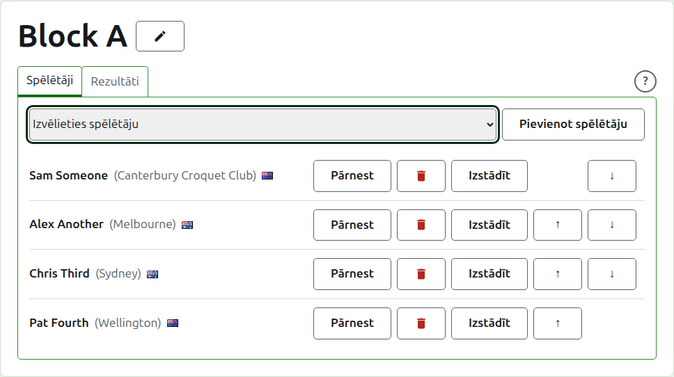
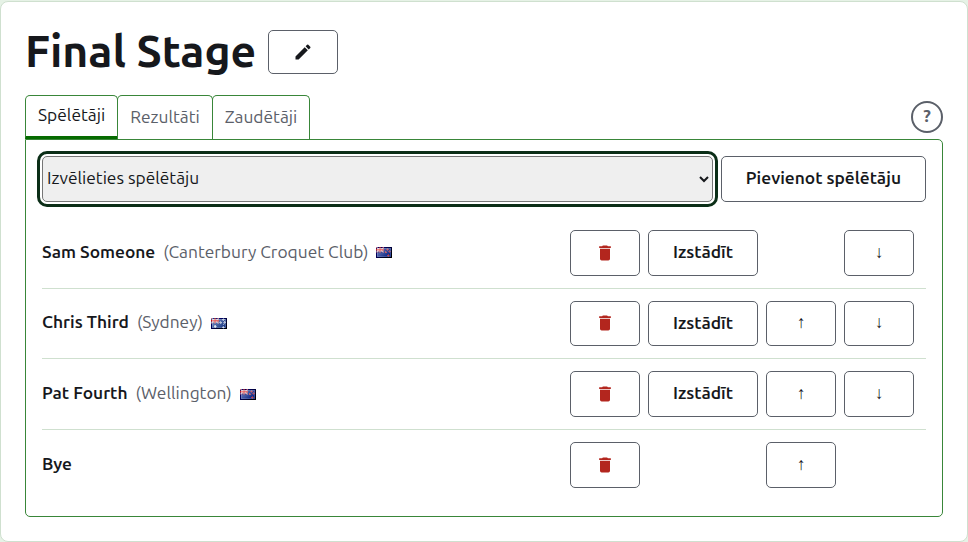
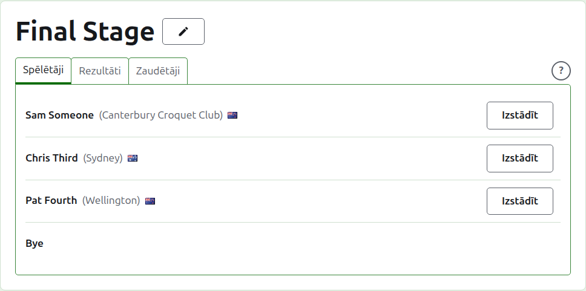
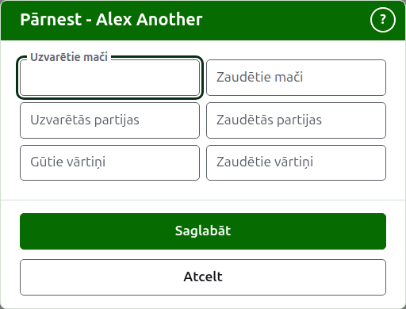
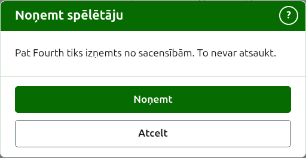
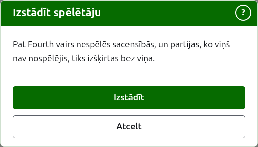
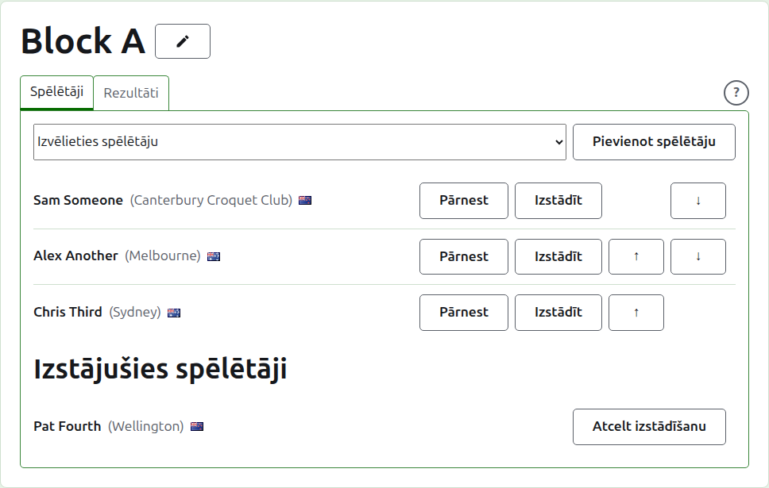

# Spēlētāju ievadīšana sacensībās

Sacensību lapa tiek atvērta no to nosaukuma cilnē Sacensības vai no tumši zaļās joslas. Tās virsraksts ir sacensību nosaukums, ar divām cilnēm zem tā: **Spēlētāji** un **Rezultāti**. Izslēgšanas turnīram ir trešā, **Zaudētāji**, kas aprakstīta sadaļā [Zaudētāju izslēgšanas turnīrs](competitions.md#losers-knockout). Lapa atveras cilnē Spēlētāji, jo spēlētāji tiek ievadīti pirms kaut kas tiek spēlēts.

Spēlētājs sacensībās ir viens no turnīra spēlētājiem, tāpēc viņi tiek ievadīti, izvēloties tos, nevis tos rakstot. Viss par viņiem, izņemot viņu vietu sacensībās un to, ko viņi tajās pārnes, tiek mainīts turnīra cilnē Spēlētāji.

## Spēlētāja pievienošana

Virs saraksta nolaižamais saraksts piedāvā katru turnīra spēlētāju, kas vēl nav sacensībās, turnīra kārtībā. Izvēlieties vienu un nospiediet **Pievienot spēlētāju**. Spēlētājs tiek ielikts turnīra kārtībā starp jau ievadītajiem, nolaižamais saraksts viņu vairs nepiedāvā, un kursors atgriežas nolaižamajā sarakstā, lai nākamo varētu izvēlēties no tastatūras. Ja katrs turnīra spēlētājs ir sacensībās, nolaižamais saraksts netiek rādīts, un cilne to saka.

Turnīra arhivētie spēlētāji netiek piedāvāti.

## Bye izslēgšanas turnīrā {#byes-in-a-knockout}

Izslēgšanas turnīrs tiek spēlēts tikai tad, kad katra tā izlozes vieta ir aizpildīta, un vietas, ko spēlētāji atstāj pāri, tiek aizpildītas ar bye. Tāpēc izslēgšanas turnīrā nolaižamais saraksts piedāvā **Bye** vispirms, pirms spēlētājiem, un turpina to piedāvāt, cik bye arī tiktu pievienoti, jo izlozei var vajadzēt vairākus.

Bye tiek ielikts izlozē tāpat kā spēlētājs: to var pārvietot uz augšu un uz leju un noņemt, bet tas nevar izstāties, jo nespēlē neko. Spēlētājs, kas tiek ievadīts izslēgšanas turnīrā, kura katra vieta ir aizpildīta, tiek noraidīts, un cilne to saka zem nolaižamā saraksta.

Izslēgšanas turnīra spēlētāju kārtība ir tā izloze. Pirmās divas vietas tiekas pirmajā mačā, nākamās divas nākamajā, un tā tālāk. Saliciet spēlētājus tādā kārtībā, kādā izloze jāspēlē, pirms tiek ievadīts kāds rezultāts, jo, tiklīdz izslēgšanas turnīrā ir izmantota partija, tā spēlētāji ir fiksēti: nevienu nevar pievienot, noņemt vai pārvietot. Spēlētājs joprojām var izstāties.

## Zaudētāju izslēgšanas turnīra spēlētāji

Zaudētāju izslēgšanas turnīra spēlētāji netiek ievadīti ar roku. Tie tiek ielikti, kad tiek izšķirti mači, kuru zaudētājus tas ņem, tāpēc tā cilne **Spēlētāji** tos tikai uzskaita un saka, kāpēc.

## Kārtība

Spēlētāji tiek uzskaitīti sacensību kārtībā, kādā tiek veikta izslēgšanas turnīra izloze un kādā grupa tiek uzskaitīta savā publiskajā lapā. **Uz augšu** un **Uz leju** pārvieto spēlētāju par vienu vietu.

## Pārnese {#carry-forward}

**Pārnest** saka, ko spēlētājs ienes sacensībās no spēles, kas netika vērtēta: agrākas stadijas rezultāti vai partijas, kas tika nospēlētas pirms sacensības tika vērtētas šeit. Tas tiek piedāvāts grupā un Šveices sistēmā, kurām ir kopvērtējums, kurā to skaitīt, un nav izslēgšanas turnīrā.

Dialogs prasa sešus skaitļus: uzvarētie un zaudētie mači, uzvarētās un zaudētās partijas, gūtie un zaudētie vārtiņi. Katrs skaitlis ir neobligāts. Atstāts tukšs skaitlis nepārnes neko, kas nav tas pats, kas pārnest 0, lai tas, kurš to vēlāk maina, to redzētu tādu, kāds tas tika atstāts. Nospiediet **Saglabāt**, lai saglabātu visus sešus.

## Spēlētāja noņemšana {#removing-a-player}

**Noņemt** izņem kļūdas dēļ ievadītu spēlētāju. Viņš paliek viens no turnīra spēlētājiem un atkal tiek piedāvāts nolaižamajā sarakstā, bet nekas no viņa vietas sacensībās netiek paturēts, tāpēc Noņemt vispirms jautā.

Spēlētāju, kuram sacensībās ir jebkura izmantota partija, nevar noņemt, jo tad partijas būtu pret kādu, kura vairs nav, un viņam Noņemt netiek piedāvāts. Spēlētāju, kura vienīgās partijas ir arhivētas, var, un viņa arhivētie rezultāti iet kopā ar viņu.

## Spēlētāja izstādīšana {#withdrawing-a-player}

**Izstādīt** ir spēlētājam, kas vairs nespēlēs sacensībās. Viņš paliek tajās ar partijām, ko ir nospēlējis, un tiek uzskaitīts zem **Izstājušies spēlētāji** pēc tiem, kas joprojām spēlē. Izslēgšanas turnīrā viņa pretinieks vēl neizšķirtā mačā iet tālāk.

Izstādīt vispirms jautā, jo tas maina sacensību iznākumu: partijas, ko spēlētājs nav nospēlējis, tiek izšķirtas bez viņa.

Izstājušam spēlētājam tiek piedāvāts tikai **Atcelt izstādīšanu**, kas ieliek viņu atpakaļ to vidū, kas spēlē, pēc tiem, kas palika, bez jautāšanas.

Tālāk: [Rezultāti](scores.md).
