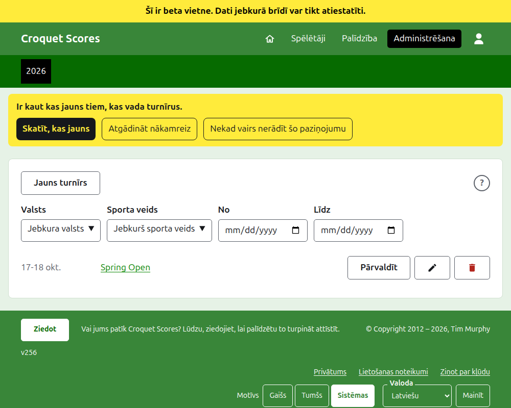
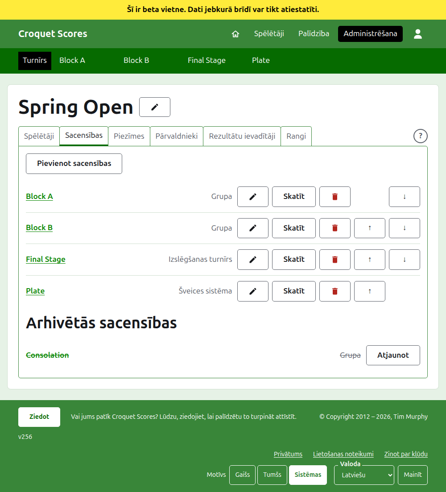

# Standarta turnīra vadīšana

Standarta turnīrs ir turnīrs, kurā spēlē pa vienam pieteikti spēlētāji: kluba nedēļas nogale, atklātais turnīrs, čempionāts. Tā spēlētāji tiek ievadīti grupās, izslēgšanas turnīros un Šveices sistēmās, un tā rezultāti parādās, tiklīdz tie ir nospēlēti. Šī pamācība ved pārvaldnieku no pierakstīšanās līdz turnīram, kura rezultāti ir pieejami publikai.

Tā ir sevī pabeigta. Nekas tajā nav atkarīgs no pamācības par turnīru, ko spēlē komandas, un tā ir uzrakstīta atsevišķi.

## Pirms sākat

Jums vajadzīgs konts. Noklikšķiniet [šeit](/account/register), lai reģistrētu kontu.

Viss, ko dara pārvaldnieks, tiek darīts vietnes administrēšanas sadaļā. Publiskās lapas, kurās spēlētāji un skatītāji seko turnīram, tiek zīmētas no tā, ko glabā administrēšanas sadaļa, tāpēc nekas nav jāpublicē: ievadīts rezultāts uzreiz ir publiskajās lapās.

## Lapas pēc kārtas

1. [Turnīra izveide](creating-a-tournament.md): tā nosaukums, dienas, sporta veids, kur tas tiek spēlēts un vai tas ir nacionāla vai starptautiska līmeņa pasākums.
2. [Spēlētāji](players.md): turnīra spēlētāju ievadīšana, labošana un kļūdaini ievadīto atlikšana malā.
3. [Sacensības](competitions.md): grupu, izslēgšanas turnīru un Šveices sistēmu pievienošana un to sakārtošana.
4. [Spēlētāju ievadīšana sacensībās](entering-players-in-a-competition.md): kas spēlē katrās sacensībās, bye izslēgšanas turnīrā, pārnesumi, noņemšana un izstādīšana.
5. [Rezultāti](scores.md): rezultātu ievadīšana, labošana un kļūdaini ievadīto atlikšana malā.
6. [Piezīmes](notes.md): kā pastāstīt spēlētājiem to, kas viņiem jāzina turnīra gaitā.
7. [Pārvaldnieki un rezultātu ievadītāji](managers-and-scorers.md): turnīra vadīšanas dalīšana un iespēja kādam ievadīt rezultātus, nevarot mainīt neko citu.
8. [Rangi](rankings.md): fails, ko sūta pasaules rangiem, un kas jums atliek aizpildīt.
9. [Turnīra maiņa, arhivēšana un atjaunošana](changing-and-archiving.md): turnīra informācijas labošana un turnīra atlikšana malā.
10. [Ko redz publika](what-the-public-sees.md): lapas, kurās jūsu spēlētāji seko turnīram, un kā tajās parādās tas, ko ievadāt.

## Kā iekārtota administrēšana

Administrēšanas pirmā lapa uzskaita turnīrus, kuros jums ir sava loma, pa vienam gadam.

Nospiežot turnīra nosaukumu vai **Pārvaldīt**, tiek atvērta tā lapa. Viss, kas jāvada, ir sešās cilnēs zem tā nosaukuma: **Spēlētāji**, **Sacensības**, **Piezīmes**, **Pārvaldnieki**, **Rezultātu ievadītāji** un **Rangi**. Lapa atveras ar Spēlētāji, jo spēlētāji ir pirmais, ko ievada. Cilņu rindas beigās un dialoga virsraksta joslā ir apaļa **?**, kas atver palīdzību par to, ko skatāties, citā cilnē, lai jūsu vieta saglabātos. Tāda ir arī blakus **Jauns turnīrs**.

Tumši zaļā josla zem galvenes ir paredzēta pārvietošanai starp lapām. Tā ved uz turnīru kā **Turnīrs** un uz katrām tā sacensībām pēc nosaukuma, lai no turnīra varētu pāriet uz sacensībām un starp sacensībām, negriežoties atpakaļ caur cilni Sacensības. Lapa, kurā esat, ir atzīmēta melnā krāsā.

## Kas ir spēkā visur

**Nekas netiek izdzēsts pavisam, izņemot piezīmi.** Spēlētāji, sacensības, rezultāti un pats turnīrs tiek arhivēti, nevis dzēsti: atlikti malā, pārsvītroti un uzskaitīti zem sava virsraksta ar **Atjaunot**, lai tos atgrieztu. Arhivēšana, atjaunošana un pārvietošana uz augšu un uz leju nekad neprasa apstiprinājumu, jo katru atsauc, nospiežot pretējo. Lietas, ko nevar atsaukt, piemēram, spēlētāja noņemšana no sacensībām vai piezīmes dzēšana, vispirms jautā.

**Dialogs virs lapas neko nesaglabā, kamēr nenospiežat tā pogu.** Atcelšana vai taustiņš Escape to aizver un atstāj visu, kā bija. Dialogi, kas pievieno, piemēram, Pievienot spēlētāju un Pievienot rezultātu, paliek atvērti pēc katra pievienošanas, lai sarakstu varētu ievadīt vienu pēc otra.

**Kas tiek atteikts, tiek teikts blakus laukam, uz kuru tas attiecas.** Nekas atteiktais netiek saglabāts, un ievadītais paliek ievadīts, lai to varētu izlabot, nevis rakstīt no jauna.

**Administrēšana darbojas telefonā.** Katra poga ir pietiekami liela, lai to nospiestu ar īkšķi, un nekas nav platāks par ekrānu.

Tālāk: [Turnīra izveide](creating-a-tournament.md).
