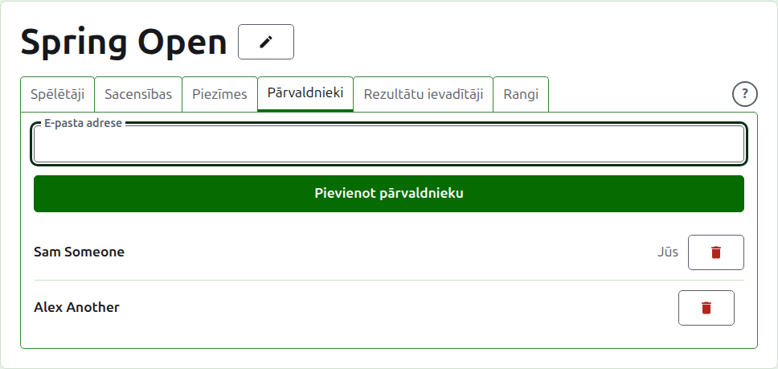
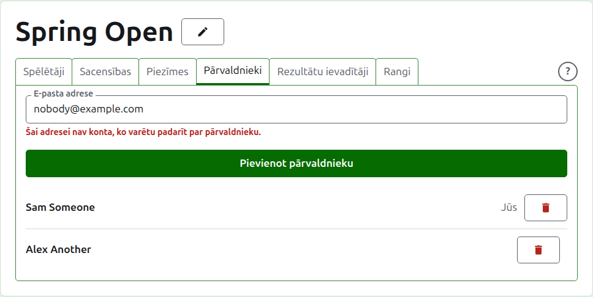
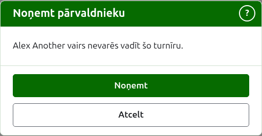
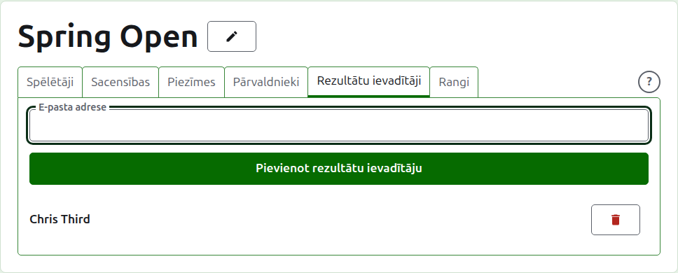
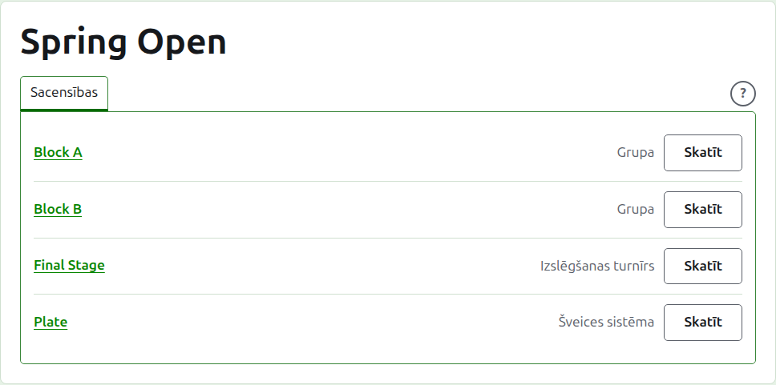

# Pārvaldnieki un rezultātu ievadītāji

Turnīram ir pārvaldnieki, kas var darīt visu, ko ar to var darīt, un var būt rezultātu ievadītāji, kas ievada tā rezultātus un neko citu. Tas, kas izveidoja turnīru, ir tā pirmais pārvaldnieks.

## Pārvaldnieki {#managers}

Cilne **Pārvaldnieki** uzskaita, kas vada turnīru, tādā kārtībā, kādā tie tika iecelti, ar jūsu pašu vārdu atzīmētu kā jūsu. Tā ir vieta, kur turnīru dala vai nodod tālāk.

Kādu par pārvaldnieku padara pēc viņa e-pasta adreses. Ierakstiet to laukā virs saraksta un nospiediet **Pievienot pārvaldnieku**. Adresei jāpieder kontam, kas ir reģistrēts un apstiprināts; adrese bez tāda tiek atteikta zem lauka, un vietne par to saka tikai tik. Rezultātu ievadītājs, kas tiek padarīts par pārvaldnieku, pārstāj būt rezultātu ievadītājs.

**Noņemt** noņem pārvaldnieku. Nekas netiek saglabāts par noņemto pārvaldnieku, tāpēc Noņemt vispirms jautā; viņu atkal padara par pārvaldnieku pēc adreses, ja viņu vajag atpakaļ. Turnīram vienmēr ir pārvaldnieks, tāpēc pēdējam netiek piedāvāts Noņemt.

Jūs varat noņemt arī sevi. Tad jautājums saka, ko tas nozīmē: jūs zaudējat savu ceļu atpakaļ uz turnīru, un neviens lapā to jūsu vietā nevar atsaukt. Cits pārvaldnieks var jūs atkal padarīt par pārvaldnieku.

## Rezultātu ievadītāji {#scorers}

Cilne **Rezultātu ievadītāji** ir cilne Pārvaldnieki rezultātu ievadītājiem un darbojas tāpat: e-pasta adrese un **Pievienot rezultātu ievadītāju** virs saraksta un **Noņemt** katram.

Rezultātu ievadītājs redz turnīru savā sarakstā administrēšanas sadaļā ar **Rezultāti** Pārvaldīt vietā un viņam tiek piedāvātas tikai tā sacensības: nav spēlētāju, piezīmju, pārvaldnieku, rezultātu ievadītāju vai rangu. Sacensību lapā viņš redz tikai cilni Rezultāti, kur var ievadīt, labot, arhivēt un atjaunot rezultātus tāpat kā pārvaldnieks. Kas spēlē sacensībās, to izlemj pārvaldnieki.

Pārvaldnieks netiek padarīts par rezultātu ievadītāju, jo pārvaldnieks jau var darīt visu, ko rezultātu ievadītājs. Turnīram nevajag rezultātu ievadītāju, tāpēc var noņemt katru rezultātu ievadītāju, arī pēdējo.

Tālāk: [Rangi](rankings.md).
