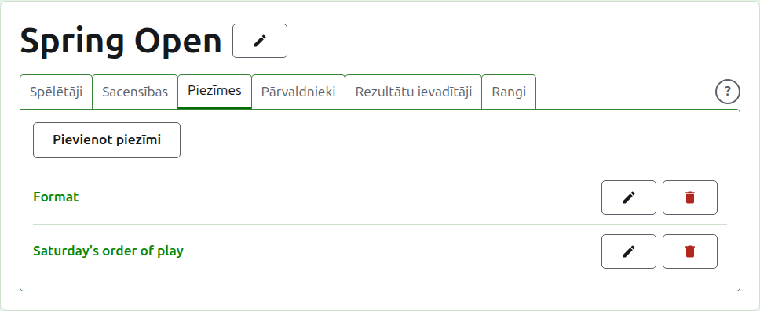
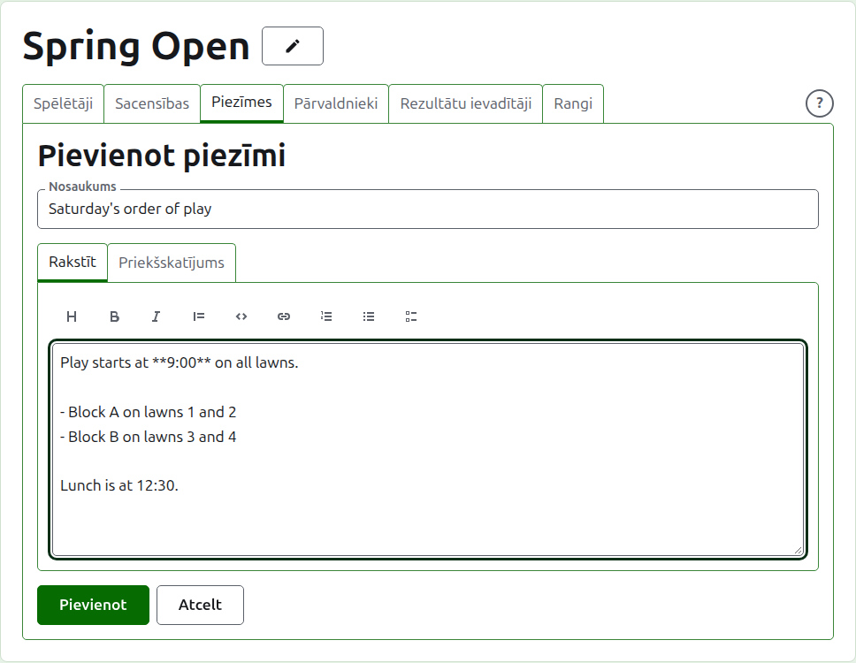
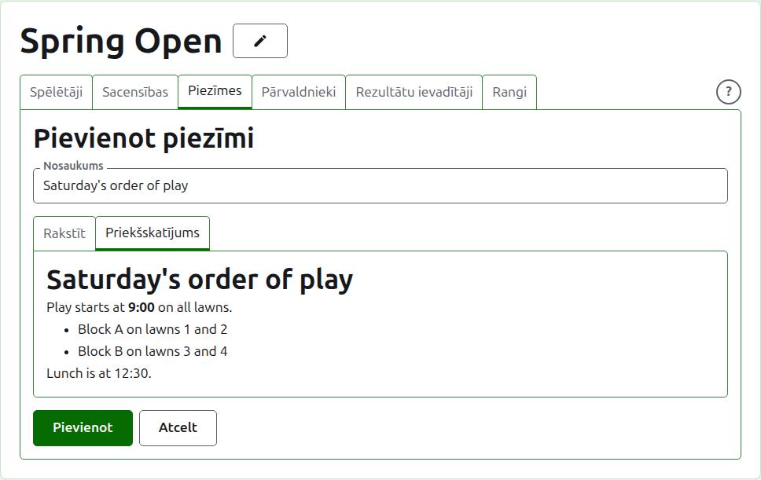
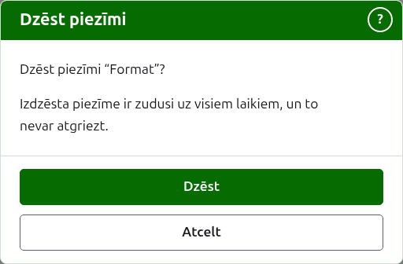

# Piezīmes

Turnīra lapas cilne **Piezīmes** ir vieta, kur tā pārvaldnieki raksta to, kas spēlētājiem jāzina turnīra gaitā: formātu, izmaiņu spēļu kārtībā, pusdienu laiku. Lasītāji tās atrod turnīra publiskajā piezīmju lapā ar virsrakstu Pārvaldnieka piezīmes, un piezīme, ko viņi nav lasījuši, tur ir atzīmēta ar sarkanu zvaigznīti, kas atzīmē arī sadaļu Piezīmes katrā turnīra lapā, kamēr viņi to neatver.

## Piezīmes rakstīšana

Nospiediet **Pievienot piezīmi** virs saraksta. Saraksta vietā parādās panelis, jo piezīme tiek rakstīta plaši un tai vajag vietu.

**Nosaukums** ir obligāts, un pēc tā piezīme tiek uzskaitīta. Tas ir vienkāršs teksts.

**Apraksts** tiek rakstīts Markdown valodā, un to var atstāt tukšu, ja nosaukums pasaka visu, kas sakāms. Rīkjosla virs lodziņa raksta Markdown jūsu vietā: Virsraksts, Treknraksts, Kursīvs, Citāts, Kods, Saite, Numurēts saraksts, Aizzīmju saraksts un Uzdevumu saraksts. Katrs darbojas ar atlasīto vai katras atlasītās rindas sākumā, vai arī novieto kursoru tur, kur jāliek vārdi.

Tukša rindiņa starp divām rindkopām tās atdala, un lasītājs starp tām redz pilnu tukšu rindu. **Priekšskatījums** parāda piezīmi tā, kā lasītājs to redzēs tās lapā.

Nospiediet **Pievienot**. Piezīme tiek saglabāta, saraksts atgriežas ar to augšā, un tā uzreiz ir publiskajā piezīmju lapā.

## Piezīmes labošana

Nospiediet piezīmes nosaukumu vai tās **Labot**, lai atvērtu paneli ar šo piezīmi. Nospiediet **Saglabāt**, lai saglabātu izmaiņu. Piezīme, kas labota pēc tam, kad lasītājs to izlasīja, viņam tiek atzīmēta no jauna.

## Piezīmes dzēšana {#deleting-a-note}

Piezīmi, kas vairs neattiecas, izdzēš. Izdzēsta piezīme ir zudusi uz visiem laikiem, tāpēc **Dzēst** vispirms jautā.

Tālāk: [Pārvaldnieki un rezultātu ievadītāji](managers-and-scorers.md).
