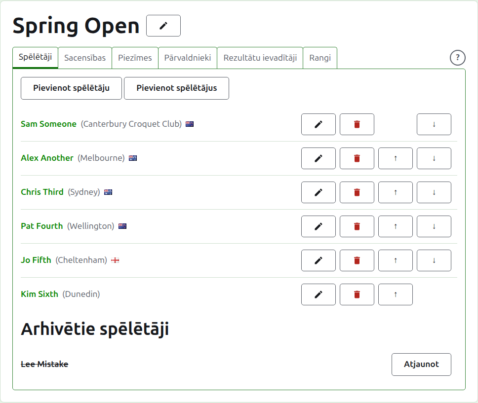
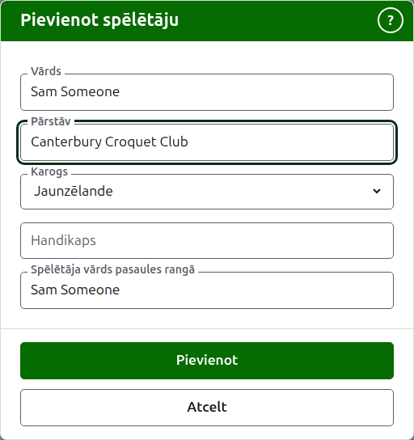
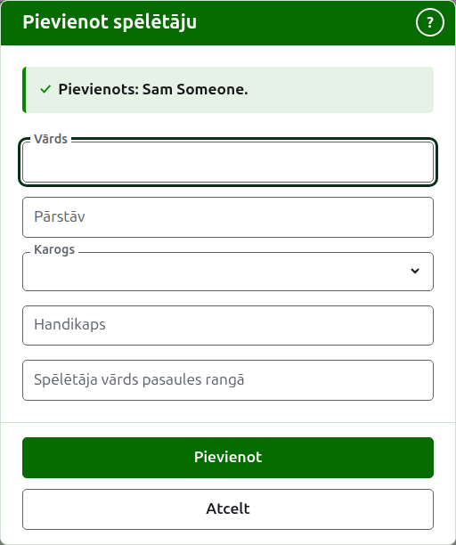
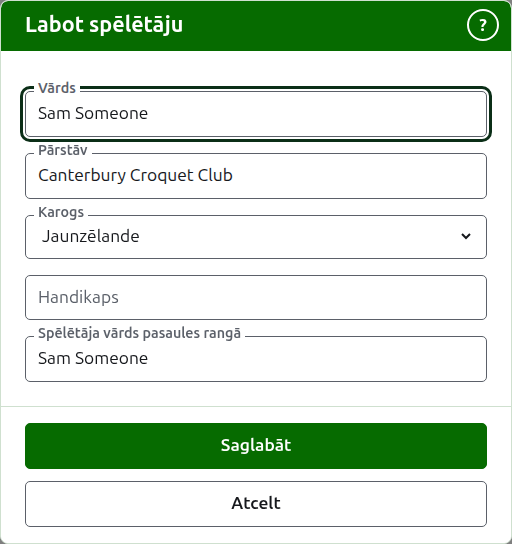
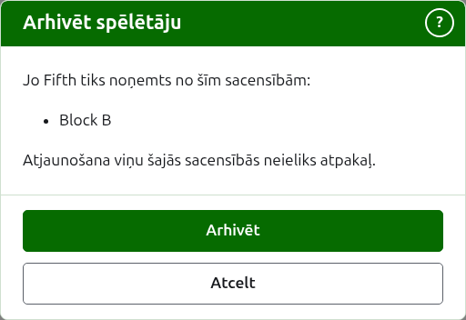

# Spēlētāji

Turnīra lapas cilne **Spēlētāji** ir vieta, kur tiek ievadīti, laboti, sakārtoti un atlikti malā tā spēlētāji. Tā ir cilne, kurā lapa atveras, jo spēlētāju ievadīšana ir pirmais, ko dara ar turnīru.

Spēlētāji šeit tiek ievadīti vienu reizi, turnīrā. Kurās sacensībās katrs spēlē, tiek izvēlēts vēlāk, katras sacensību lapā, no šeit ievadītajiem spēlētājiem. Skatiet [Spēlētāju ievadīšana sacensībās](entering-players-in-a-competition.md).



## Spēlētāja pievienošana {#add-a-player}

Nospiediet **Pievienot spēlētāju** virs saraksta. Virs lapas atveras dialogs.



**Vārds** ir obligāts. Tas ir spēlētāja vārds, kā tas tiks rādīts katrā lapā, no 3 līdz 254 rakstzīmēm. Diviem spēlētājiem vienā turnīrā nevar būt viens un tas pats vārds, lai kā tas būtu rakstīts ar lielajiem un mazajiem burtiem; ja divi spēlētāji tiešām dala vārdu, atšķiriet tos pašā vārdā, piemēram, "Andrew Hobbs (2)".

**Pārstāv** ir tas, ko spēlētājs pārstāv, rakstīts tā, kā to teiktu lasītājs: klubs, reģions vai valsts, piemēram, "Canterbury Croquet Club". Tas tiek rādīts iekavās aiz vārda. To var atstāt tukšu. Rakstot tiek piedāvāts tas, ko jebkura vietnes turnīra spēlētāji ir pārstāvējuši un kam kāds vārds sākas ar jūsu rakstīto, lai klubs tiktu rakstīts tā, kā tas ir rakstīts iepriekš; taustiņš Tab pieņem to, kas rādīts aiz kursora.

**Karogs** ir karogs, kas tiek rādīts blakus spēlētāja vārdam. Tas ir nolaižams saraksts ar vietām pēc nosaukuma, vispirms "nav", tad vietas, kurās tiek spēlēts visvairāk turnīru; ierakstiet nosaukuma sākumu, lai pārietu uz to. To var atstāt kā "nav", kā tas ir lielākajai daļai spēlētāju. Tas, ko spēlētājs pārstāv, un tas, kura karogu viņš nes, ir šķirti, jo spēlētājs var spēlēt par klubu vienā valstī un nest citas valsts karogu.

**Handikaps** ir spēlētāja handikaps, ja viņam tāds ir: zīme, līdz diviem cipariem un daļa ar vienu ciparu, piemēram, 4, +4 vai -1.5. Tas tiek saglabāts tā, kā jūs to rakstāt, un tiek rādīts iekavās kopā ar to, ko spēlētājs pārstāv, pirms tā. To var atstāt tukšu.

**Spēlētāja vārds pasaules rangā** ir vārds, ar kādu pasaules rangi pazīst spēlētāju. To prasa tikai Asociācijas kroketa vai Golfa kroketa turnīrā, abos sporta veidos, kuru spēlētājiem pasaules rangi tur sarakstu. Amerikāņu 6 vārtiņu kroketa spēlētājus rangi pazīst pēc viņu pašu vārdiem, tāpēc to tur neprasa, un katra spēlētāja pasaules ranga vārds vienmēr ir viņa vārds. Kamēr pievienojat spēlētāju, tas seko vārdam, to rakstot, jo lielākā daļa spēlētāju rangos ir pazīstami pēc sava vārda, un pārstāj sekot, tiklīdz jūs rakstāt tajā. Atstāts tukšs, tas tiek saglabāts kā spēlētāja vārds.

Rakstot vārdu, tiek piedāvāti spēlētāji, ko pasaules rangi pazīst un kuru vārdi sāktos šādi, lai jūs varētu paņemt vārdu tā, kā to raksta rangi, nevis rakstīt to pilnībā. Blakus pasaules ranga vārdam atzīme saka, ka rangi vārdu pazīst, un jautājuma zīme saka, ka nepazīst: vārds var būt uzrakstīts nepareizi vai spēlētājs rangos var būt jauns. Tas ir tikai padoms. Vārds, ko rangi nepazīst, tiek saglabāts tikpat viegli kā tas, ko pazīst.

Nospiediet **Pievienot**. Spēlētājs tiek pievienots, dialogs to saka, un tā lauki tiek iztukšoti nākamajam spēlētājam, kursoram atgriežoties vārdā. Pievienojiet visu sarakstu šādi, tad nospiediet **Atcelt**, lai aizvērtu dialogu. Atcelšana neatceļ neko, kas jau bija pievienots.



Spēlētāju nekad nesauc par "Bye". Izslēgšanas turnīra bye tiek pievienoti pašā izslēgšanas turnīrā, kur vien tiek ievadīti tā spēlētāji, tāpēc vārds, kas ir "Bye" vai "Bye" ar numuru, piemēram, "Bye 2", "Bye-2" vai "Bye (2)", tiek noraidīts, un dialogs paskaidro, kāpēc.

## Vairāku spēlētāju pievienošana {#adding-multiple-players}

Lai pievienotu visu sarakstu uzreiz, nospiediet **Pievienot spēlētājus** blakus **Pievienot spēlētāju**. Virs lapas atveras dialogs ar vienu lodziņu, kurā var ievadīt vairākas teksta rindas. Sarakstu varat nokopēt no izklājlapas un ielīmēt lodziņā.

**Pirmā rinda nosauc laukus** (saraksts, kura pirmā rinda nenosauc nevienu, tiek noraidīts ar tekstu "Pirmajai rindai jābūt lauku nosaukumiem"), atdalītus ar komatiem vai tabulēšanas taustiņiem: **Name** un jebkuri no **Representing**, **Flag**, **Handicap** un **WorldRankingPlayerName**, jebkurā secībā. Šie nosaukumi tiek rakstīti angliski, lai kādā valodā būtu vietne. **Name** jābūt vienam no tiem. **Katra rinda pēc tās ir spēlētājs**, ar vērtību katram laukam tajā pašā secībā, atdalītām tāpat. Spēlētājs, kuram laukam nekā nav, atstāj to tukšu, bet patur komatu vai tabulēšanas zīmi. Piemēram, ar komatiem:

```
Name,Representing,Flag
Sam Someone,Canterbury Croquet Club,New Zealand
Alex Another,,England
```

- **Vārds, Pārstāv un Spēlētāja vārds pasaules rangā** ir pakļauti tiem pašiem noteikumiem kā tad, kad pievienojat vienu spēlētāju (skatiet [Spēlētāja pievienošana](players.md#add-a-player)). Vārds ir no 3 līdz 254 rakstzīmēm, tā vēl nav turnīrā, lai kā tas būtu rakstīts ar lielajiem un mazajiem burtiem, un tas nav "Bye".
- **Karogs** ir valsts vai vietas nosaukums jūsu valodā, kā to piedāvā saraksts dialogā Pievienot spēlētāju, piemēram, Jaunzēlande.
- **Handikaps** ir zīme, līdz diviem cipariem un daļa ar vienu ciparu, piemēram, 4, +4 vai -1.5.
- Spēlētājs, kuram nav dots **WorldRankingPlayerName**, tiek pazīts pēc sava vārda, tāpat kā tad, kad tiek pievienots pa vienam.
- **Komati vai tabulēšanas zīmes.** No izklājlapas nokopētas šūnas ir atdalītas ar tabulēšanas zīmēm, un ar roku rakstīts saraksts parasti ir atdalīts ar komatiem. Der abi. Ja pirmajā rindā ir tabulēšanas zīme, viss saraksts tiek lasīts ar tabulēšanas zīmēm, citādi ar komatiem.
- Vērtība, kurā ir atdalītājs, tiek rakstīta pēdiņās, kā to raksta izklājlapa: "Smith, John" sarakstā, kas atdalīts ar komatiem. Pēdiņa vērtības iekšpusē tiek rakstīta divas reizes.
- No katras vērtības galiem tiek noņemtas atstarpes, un rinda, kurā nekā nav, tiek ignorēta.
- Sarakstā var būt ne vairāk kā 500 spēlētāju. Pārējos pievienojiet citā sarakstā.

Nospiediet **Pievienot**. Viss saraksts tiek pārbaudīts, pirms kaut kas no tā tiek saglabāts, tāpēc saraksts, kurā kaut kas nav kārtībā, nepievieno nevienu. Kas nav kārtībā, tiek teikts zem lodziņa, pie rindas, kurā tas ir, pirmo rindu skaitot kā 1. Tiek uzskaitītas visas kļūdas, ne tikai pirmā, un tas, ko rakstījāt, paliek, lai jūs to varētu izlabot. Kad saraksts ir saglabāts, dialogs aizveras un cilnē Spēlētāji tiek uzskaitīti jaunie spēlētāji tādā secībā, kādā tos rakstījāt. Atšķirībā no **Pievienot spēlētāju**, kas paliek atvērts nākamajam spēlētājam, nākamā nav: saraksts bija nākamais.

**?** dialoga virsraksta joslā ved uz šejieni. Gan šis dialogs, gan Pievienot spēlētāju paliek logā, lai kur lapa būtu ritināta.

## Spēlētāja labošana {#correcting-a-player}

Nospiediet spēlētāja vārdu vai viņa **Labot**, lai atvērtu to pašu dialogu par šo spēlētāju ar nosaukumu Labot spēlētāju. Mainiet to, kas nav pareizi, un nospiediet **Saglabāt**, kas saglabā izmaiņu un aizver dialogu. Spēlētājs, kura vārds tiek labots, patur savu pasaules ranga vārdu, jo rangi viņu joprojām pazīst pēc tā. Amerikāņu 6 vārtiņu kroketā spēlētāja pasaules ranga vārds vienmēr ir viņa vārds, tāpēc vārda labošana labo arī to.



Šeit labots spēlētājs tiek labots visur: katrās sacensībās, kurās viņš ir, un katrā publiskajā lapā.

## Spēlētāju sakārtošana

Spēlētāji tiek uzskaitīti turnīra kārtībā, kādā tie tiek piedāvāti, kad tos ievada sacensībās, un kādā tiek veikta izslēgšanas turnīra izloze. **Uz augšu** un **Uz leju**, bultiņas katras rindas beigās, pārvieto spēlētāju par vienu vietu. Pirmajam spēlētājam netiek piedāvāts Uz augšu, bet pēdējam Uz leju.

## Spēlētāja arhivēšana {#archiving-a-player}

**Arhivēt** noliek spēlētāju malā: ievadīts kļūdas dēļ vai izstājies no visa turnīra. Arhivēts spēlētājs tiek uzskaitīts zem **Arhivētie spēlētāji**, pārsvītrots, aiz izmantotajiem spēlētājiem, un viņam tiek piedāvāts tikai **Atjaunot**. Arhivēts spēlētājs nav nevienās sacensībās un neparādās nevienā publiskajā lapā.

Spēlētāju, kurš ir nospēlējis jebkuru partiju, nevar arhivēt, jo tad partijas būtu pret kādu, kura vairs nav, tāpēc šādam spēlētājam Arhivēt netiek piedāvāts. Spēlētāju, kura vienīgās partijas ir arhivētas, var.

Spēlētāja, kas nav nevienās sacensībās, arhivēšana nejautā iepriekš, jo atjaunošana visu atgriež. Spēlētāja, kas ir jebkurās sacensībās, arhivēšana jautā iepriekš, jo arhivēšana viņu noņem no katrām sacensībām, kurās viņš ir, un atjaunošana neieliek viņu atpakaļ.



Tālāk: [Sacensības](competitions.md).
