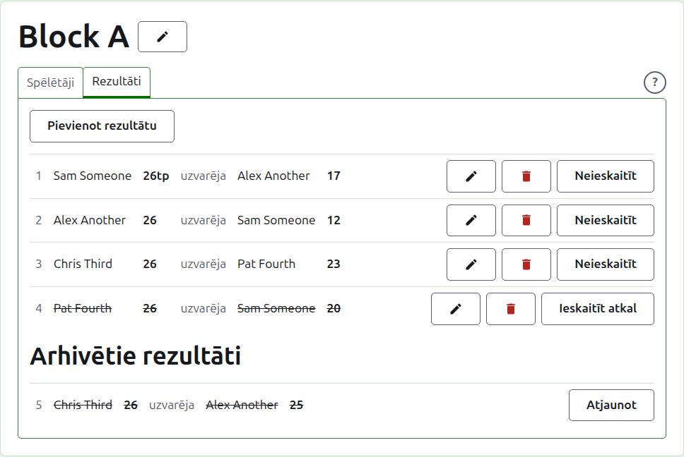
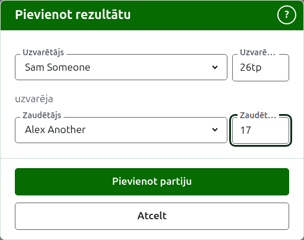
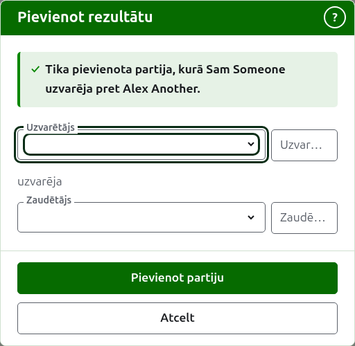
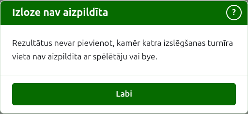
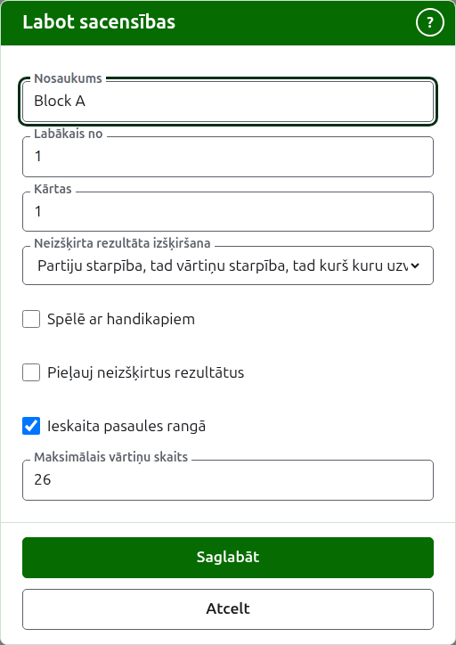

# Rezultāti

Sacensību lapas cilne **Rezultāti** ir vieta, kur tiek ievadītas, labotas un atliktas malā tā partijas. Rezultātu ievadītājs redz tikai šo cilni un var tajā darīt visu, ko pārvaldnieks.

## Rezultāta ievadīšana {#entering-a-score}

Nospiediet **Pievienot rezultātu** virs saraksta. Dialogs lasās tā, kā rezultātu saka skaļi: uzvarētājs un viņa rezultāts, tad "uzvarēja", tad zaudētājs un viņa rezultāts.

Uzvarētājs un zaudētājs tiek izvēlēti no sacensību spēlētājiem, kas spēlē, sacensību kārtībā. Sākumā netiek izvēlēts neviens, lai partija nekad netiktu ierakstīta pret spēlētāju, ko neizvēlējāties. Izslēgšanas turnīrā, izvēloties uzvarētāju, tiek izvēlēts, pret ko viņš ir izlozēts kā zaudētājs, kur to redzat un varat izvēlēties citu.

Rezultāts tiek rakstīts tā, kā rezultātu ievadītājs to pierakstīja: tā punktu skaits un viss, kas seko, kas tiek paturēts un rādīts tā, kā rakstīts, piemēram, "26tp" 26 vārtiņiem un trīskāršai peel. Skaitlis ir cipari, ar kuriem rezultāts sākas; rezultāts, kas nesākas ar ciparu, tiek noraidīts.

Partija, kas uzvarēta ar vienādiem punktiem, kā tad, kad tā tiek apturēta laika dēļ un izšķirta citādi, saka, kurš to uzvarēja, ar atzīmi aiz uzvarētāja rezultāta: "6w" uzvarēja "6". Croquet Scores atzīmes ir "w", "won" un "winner"; Gateball Scores pieņem arī "cb" un "so". Uzvarētāja rezultātam jābūt lielākam par zaudētāja vai atzīmētam, ja vien turnīrs nepieļauj neizšķirtus rezultātus, un tad vienādi punkti bez atzīmes tiek paturēti kā neizšķirts.

Nospiediet **Pievienot partiju**. Partija tiek pievienota, dialogs saka, kura, un lauki tiek iztukšoti nākamajai, jo rezultāti nāk kopumā, nolasīti no tāfeles kārtas beigās. Nospiediet **Atcelt**, kad tie visi ir ievadīti.

Ja dialogs nevar nolasīt sacensību spēlētājus, tas saka "Spēlētājus nevarēja nolasīt. Aizveriet šo dialogu un atveriet to vēlreiz." Izdariet to.

Kas tiek noraidīts, tiek teikts zem lauka, uz kuru tas attiecas: neizvēlēts uzvarētājs vai zaudētājs, neievadīts rezultāts vai tāds, kas nesākas ar ciparu, viens un tas pats spēlētājs abās vietās, zaudētāja rezultāts, atzīmēts kā uzvarēts, vai uzvarētāja rezultāts, kas atpaliek no zaudētāja. Izslēgšanas turnīrā divi spēlētāji, kas nav izlozēti tikties, tiek noraidīti virs laukiem.

## Izslēgšanas turnīra izlozei vispirms jābūt aizpildītai {#draw-filled-first}

Izslēgšanas turnīrs tiek spēlēts tikai tad, kad katra izlozes vieta satur spēlētāju vai bye. Līdz tam Pievienot rezultātu paskaidro, kāpēc rezultātus nevar pievienot, nevis atver dialogu.

## Rezultātu saraksts

Izmantotie rezultāti tiek uzskaitīti tādā secībā, kādā tie tika ievadīti, vecākie pirmie, lai saraksts lasītos tā, kā sacensības tika spēlētas. Saraksts ir tabula ar rindu katrai partijai un bez kolonnu virsrakstiem. Rinda saka partijas numuru, uzvarētāju un viņa rezultātu, vārdu "uzvarēja", tad zaudētāju un viņa rezultātu, un piedāvā **Labot** un **Arhivēt**.

Partijas numurs ir tās vieta starp ievadītajām partijām, pirmā ir 1, arhivētās ieskaitot. Partijas arhivēšana nemaina nevienas citas numuru, tāpēc robs numuros saka, ka partija ir arhivēta.

## Rezultāta labošana {#correcting-a-score}

**Labot** atver to pašu dialogu par šo rezultātu ar nosaukumu Labot rezultātu, ar izvēlētiem spēlētājiem un rezultātiem tādiem, kādi tie tika ievadīti. Nospiediet **Saglabāt**, lai saglabātu labojumu un aizvērtu dialogu.

Labojums saglabā iznākumu: uzvarēta partija paliek uzvarēta, un neizšķirta partija paliek neizšķirta. Partija, kuras iznākums bija nepareizs, tiek arhivēta un ievadīta no jauna.

Kur rezultātu varētu arhivēt, var mainīt gan tā spēlētājus, gan rezultātus. Izslēgšanas turnīrā rezultāts, kura uzvarētājs jau ir spēlējis nākamajā kārtā, patur savus spēlētājus, jo uzvarētāja maiņa atstātu nākamo partiju nospēlētu ar kādu, kas tur nebija nonācis; var labot tikai tā rezultātus.

## Rezultāta arhivēšana

**Arhivēt** noliek rezultātu malā, lai tas neskaitītos nekam. Tas tiek uzskaitīts zem **Arhivētie rezultāti**, pārsvītrots, un tam tiek piedāvāts tikai **Atjaunot**. Neviens nejautā iepriekš, jo katrs atceļ otru.

Izslēgšanas turnīrā mača uzvarētājs iet uz nākamo kārtu, tāpēc mača rezultātam, kura uzvarētājs ir spēlējis nākamajā kārtā, Arhivēt netiek piedāvāts. Vispirms tiek arhivēta nākamās kārtas partija, un tad var arhivēt tās, kas ir pirms tās. Kur kārta ir labākais no 3 vai 5, katra mača partija tiek turēta tāpat. Grupai un Šveices sistēmai nav kārtu, kas būtu atkarīgas viena no otras, tāpēc katru to rezultātu var arhivēt.

## Rezultāta neieskaitīšana

Spēlētājs, kas atstāj sacensības, parasti tiek izstādīts no tām, cilnē Spēlētāji, un ar to pietiek: viņš vairs nespēlē, un partijas, ko viņš nospēlēja, paliek spēkā, bet viņa partijas vairs netiek skaitītas uzvarās/zaudējumos un vārtiņos. Rezultāta neieskaitīšana ir retākam gadījumam, kad nospēlēta partija nav jāskaita. Piemēram, Australian President's Eights pirmās kārtas rezultāti paliek spēkā, kad spēlētājs izstājas, un no vērtējuma tiek izņemtas tikai viņa otrās kārtas partijas: neieskaitiet tās.

Grupā vai Šveices sistēmā rezultāts, kas tika nospēlēts, bet nav jāskaita, tiek neieskaitīts, nevis arhivēts. **Neieskaitīt** patur to starp izmantotajiem rezultātiem, savā vietā, bet pārsvītrotu un nekam neskaitītu publiskajās lapās. **Ieskaitīt atkal** liek tam skaitīties atkal. Neviens nejautā iepriekš. Izslēgšanas turnīra rezultātiem Neieskaitīt netiek piedāvāts, jo tur rezultāts izšķir vairāk nekā kopvērtējumu.

Tālāk: [Piezīmes](notes.md).
