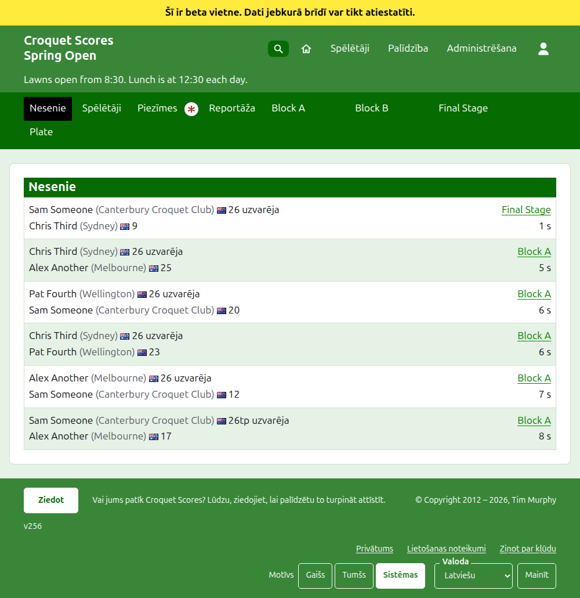
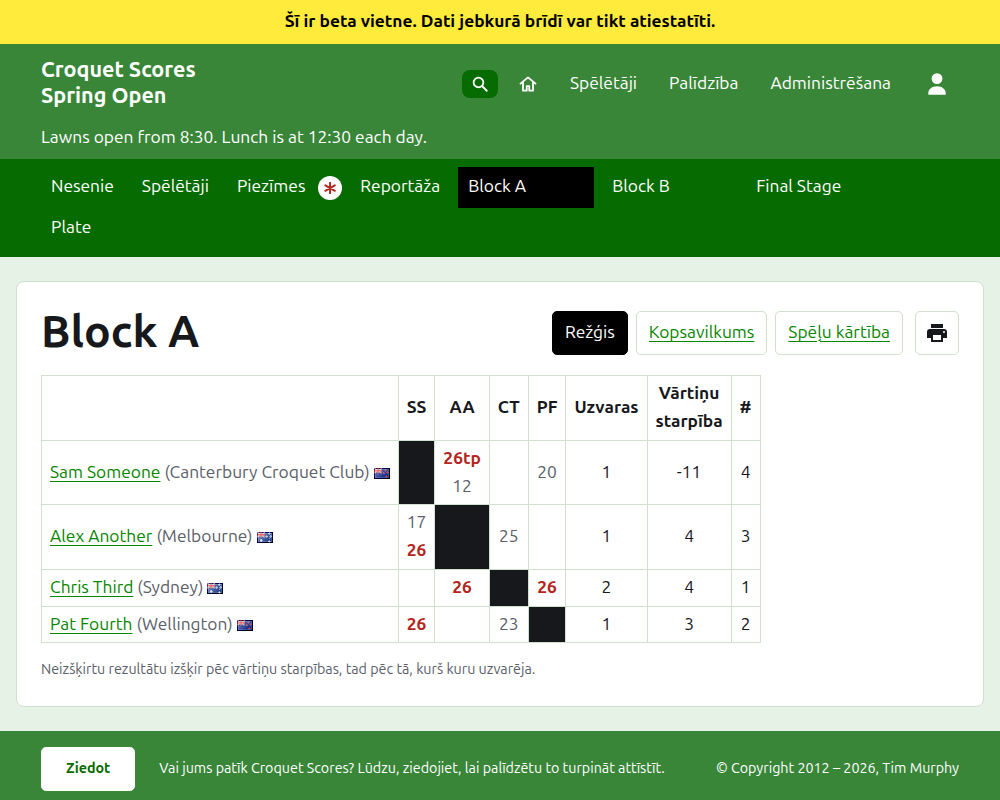
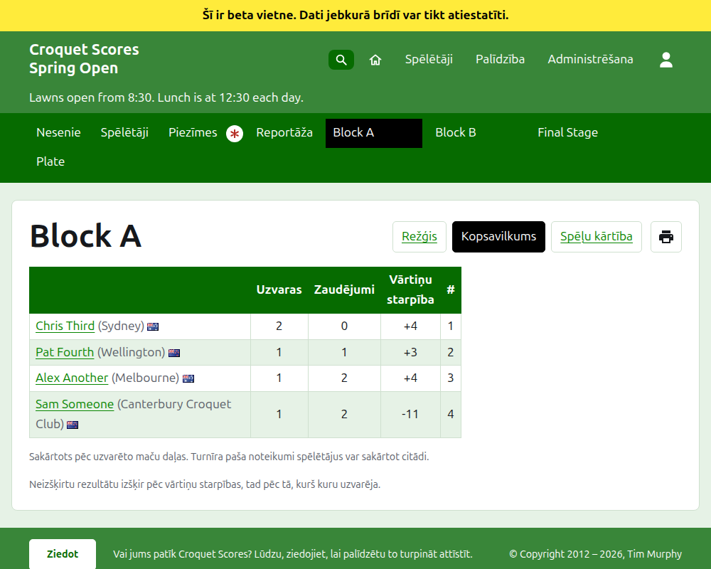
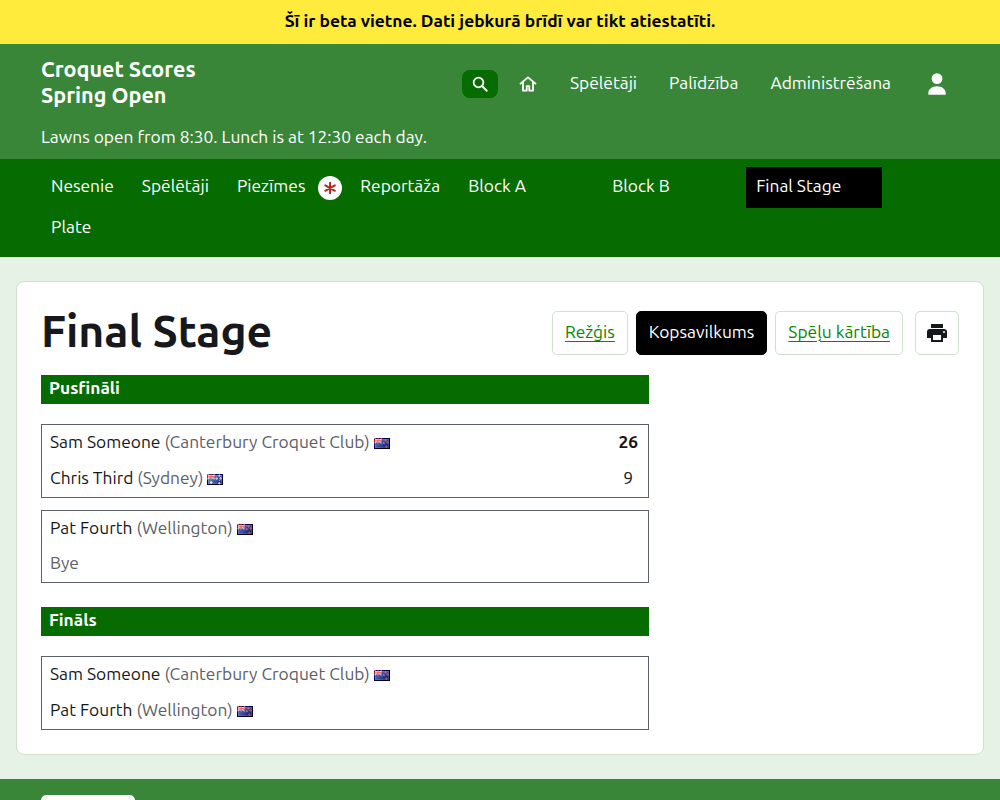
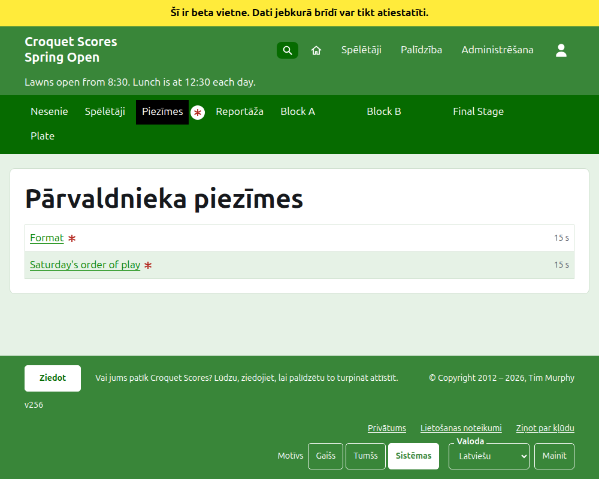

# Ko redz sabiedrība

Nekas netiek publicēts: publiskās lapas tiek zīmētas no tā, ko tur administrēšana, tāpēc ievadīts rezultāts tajās ir uzreiz. Tām nevajag konta ne skriptus, un tās ir veidotas tālrunim.

## Turnīra lapa

Turnīra lapa ir pie tā gada, sporta veida un nosaukuma, piemēram, `/2026/ac/spring-open`. Tās virsraksts ir turnīra nosaukums ar apakšvirsrakstu zem tā. Tā uzskaita katru izmantoto partiju, nesen pievienotās pirmās, lai lasītājs, kas atgriežas, redzētu, kas noticis kopš tā laika. Katra partija saka uzvarētāju, viņa handikapu un ko viņš pārstāv, viņa karogu un rezultātu, tad zaudētāju un viņa, ar sacensībām, kurās tā tika spēlēta, un cik sen tā tika pievienota.

Tumši zaļā josla piedāvā turnīra sadaļas: **Nesenie**, kas ir šī lapa, **Spēlētāji**, **Piezīmes** un **Reportāža**, tad katras izmantotās sacensības tādā secībā, kādā tās ir cilnē Sacensības. Piezīmes ir atzīmētas ar sarkanu zvaigznīti, kamēr ir piezīme, ko lasītājs nav lasījis.

## Grupa

Grupas lapa rāda tās rezultātus kā režģi: rinda un kolonna katram spēlētājam grupas kārtībā, ar partijām starp diviem spēlētājiem tur, kur rinda sastopas ar kolonnu, katra atzīmēta kā uzvarēta, zaudēta vai neizšķirta rindas spēlētājam. Aiz spēlētāju kolonnām nāk katra spēlētāja kopsummas. Kur katrs mačs ir viena partija, tās ir uzvaras un vārtiņu starpība; kur mačs ir labākais no vairāk nekā vienas, tie ir mači, partiju starpība, partijas un vārtiņu starpība. Pēdējā kolonna ar virsrakstu **#** ir katra spēlētāja vieta: 1 pirmajam un =2, kur spēlētājus nevar šķirt un tie dala otro vietu. Kur kādi spēlētāji ir uzvarējuši vienādu daļu savu maču, rinda zem režģa saka, kā tie tiek šķirti, kā to nosaka grupas neizšķirta rezultāta izšķiršana (skatiet Sacensības).

Grupa, izslēgšanas turnīrs un Šveices sistēma katra tiek rādīta trīs veidos, kas piedāvāti sacensību nosaukuma rindā: **Režģis**, **Kopsavilkums** un **Spēļu kārtība**. Blakus tiem ir drukas poga, kas drukā turnīra nosaukumu, sacensību nosaukumu un to rezultātus, un neko citu. Kopsavilkums ir tālrunim: grupai tie ir ranžēti spēlētāji ar uzvarām, zaudējumiem, vārtiņu starpību un vietu; izslēgšanas turnīram mači, uzskaitīti kārtu pa kārtai; Šveices sistēmai režģa tabula bez rezultātiem. Spēļu kārtība uzskaita katru partiju, sākumā vecākās pirmās. Tās virsraksti ir **Partija** un **Datums**: nospiežot **Partija**, partijas tiek kārtotas pēc uzvarētāja vārda un tad zaudētāja, un nospiežot **Datums**, tās tiek kārtotas vecākās vai jaunākās pirmās, un nospiežot virsrakstu, pēc kura saraksts ir kārtots, kārtība tiek apgriezta. Veids, kā lasītājs kārtoja, tiek atcerēts viņa ierīcē. Lasītājs, kas izvēlas skatu, patur to katrām sacensībām, kamēr izvēlas citu.

Sacensības, kas tiek spēlētas līdz citam vārtiņu skaitam nekā sporta veida parastais, to saka zem sava nosaukuma, piemēram, "Spēlē līdz 14 vārtiņiem" (skatiet [Sacensības](competitions.md#adding-a-competition)).

Izstājušā spēlētāja rinda to saka. Neieskaitīts rezultāts tiek rādīts pārsvītrots un nekam neskaitās. Arhivēts rezultāts netiek rādīts.

## Izslēgšanas turnīrs

Izslēgšanas turnīra lapa zīmē tā izlozi kārtu pa kārtai, kolonna katrai kārtai no pirmās līdz finālam, ar katra mača abām pusēm vienu virs otras un šūnu katrai partijai, no kurām mačs ir labākais. Vēlākas kārtas mačs stāv blakus abiem mačiem, kuru uzvarētāji tajā ir. Tālrunī izloze ritinās šķērsām ar bultiņām uz finālu un atpakaļ.

## Šveices sistēma

Šveices sistēmas lapa ranžē tās spēlētājus tabulā: viņu partijas, uzvaras, uzvaru procents un rezultāti, katrs teikts kā pretinieks un starpība, piemēram, "+4" par partiju, kas uzvarēta ar četriem.

## Spēlētāji

Lapa Spēlētāji uzskaita katru turnīra spēlētāju, kas nav arhivēts, alfabētiskā secībā, ar viņu handikapu un ko viņi pārstāv iekavās, un viņu karogu.

## Piezīmes

Lapa Piezīmes ar virsrakstu Pārvaldnieka piezīmes uzskaita turnīra piezīmes, nesen uzrakstītās pirmās, katra ved uz savu lapu un saka, cik sen tā tika uzrakstīta. Piezīme, ko lasītājs nav lasījis, ir atzīmēta ar sarkanu zvaigznīti, līdz viņš to atver. Turnīrs bez piezīmēm saka "Vēl nav piezīmju."

## Kur turnīrs ir uzskaitīts

Turnīrs ir sākumlapā, kamēr tas tiek spēlēts vai drīz sāksies. Tā gada lapa, piemēram, `/2026`, uzskaita gada mēnešus, no kuriem katrs, nospiests, uzskaita turnīrus, kas tajā sākas. Vadīklas zem virsraksta, **Rādīt visu** un tad **Slēpt visu**, atver vai aizver katru mēnesi. Turnīrs, kas atzīmēts kā nacionāls vai starptautisks, ir iezīmēts treknrakstā visā rindā.

## Adreses, kas pārceļas

Turnīrs patur savu adresi, kad tā nosaukums tiek labots. Kur tā pārceļas, jo mainījies gads vai sporta veids, vecā adrese ved uz jauno, lai saite, kas paturēta no agrāk, joprojām darbotos. Arhivēta turnīra lapas netiek atrastas, kamēr tas netiek atjaunots.
