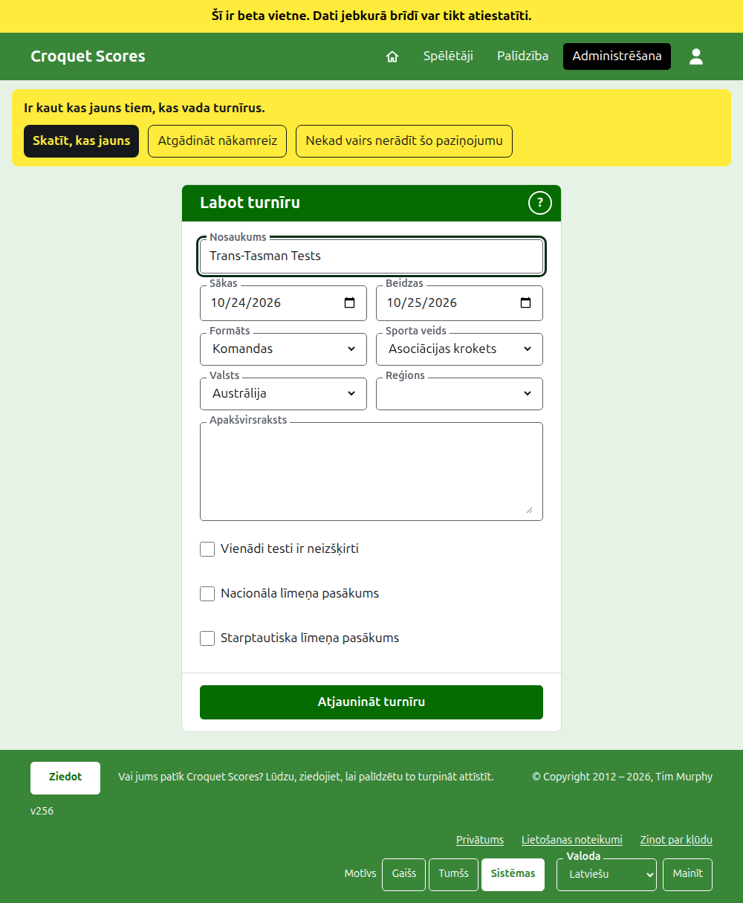
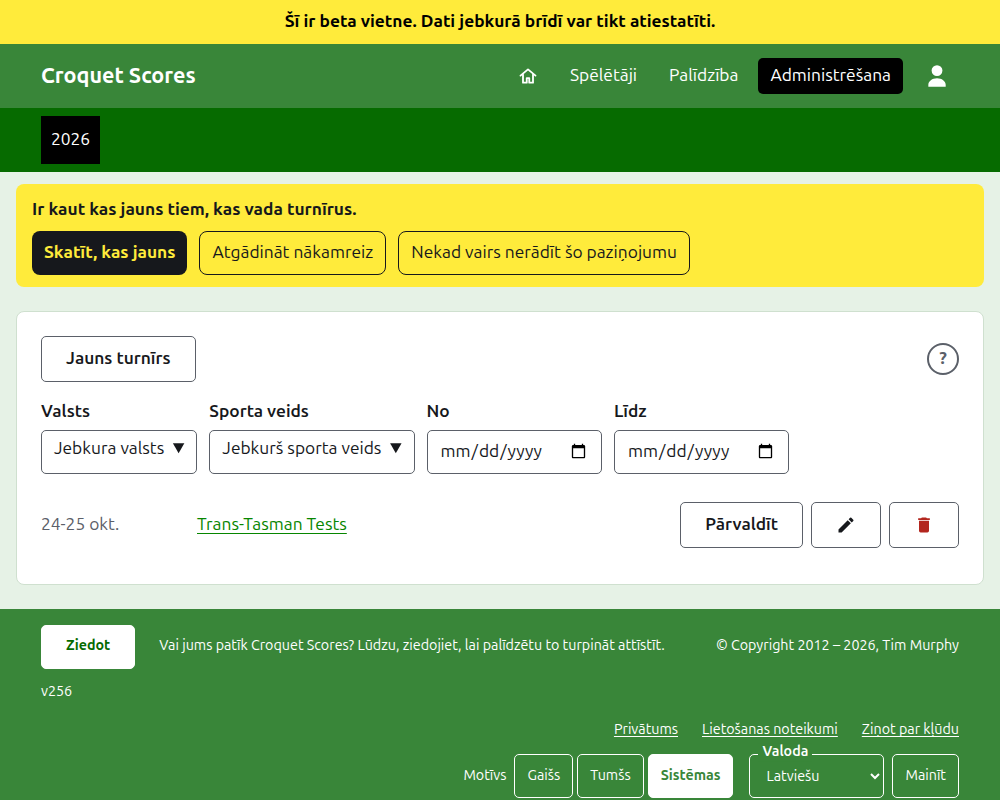

# Turnīra maiņa, arhivēšana un atjaunošana

## Turnīra informācijas maiņa

Turnīru sarakstā administrēšanā nospiediet turnīram **Labot**. Veidlapa ir tā pati, kas to izveidoja, aizpildīta ar turnīra datiem. Izlabojiet, kas nav pareizi, un nospiediet **Atjaunināt turnīru**.

Turnīra dienas šeit var paplašināt, ja testam vajag dienu ārpus tām, jo tests tiek spēlēts turnīra robežās. Tiklīdz turnīrā ir kāda komanda vai tests, arī arhivēti, tā **Formātu** vairs nevar mainīt nemaz: ne uz Standarta formātu, kurā ir spēlētāji un sacensības, ne uz citu komandu formātu, jo testu var būt ielikts grupā, kuras otrā formātā nav. Izvēlieties formātu, kad turnīrs tiek izveidots.

Turnīrs patur savu adresi, kad tā nosaukums tiek izlabots, lai kāda jau nosūtīta saite joprojām to atrastu. Tā mainās tikai tad, kad mainās gads, kurā tas sākas, vai tā sporta veids, un tad vecā adrese ved uz jauno. Saglabāšana jūs aizved uz turnīru, kur tas tagad atrodams.

Turnīru var mainīt tikai pārvaldnieks. Rezultātu ievadītājam vai ikvienam citam tas tiek pateikts, nevis parādīta veidlapa.

## Turnīru saraksts

Administrēšana uzskaita pa vienam gadam, sākot ar šo gadu, jaunākie turnīri pirmie. Gadi, kuros jums ir turnīrs, ir cilnes tumši zaļajā joslā, jaunākie pirmie; ja to ir vairāk, nekā ietilpst telefonā, vecākie ir nolaižamajā sarakstā rindas galā. Gads ir adresē, tāpēc uz gadu var uzlikt saiti. Zem pogām sarakstu var sašaurināt pēc **Valsts**, **Reģions** un **Sporta veids**, kā arī pēc dienām, kurās tam ir turnīri, **No** un **Līdz**. Apaļa **?** blakus **Jauns turnīrs** ved uz palīdzību.

## Turnīra arhivēšana

**Arhivēt** uz turnīra sarakstā to atliek malā. Tas joprojām ir uzskaitīts, pārsvītrots un aiz lietošanā esošajiem turnīriem, bet tam piedāvā tikai **Atjaunot**: tā lapa administrēšanā un tā publiskās lapas ir slēgtas, līdz tas tiek atjaunots. Arhivēšana nejautā iepriekš, jo atjaunošana to atsauc.

Tālāk: [Ko redz sabiedrība](what-the-public-sees.md).
