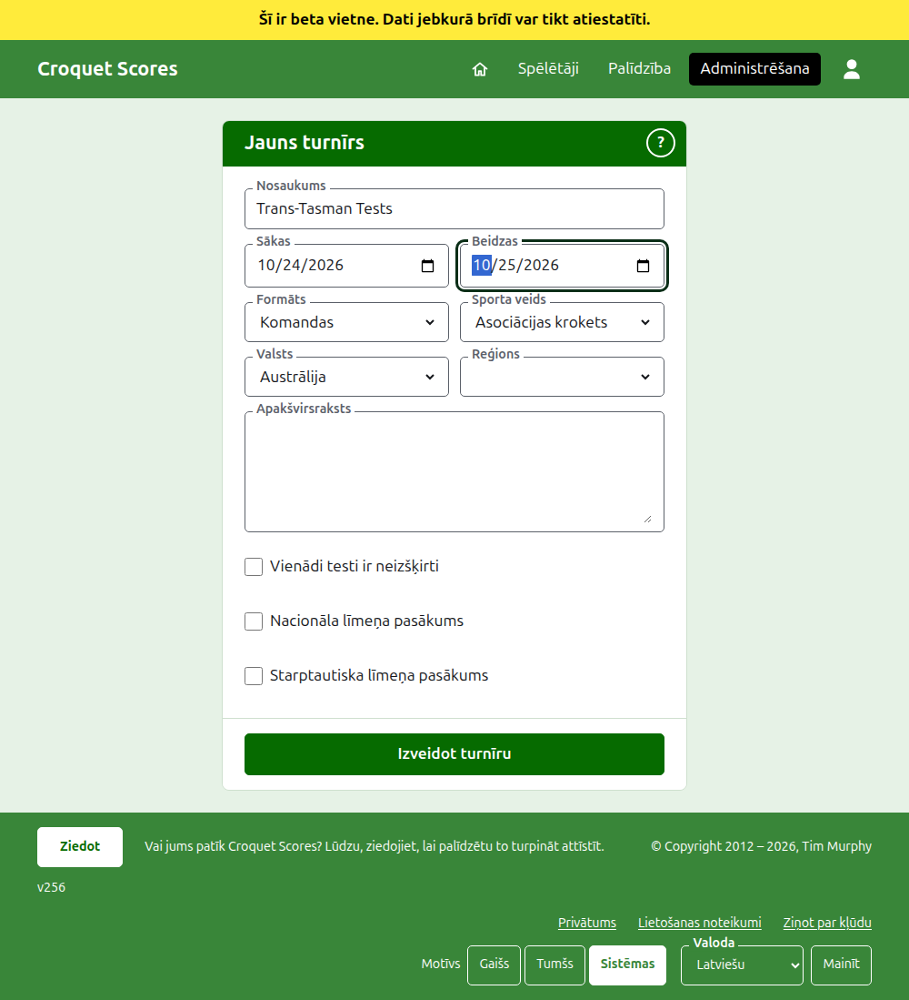
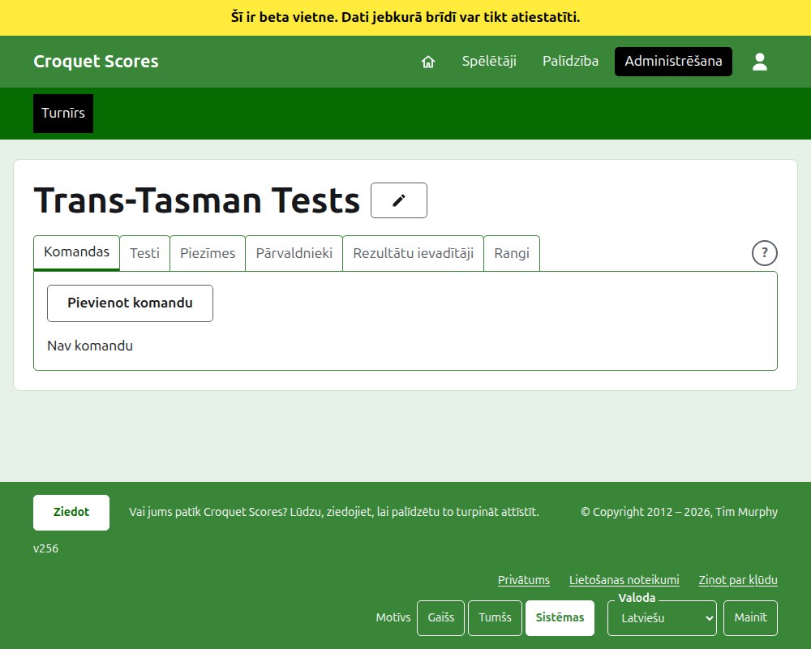

# Turnīra izveide

Administrēšanā nospiediet **Jauns turnīrs** virs turnīru saraksta. Tā ir virs saraksta, nevis zem tā, lai garš saraksts to neizstumtu ārpus telefona ekrāna.

Veidlapa prasa visu, ar ko turnīrs sākas. Svarīgākais šeit ir **Formāts**, kas padara turnīru par komandu turnīru.

## Ko veidlapa prasa

**Nosaukums.** Ko lasītāji meklē, lai atrastu turnīru, piemēram, "Trans-Tasman Tests". Tajā ir no 3 līdz 254 rakstzīmēm. Nosaukums, kas ir tikai ar mazajiem vai tikai ar lielajiem burtiem, tiek atteikts, jo tas katrā lapā, kur tas tiek rādīts, izskatītos pēc kļūdas. Diviem turnīriem var būt vienāds nosaukums, jo viens un tas pats turnīrs tiek spēlēts katru gadu.

**Sākas** un **Beidzas.** Dienas, kad turnīrs norit. Katrs tests tiek spēlēts to robežās, tāpēc iestatiet tās tā, lai tās aptvertu visu pasākumu. Turnīrs nevar beigties pirms tas sākas un nevar sākties vai beigties vēlāk par nākamā gada beigām. Turnīrs pieder gadam, kurā tas sākas, un tas ir arī gads tā adresē.

**Formāts.** Izvēlieties vienu no komandu formātiem:

- **Komandas** ir vispārīgais formāts jebkuram pasākumam starp komandām.
- **Eire Cup**, **Interstate Shield** un **GC pasaules komandu čempionāts** ir atsevišķi pasākumi, katrs paturēts kā savs formāts, lai to varētu vadīt tā, kā šis pasākums tiek vadīts.

Standarta ir vienīgais formāts, kas nav komandu formāts, un šeit tas nav tas, ko vēlaties. Gateball Scores nepiedāvā formātu, jo katrs turnīrs tur ir standarta gateball turnīrs; komandu turnīrs tiek izveidots vietnē Croquet Scores.

**Sporta veids.** Sporta veidi, ko vietne piedāvā, tās kārtībā: Asociācijas krokets, Golfa krokets, Amerikāņu 6 vārtiņu krokets un Ricochet.

**Valsts** un **Reģions.** Kur turnīrs tiek spēlēts. Reģions tiek prasīts tikai tad, ja izvēlētā valsts ir sadalīta reģionos, piemēram, Austrālijas štatos, un arī tad to nav obligāti jāizvēlas.

**Apakšvirsraksts.** Viss, ko vēlaties, lai lasītāji zina, kam nav sava lauka: kur novietot automašīnu, kad ir pusdienas, kam zvanīt. Tas tiek rādīts zem turnīra nosaukuma katrā publiskajā lapā. Tas tiek rakstīts Markdown valodā, tāpēc vārdu var padarīt treknu, ielikot ap to zvaigznītes, un sarakstu izveidot, katras rindas sākumā liekot domuzīmi. Tajā var būt līdz 2000 rakstzīmēm, un to var atstāt tukšu.

Kā tā testi tiek spēlēti un skaitīti, vai ar handikapiem, ar neizšķirtiem rezultātiem un pasaules rangiem, nosaka katrs tests, kad tas tiek pievienots.

**Vienādi testi ir neizšķirti.** Tiek prasīts, kad ir izvēlēts komandu formāts. Testu, kurā komandas uzvar vienādu skaitu maču, izšķir pēc to partiju starpības, tad pēc vārtiņu starpības. Atzīmējiet to, un tā vietā tas ir neizšķirts. Sākumā tas ir atzīmēts tikai **GC pasaules komandu čempionātam**, kas vienmēr tos ir uzskatījis par neizšķirtiem, un vēlāk to var mainīt.

**Nacionāla līmeņa pasākums** un **Starptautiska līmeņa pasākums.** Turnīrs var būt viens, otrs vai neviens, bet nekad abi: atzīmējot vienu, otrs tiek noņemts.

## Izveide

Nospiediet **Izveidot turnīru**. Jūs tiekat aizvests uz turnīra lapu administrēšanā, atvērtu tā cilnē Komandas, un jūs esat tā pirmais pārvaldnieks. Tas administrēšanā tiek uzskaitīts zem gada, kurā tas sākas.

Turnīra publiskā adrese tiek veidota no tā gada, sporta veida un nosaukuma, piemēram, `/2026/ac/trans-tasman-tests`. Tā paliek šī adrese arī tad, kad nosaukums vēlāk tiek izlabots, lai jau nosūtīta saite joprojām to atrastu; tā mainās tikai tad, kad mainās gads, kurā tas sākas, vai tā sporta veids.

## Ja kaut kas tiek atteikts

Tas, kas tiek atteikts, tiek pateikts zem lauka, uz kuru tas attiecas, un tas, ko ievadījāt, paliek ievadīts. Nekas netiek saglabāts, kamēr nav pieņemts katrs lauks. Visbiežāk atsaka nosaukumu, kas ievadīts tikai ar mazajiem burtiem, beigas pirms sākuma un neizvēlētu valsti.

Tālāk: [Komandas](teams.md).
